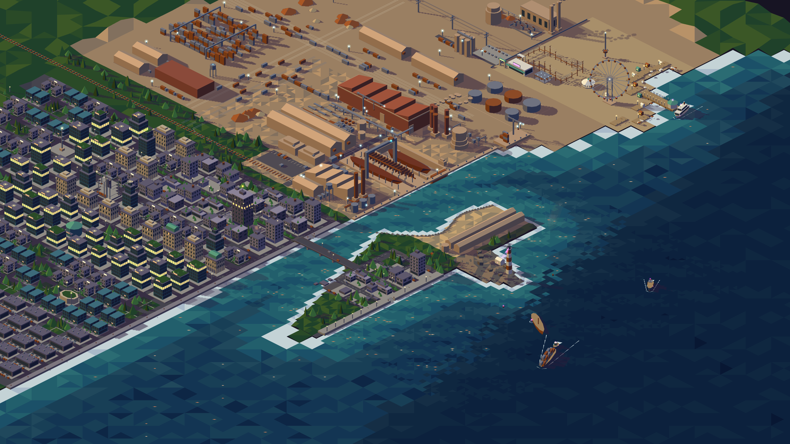
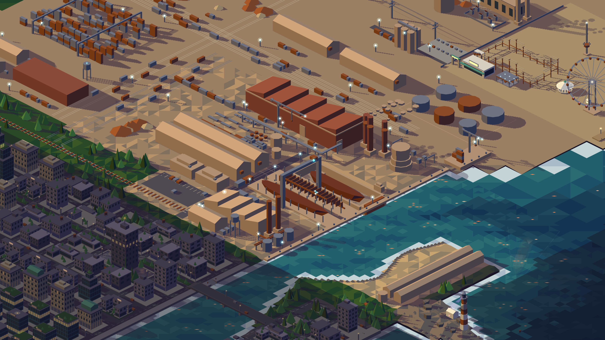
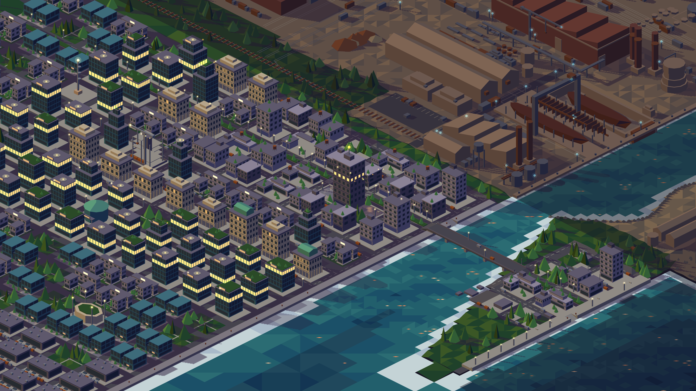
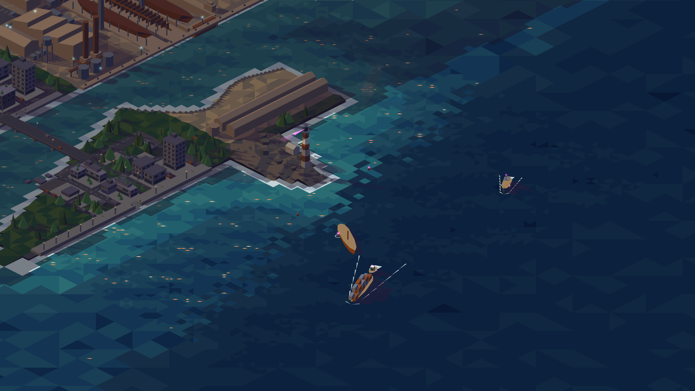
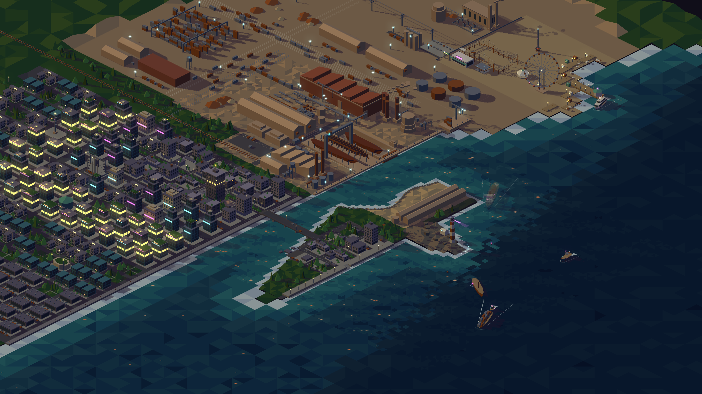
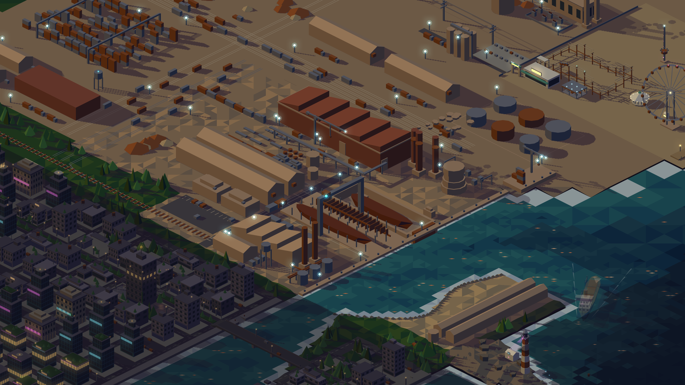
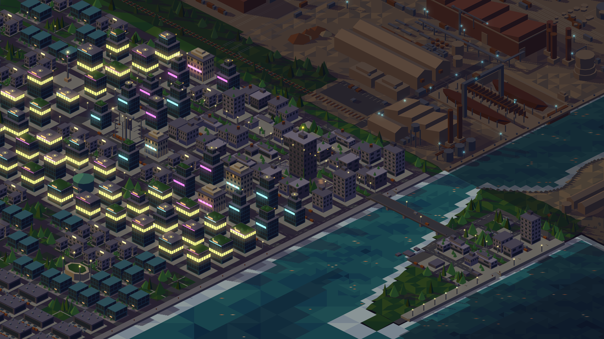
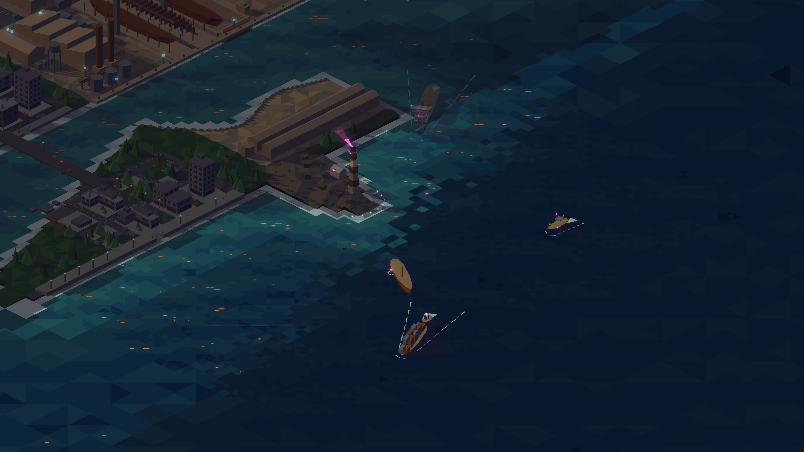
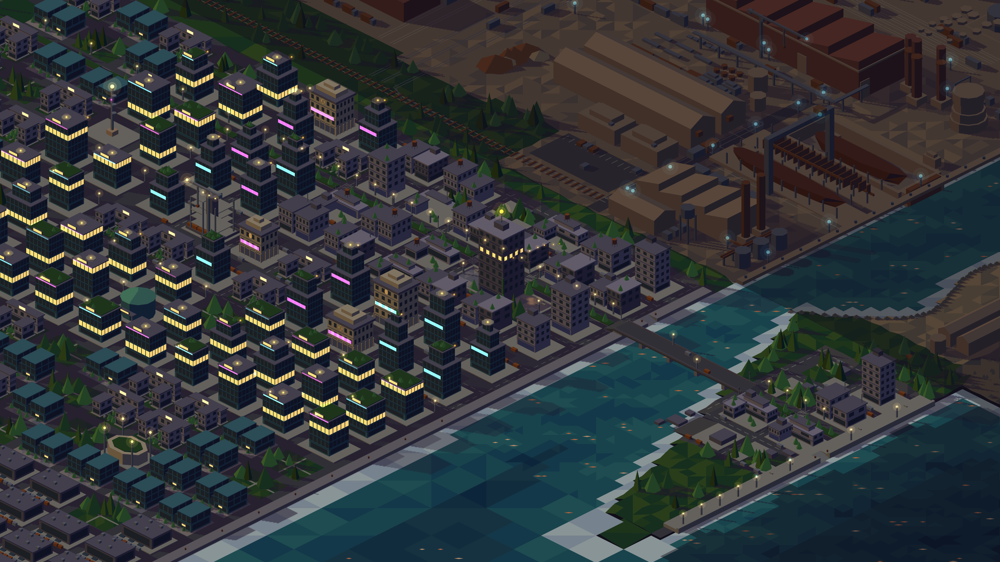
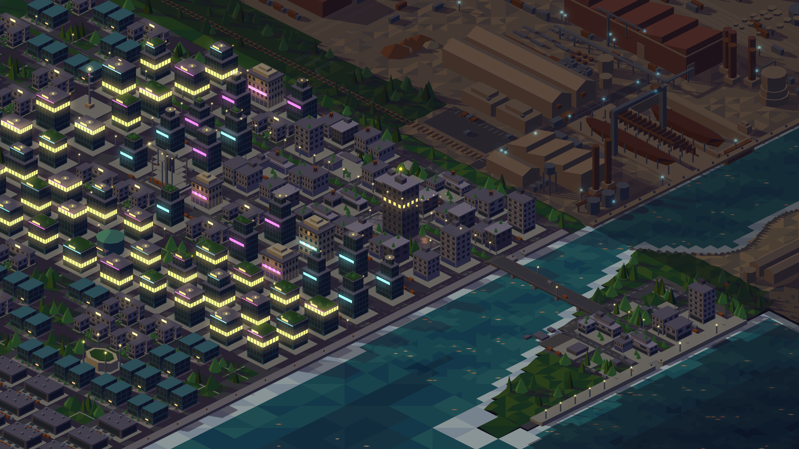

# Estética cyberpunk: crepúsculo tardío, neones y bloom diferido — diseño

**Fecha:** 2026-10-14
**Estado:** implementada (2026-10-14)
**Antecede:** `2026-09-15-reintegracion-mundo-iso-design.md`
**Alcance:** `src/map/palette-iso.ts` y `palette-base.ts`, `scripts/darken-palette.ts`, fondo de página (`src/style.css`, `lab/*.html`), escenas y animadores de ciudad, distrito tecnológico, mar y feria, `src/world/stage.ts` (bloom) y el arranque del sitio y del lab. Historia #11, hijos #12–#18.

## 1. Problema

La paleta actual es un atardecer bajo y el mundo se lee con poco carácter nocturno. La historia #11 lo lleva a un crepúsculo tardío más oscuro, con neones celestes y rosas animados en Resume (ciudad y distrito tecnológico), Blog (punta, faro, casa del farero y costa) y la feria, y con un bloom sobre las luces que se carga en diferido, después del primer dibujo, y que cae a un halo barato si el presupuesto de tiempo no alcanza. El primer dibujo en el sitio ya está fuera de su objetivo (223.6 ms frente a 200 ms; en el lab son 164.5 ms, dentro del objetivo); el issue citaba ≈ 260 ms, de una medición anterior (spec 2026-09-15, antes de la fusión de celdas). Esta historia no lo repara, solo no lo empeora.

## 2. Decisiones

| Tema | Decisión |
| --- | --- |
| Oscurecimiento | Factor ×0.7 por canal RGB, redondeado, sobre los cinco tonos de todos los materiales de `ISO_TONES` (incluidos agua y `glint`), sobre `sky` y sobre `shadow`. Los acentos (`cyan`, `amber`, `magenta` y sus variantes `Mid`/`Bleed`) conservan su valor. La tabla previa vive en `src/map/palette-base.ts` con `DARKEN = 0.7` y `darken()`; `npm run palette` (`scripts/darken-palette.ts`) imprime los literales que se pegan en `palette-iso.ts`. Un test verifica `ISO_TONES` contra `darken(BASE, 0.7)` (±1 por canal). Los umbrales de agua y `glint` no necesitaron reescalarse. |
| Dónde van los neones | Solo en ciudad y distrito tecnológico (Resume); punta, faro, casa del farero y costa (Blog); y la feria. La feria es Portfolio por geografía y es la excepción: sus luces se atenúan con el velo de Portfolio. Astillero, fábrica e hinterland no se tocan; los guarda `src/scenes/portfolio-accents.test.ts`, que cuenta acentos por color con valores tomados antes de cualquier cambio. Colores celestes y rosas (`cyan*` y `magenta*`); el ámbar existente puede quedarse. |
| Animación | Pulsos de intensidad y letreros que cambian de color o de estado, como una capa `kind: "accent"` nueva dentro de cada animador existente, con un helper puro de neones. Con `prefers-reduced-motion` quedan estáticos en un estado encendido fijo, como el resto de los animadores. Deterministas por seed. |
| Bloom | Composición propia con el `BlurFilter` del core de Pixi, sin `pixi-filters`: una copia aditiva de la capa de acentos desenfocada, hecha con `Graphics` que comparten el `GraphicsContext` de las `Graphics` de acentos, por lo que sigue los redibujos sin costo extra de CPU. Se activa después del primer dibujo, en una tarea diferida (idle o siguiente frame); el primer dibujo no cambia. Con reduced motion el bloom sigue activo, porque es estático. |
| Fallback | Tras activar el bloom se promedian ~60 frames de tiempo de CPU de `stage.tick` más tiempo de render (`prerender`/`postrender`). Si el promedio supera 15 ms se quita el filtro y los `dot` reciben un segundo halo translúcido más grande. `deltaMS` no sirve de medida porque el sitio limita a 30 fps. La decisión se loguea bajo `import.meta.env.DEV` en lab y sitio. |
| Lab | El lab de mundo fuerza el estado con `?bloom=on\|off\|fallback`, para revisar los tres caminos sin depender de la máquina. |
| Fondo de página | `#100e19`, igual al nuevo `sky`: `--bg` de `src/style.css` y el `background` inline de `lab/*.html`. |
| Paleta ya implementada | La implementó #12: `src/map/palette-base.ts`, `npm run palette` y `src/map/palette-iso.ts` con los literales nuevos. |
| Evidencia | Capturas antes y después en `docs/superpowers/specs/assets/2026-10-14-cyberpunk/`; esta spec la crea el primer hijo (decisiones y baseline) y la cierra el último (medidas, gzip, veredicto por criterio). |

## 3. Medidas

### Antes (baseline, 2026-10-14)

Chrome headless vía CDP con `agent-browser`, sin GPU, DPR 2, viewport 1600×900, sobre el estado previo al cambio de paleta. Los tiempos de primer dibujo son de la segunda carga; en ambos casos `stage.staticCount` = 32 498 polígonos estáticos.

- **Primer dibujo, lab: 164.5 ms** (primera carga: 315.4 ms).
- **Primer dibujo, sitio (`/`): 223.6 ms** (primera carga: 224.8 ms).
- **Peor redibujo en 5 s, lab, cinco lecturas:** 12.00, 9.80, 10.10, 8.50 y 21.00 ms. El 21.00 ms es un valor atípico: es cerca del doble de las otras cuatro lecturas, que van de 8.5 a 12 ms.
- **Peor redibujo en 5 s, sitio (`/`), cinco lecturas:** 91.00, 8.70, 31.90, 18.60 y 12.40 ms. El 91.00 ms es la primera lectura tras la carga. Se midió con la pestaña en primer plano y moviendo el puntero cada 2 s durante unos 60 s.
- **gzip total del JS: 179 435 bytes** en 10 archivos (index 104 799, Geometry 31 406, RenderTargetSystem 21 594, browserAll 11 084, init 4 814, BufferResource 2 859, canvasUtils 2 038, CanvasPool 450, getTextureBatchBindGroup 303, webworkerAll 88).

Líneas de consola crudas:

```
[info] [lab] primer dibujo: 164.5 ms, 32498 polígonos estáticos
[info] [mapa] primer dibujo: 223.6 ms, 32498 polígonos estáticos
[info] [lab] peor redibujo en 5 s: 12.00 ms
[info] [lab] peor redibujo en 5 s: 9.80 ms
[info] [lab] peor redibujo en 5 s: 10.10 ms
[info] [lab] peor redibujo en 5 s: 8.50 ms
[info] [lab] peor redibujo en 5 s: 21.00 ms
[info] [mapa] peor redibujo en 5 s: 91.00 ms
[info] [mapa] peor redibujo en 5 s: 8.70 ms
[info] [mapa] peor redibujo en 5 s: 31.90 ms
[info] [mapa] peor redibujo en 5 s: 18.60 ms
[info] [mapa] peor redibujo en 5 s: 12.40 ms
```

Capturas del estado previo, tomadas en el lab a 1600×900 con DPR 2 (los PNG son de 3200×1800):






### Después

Mismo método que el "Antes" (Chrome headless vía CDP con `agent-browser`, sin GPU, DPR 2, 1600×900), en la rama final con el bloom diferido de #18 (`attachBloom`, 60 frames, presupuesto de 15 ms). La línea base de "igual o mejor" se midió en la misma máquina, en un worktree del estado previo a #18, con el dev server en otro puerto y midiendo un lado después del otro. Con 32 387 polígonos estáticos en ambos lados (el cambio de paleta de #12 y los neones de #13–#16 movieron el conteo respecto de los 32 498 del "Antes").

- **Modo que quedó:** `on` en el lab y en el sitio. El promedio fue de 9.5–9.9 ms en las cinco líneas `bloom:` (tick 6.2–6.4 + render 3.1–3.5) contra 15 ms; el veredicto llega unos 15 s después de la carga, porque en el headless los 60 frames tardan en acumularse.
- **Primer dibujo, lab:** segunda carga 176.5 ms después contra 167.4 ms antes (+5.4 %, fuera del 5 % del protocolo). Se repitió con diez segundas cargas por lado, intercaladas. Antes: 167.4, 167.9, 170.6, 173.6, 170.8, 178.3, 238.6, 174.8, 169.8 y 250.0 ms, mediana 172.2 ms. Después: 176.5, 178.6, 170.9, 172.9, 173.1, 174.3, 174.0, 168.6, 170.6 y 172.5 ms, mediana 173.0 ms (+0.5 %, dentro del ruido). Los 238.6 y 250.0 ms del baseline son valores atípicos.
- **Primer dibujo, sitio (`/`):** segunda carga 206.4 ms después contra 216.5 ms antes. Antes (tres lecturas): 216.5, 221.6 y 211.7 ms, mediana 216.5 ms. Después (cinco lecturas): 206.4, 219.9, 213.7, 214.3 y 216.3 ms, mediana 214.3 ms. Igual o mejor. Sigue fuera del objetivo de 200 ms de la spec 2026-09-15, como antes de #18.
- **Peor redibujo en 5 s, lab, cinco lecturas:** 18.40, 15.80, 8.50, 15.40 y 9.00 ms (una sexta, 17.00 ms, llegó después).
- **Peor redibujo en 5 s, sitio (`/`), cinco lecturas:** 22.80, 21.70, 10.00, 22.20 y 11.20 ms. Medido con puntero moviéndose cada 2 s sobre unos 90 s.
- **gzip total del JS: 183 900 bytes** en 10 archivos, contra 179 435 antes (+4 465 bytes, +2.5 %), todo en el chunk principal: index 109 264 (antes 104 799); los otros nueve archivos no cambian (Geometry 31 406, RenderTargetSystem 21 594, browserAll 11 084, init 4 814, BufferResource 2 859, canvasUtils 2 038, CanvasPool 450, getTextureBatchBindGroup 303, webworkerAll 88). Ese aumento reúne paleta, neones, bloom y su medición (#12–#18).

Líneas de consola crudas, todas las lecturas (copiadas tal cual de `agent-browser console`; las ráfagas van en el orden en que se tomaron):

```
# baseline #18 (worktree previo), lab: segunda carga y tres más; luego tres tandas de tres
[info] [lab] primer dibujo: 167.4 ms, 32387 polígonos estáticos
[info] [lab] primer dibujo: 167.9 ms, 32387 polígonos estáticos
[info] [lab] primer dibujo: 170.6 ms, 32387 polígonos estáticos
[info] [lab] primer dibujo: 173.6 ms, 32387 polígonos estáticos
# baseline #18, lab, tandas intercaladas con las de después
[info] [lab] primer dibujo: 170.8 ms, 32387 polígonos estáticos
[info] [lab] primer dibujo: 178.3 ms, 32387 polígonos estáticos
[info] [lab] primer dibujo: 238.6 ms, 32387 polígonos estáticos
[info] [lab] primer dibujo: 174.8 ms, 32387 polígonos estáticos
[info] [lab] primer dibujo: 169.8 ms, 32387 polígonos estáticos
[info] [lab] primer dibujo: 250.0 ms, 32387 polígonos estáticos
# baseline #18, sitio
[info] [mapa] primer dibujo: 216.5 ms, 32387 polígonos estáticos
[info] [mapa] primer dibujo: 221.6 ms, 32387 polígonos estáticos
[info] [mapa] primer dibujo: 211.7 ms, 32387 polígonos estáticos
# después, lab, tres segundas cargas
[info] [lab] primer dibujo: 176.5 ms, 32387 polígonos estáticos
[info] [lab] primer dibujo: 178.6 ms, 32387 polígonos estáticos
[info] [lab] primer dibujo: 170.9 ms, 32387 polígonos estáticos
# después, lab, tandas intercaladas
[info] [lab] primer dibujo: 173.1 ms, 32387 polígonos estáticos
[info] [lab] primer dibujo: 174.3 ms, 32387 polígonos estáticos
[info] [lab] primer dibujo: 174.0 ms, 32387 polígonos estáticos
[info] [lab] primer dibujo: 168.6 ms, 32387 polígonos estáticos
[info] [lab] primer dibujo: 170.6 ms, 32387 polígonos estáticos
[info] [lab] primer dibujo: 172.5 ms, 32387 polígonos estáticos
# después, lab, con peor redibujo y bloom
[info] [lab] primer dibujo: 172.9 ms, 32387 polígonos estáticos
[info] [lab] peor redibujo en 5 s: 18.40 ms
[info] [lab] bloom: promedio 9.5 ms en 60 frames (tick 6.2 + render 3.3), presupuesto 15 ms → activo
[info] [lab] peor redibujo en 5 s: 15.80 ms
[info] [lab] peor redibujo en 5 s: 8.50 ms
[info] [lab] peor redibujo en 5 s: 15.40 ms
[info] [lab] peor redibujo en 5 s: 9.00 ms
[info] [lab] peor redibujo en 5 s: 17.00 ms
# después, lab, carga de las capturas (lectura extra, no entra en las medianas)
[info] [lab] primer dibujo: 173.2 ms, 32387 polígonos estáticos
[info] [lab] bloom: promedio 9.7 ms en 60 frames (tick 6.3 + render 3.4), presupuesto 15 ms → activo
# después, sitio, tres segundas cargas
[info] [mapa] primer dibujo: 206.4 ms, 32387 polígonos estáticos
[info] [mapa] primer dibujo: 219.9 ms, 32387 polígonos estáticos
[info] [mapa] primer dibujo: 213.7 ms, 32387 polígonos estáticos
[info] [mapa] bloom: promedio 9.5 ms en 60 frames (tick 6.4 + render 3.1), presupuesto 15 ms → activo
# después, sitio, con peor redibujo (primera pasada, solo una lectura de peor redibujo)
[info] [mapa] primer dibujo: 214.3 ms, 32387 polígonos estáticos
[info] [mapa] peor redibujo en 5 s: 16.20 ms
[info] [mapa] bloom: promedio 9.7 ms en 60 frames (tick 6.2 + render 3.4), presupuesto 15 ms → activo
# después, sitio, con peor redibujo (segunda pasada, las cinco lecturas de arriba)
[info] [mapa] primer dibujo: 216.3 ms, 32387 polígonos estáticos
[info] [mapa] peor redibujo en 5 s: 22.80 ms
[info] [mapa] bloom: promedio 9.9 ms en 60 frames (tick 6.4 + render 3.5), presupuesto 15 ms → activo
[info] [mapa] peor redibujo en 5 s: 21.70 ms
[info] [mapa] peor redibujo en 5 s: 10.00 ms
[info] [mapa] peor redibujo en 5 s: 22.20 ms
[info] [mapa] peor redibujo en 5 s: 11.20 ms
# forzados
[info] [lab] bloom forzado por URL: fallback
[info] [lab] bloom forzado por URL: on
```

Capturas del estado final, lab a 1600×900 con DPR 2 (3200×1800), con el bloom en `on` y la zona enfocada con `5`:






Forzados, Resume enfocado, mismo encuadre (`?bloom=fallback` con halo grande y sin filtro; `?bloom=on` con el filtro de acentos):




## 4. Criterios de aceptación

- [x] Cada tono de `ISO_TONES`, más `sky` y `shadow`, vale el valor anterior ×0.7 por canal (±1 por redondeo); un test lo verifica contra el factor, no contra una tabla copiada.
- [x] Los nueve `AccentColor` conservan exactamente su valor actual.
- [x] El guard de paleta y toda la suite (`npm test`) y el typecheck (`npm run typecheck`) pasan.
- [x] Los acentos de Portfolio (astillero, fábrica, hinterland) son los mismos que antes del cambio: mismos colores, misma cantidad (test de conteo por color, o equivalente).
- [x] Ciudad, distrito tecnológico, mar/punta y feria tienen al menos una capa de acentos animada nueva con colores `cyan*` y/o `magenta*`; con `reducedMotion: true` su `tick` no reporta redibujos.
- [x] Al enfocar otra zona, las luces nuevas bajan a `ACCENT_DIM` como las actuales (test sobre el `Stage` o sobre `focusAlphas`).
- [x] El bloom no está presente en el primer dibujo; se activa después y queda medido: en el lab de mundo, con el headless de siempre (Chrome vía CDP, sin GPU, DPR 2), el log muestra la medición y la decisión (bloom activo o fallback).
- [x] Primer dibujo en el lab de mundo y en el sitio: igual o mejor que la medición previa en la misma máquina, anotada en el PR. (ver veredicto: desvío de protocolo en el lab)
- [x] Fallback: forzado por parámetro de URL en el lab, las luces muestran halo y no hay filtro en el slot de acentos.
- [x] Capturas antes/después del mundo completo y de cada zona enfocada (lab, mismo viewport) adjuntas al PR.
- [x] Peso gzip del bundle del sitio anotado antes y después en el PR.
- [x] Spec de diseño en `docs/superpowers/specs/` con fecha, siguiendo las existentes, que registre las decisiones de arriba y las medidas.

### Veredicto por criterio (#18, 2026-10-14)

1. **Tonos ×0.7: PASS.** `src/map/palette-iso.test.ts` ("cada tono, sky y shadow valen la base × DARKEN por canal (±1)") y `src/map/palette-base.test.ts` (factor 0.7).
2. **Nueve acentos intactos: PASS.** `src/map/palette-iso.test.ts` ("los nueve acentos no se oscurecen").
3. **Guard, suite y typecheck: PASS.** `src/map/palette-guard.test.ts`; `npm test` y `npm run typecheck` en verde al cerrar #18.
4. **Acentos de Portfolio sin cambios: PASS.** `src/scenes/portfolio-accents.test.ts` (conteo por color con valores previos al cambio).
5. **Capas animadas nuevas, quietas con reduced motion: PASS.** `src/scenes/neon.test.ts` y los tests de animador `city-animator`, `tech-animator`, `sea-animator` y `fair-animator` (`src/scenes/*-animator.test.ts`), con `reducedMotion: true` sin redibujos.
6. **Luces nuevas bajan a `ACCENT_DIM`: PASS.** `src/world/veil.test.ts` y `src/world/assemble.test.ts`.
7. **Bloom diferido y medido: PASS.** En ambos logs `primer dibujo` precede a `bloom:`; el `Stage` arranca con el bloom en `off` (`src/world/stage.test.ts`) y `attachBloom` lo activa después (`src/world/bloom-runtime.test.ts`). El lab loguea `[lab] bloom: promedio 9.5 ms en 60 frames (tick 6.2 + render 3.3), presupuesto 15 ms → activo` y el sitio `[mapa] bloom: promedio 9.9 ms ... → activo`. Quedó en `on` en esta máquina; el camino a `fallback` lo cubre el test de runtime (promedio sobre 15 ms) y el forzado (criterio 9).
8. **Primer dibujo igual o mejor: sitio PASS; lab PASS por medianas, con desvío de protocolo declarado.** Sitio: 206.4 ms contra 216.5 ms en la segunda carga (medianas 214.3 contra 216.5). Lab: la comparación de una sola segunda carga da +5.4 % (176.5 ms contra 167.4 ms), que cae fuera de la banda del protocolo (después peor por menos de 5 % → tres cargas por lado y medianas). Se extendió el protocolo a diez segundas cargas por lado: medianas de 172.2 ms (baseline) contra 173.0 ms (después), +0.5 %. Los 167.4 ms eran la lectura más baja de las diez del baseline. La decisión de aceptarlo queda visible para el responsable: una sola lectura por lado habría dado NO CUMPLIDO por 0.4 puntos porcentuales; con diez lecturas la diferencia no se distingue del ruido del headless sin GPU.
9. **Fallback forzado: PASS.** `[lab] bloom forzado por URL: fallback` y `bloom-forzado-fallback.png`; `src/world/stage.test.ts` ("fallback quita el bloomSlot y redibuja los dot con el halo grande") verifica halo y ausencia de filtro; `src/lab/page.test.ts` cubre `?bloom=` y la tecla `6`.
10. **Capturas antes/después: PASS.** `antes-*.png` y `despues-*.png` (mundo, Portfolio, Resume, Blog), más los dos forzados, en `assets/2026-10-14-cyberpunk/`.
11. **Peso gzip: PASS (anotado).** 179 435 bytes antes, 183 900 después (+4 465, +2.5 %), todo en el chunk principal. El criterio pide anotarlo, no limitarlo.
12. **Spec con fecha: PASS.** Este documento.
