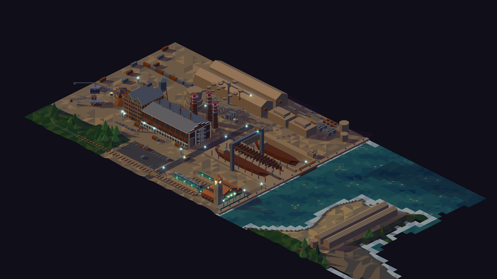
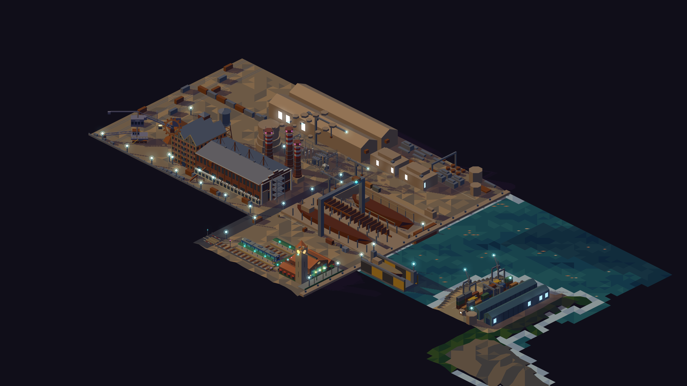
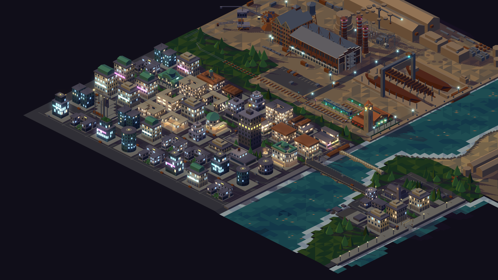
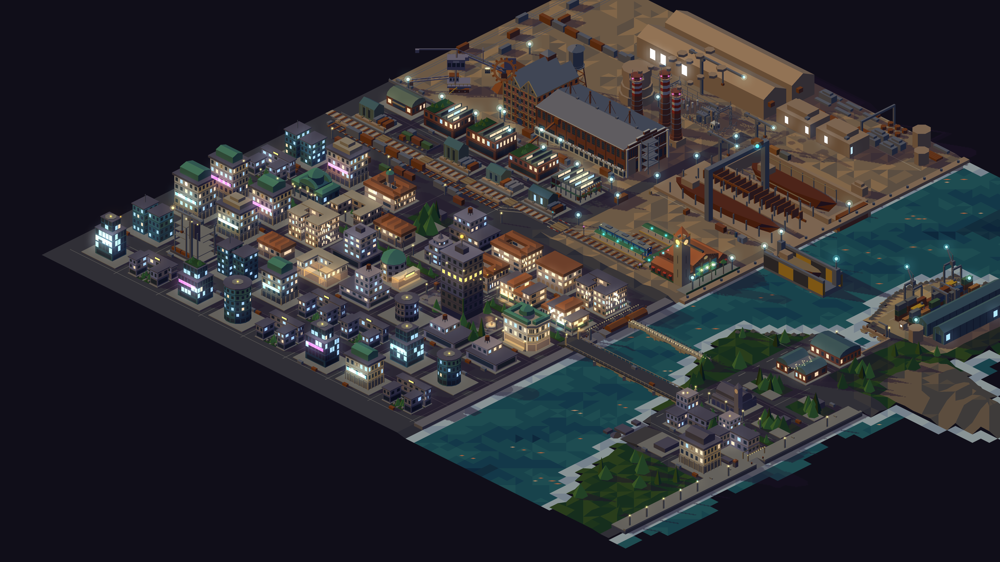
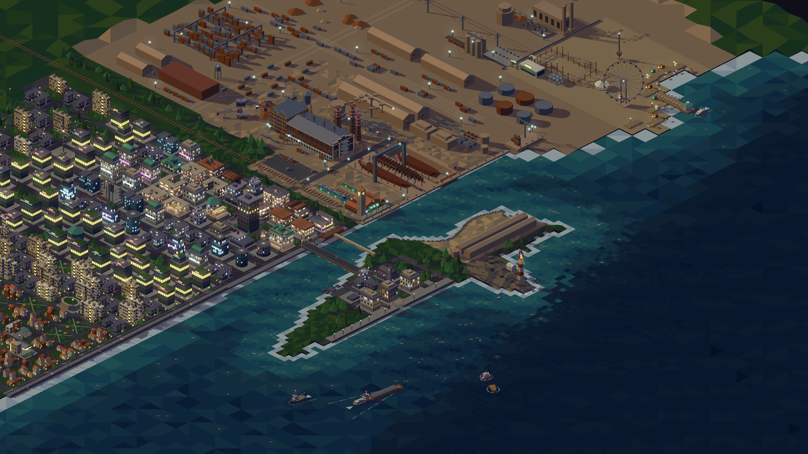
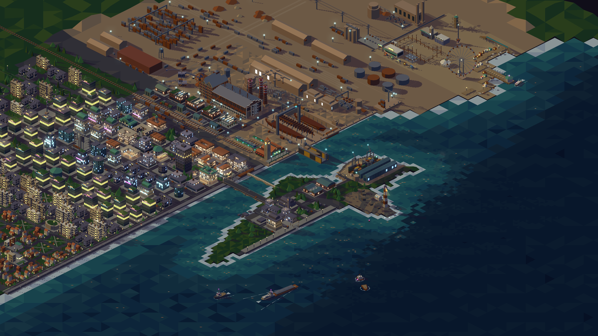
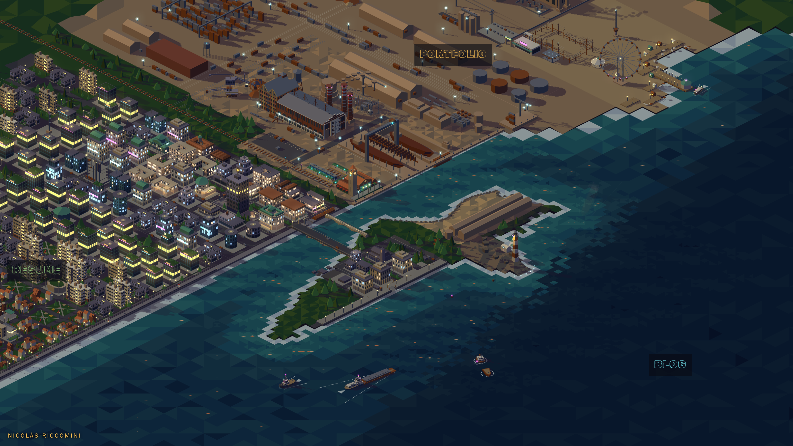
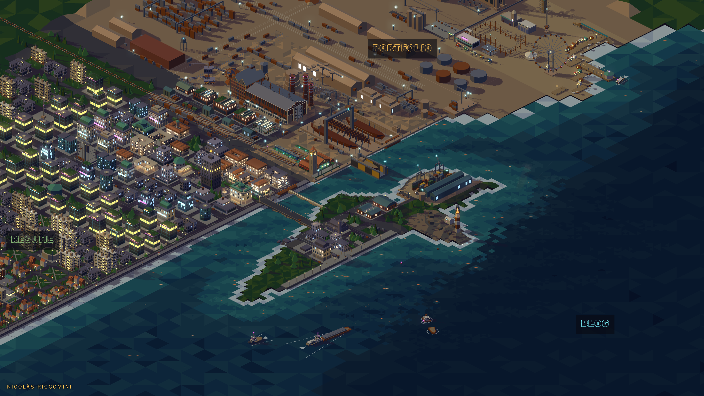

# Costura en y 90: Portfolio denso, barrio de galpones, dársena y feria — diseño

**Fecha:** 2026-10-15
**Estado:** implementada (#56, hijos #319–#327 y este cierre, #328; medición y desvíos en §12)
**Antecede:** `2026-10-15-resume-nivel-2-kit-zonificacion-luces-design.md` (kit,
paleta de nueve tonos, zonificación, luces por ventana),
`2026-09-14-mundo-2-fabrica-distrito-blog-design.md` (fábrica),
`2026-09-15-margenes-urbanos-design.md` (sangrado, cinturón verde),
`2026-09-15-mundo-3-tecnologico-feria-agua-barcos-design.md` §4.3 (feria).
**Depende de:** pasos 1–3 de Resume nivel 2 (motor y paleta, kit, `zoning.ts`).
Esta spec usa la escalera de nueve tonos, `dome`/`vault`/`hip`, el kit de
`src/kit/` y el catálogo por barrio; no los redefine.

## 0. Desvíos del plan (#56, 2026-11-07)

Lo que cambia respecto del texto de abajo, releído contra la estación terminal
(#239) y la fábrica mudada (#238). Donde esta sección y el resto discrepan,
manda esta.

- (a) La estación terminal (#239) ocupa `x 100..197, y 80..142` y se queda en
  Portfolio por `STATION_LAND`, una excepción geográfica como la punta del faro.
- (b) `RAIL_Y` sigue en `[131, 134]`: no hay corredor en `y 84..90`. La vía del
  tren es el borde y las playas ferroviarias (`y 129..158`) van dentro de
  Resume, con la regla de oclusión del tren (`y_min − 1.4·z_max ≥ 134.5` al sur
  de la vía). De las filas `92, 116, 140` solo queda la `92` como manzanas, más
  una fila de carga `116..129`.
- (c) Se descartan P3 (calderería mudada), la plaza de la chimenea y el mercado
  en `102..162 × 92`. El mercado cubierto va fijo en `(72, 92)`.
- (d) P1/P4/P6/P7 se releen contra la fábrica mudada (#238): naves, talleres y
  patio en la banda norte, el complejo en `x 4..98`.
- (e) `GREEN_BELT` pasa a `y 116..158`, no a `66..90`.
- (f) La dársena no lleva puente levadizo: el anillo es agua en `y 96..112`.
- (g) La densidad de partida de Portfolio es 1 201 sólidos elevados, no 401. El
  tope pasa a 1 700.
- (h) Resume queda con ≈ 59 % de la franja, no 62 %.

## 1. Problema

1. **Proporción.** En el contenido al oeste de `x 344` (`y −60..336`, 396 u),
   Portfolio ocupa `y −60..146` (52 %) y Resume `y 146..336` (48 %). Se pide
   Resume ≈ 60–66 %, Portfolio ≈ 33–40 %.
2. **Densidad de Portfolio.** 401 sólidos elevados (astillero 298 + fábrica 103,
   seed 7) en 83 224 u²: **0.48 por 100 u²**, contra 1.16 de Resume. Hay
   vacíos grandes (playa de prefabricados, columna oeste, ribera este entre el
   río y los galpones de alistamiento) y casi todo es `concrete`/`steel`/`rust`
   con cinco tonos.
3. **Feria.** Ocho atracciones y ocho puestos idénticos (`booths`: mismo prisma
   4×3, tres materiales en rotación). Se pide más atracciones y puestos variados.

## 2. Decisiones

| Tema | Decisión |
|---|---|
| Medida del 60/40 | Franja del contenido al oeste de `x 344`, sin sangrado |
| Costura | `ZONE_SPLIT_Y = 90` (múltiplo de 6 y de 18). Resume 246 u = **62 %**, Portfolio 150 u = **38 %** |
| Mecanismo | Correr la costura; la grilla de Resume (filas `164..302`) no se mueve, se suman tres filas al norte |
| Punta del faro | Sigue siendo Portfolio (excepción geográfica de `worldZoneAt`, como hoy) |
| Estuario | Anclado en `y 146`: constante nueva `ESTUARY_Y0 = 146`, desacoplada de la costura. El río no se mueve |
| Borde | Corredor ferroviario E-O en `y 84..90`, del lado de Portfolio |
| Producción del astillero | Se muda comprimida a la columna oeste (`x −36..0, y 0..84`) y al hueco de la franja de la fábrica |
| Franja nueva de Resume (oeste del río) | **Barrio de galpones reconvertidos**, filas `92, 116, 140` sobre `WEST_COLS` |
| Hito del barrio | **Chimenea de ladrillo conservada** de la calderería vieja, en su lugar (`x 176, y 104`) |
| Ribera este nueva de Resume (`x 257..344, y 90..146`) | **Dársena reconvertida**: mercado de pescado y food hall en galpones `vault` |
| Sangrado oeste | El límite industrial/urbano se corre con la costura; el cinturón verde pasa a `y 66..90` |
| Densidad de Portfolio | ≈ **2×** la de hoy: 0.96 por 100 u² → ≈ 580 sólidos en 60 600 u² |
| Subzonas nuevas de Portfolio | Patio de contenedores; dique flotante y grúas de muelle |
| Feria | Suma tren fantasma, casa de espejos, tobogán gigante, tronco acuático, hilera de puestos variados (incluye food trucks) |
| Luces de Portfolio | Faroles cian, ventanas `windowCool` y chispas de soldadura animadas. El guard pasa de cantidades fijas a reglas |
| Materiales nuevos de Portfolio | Chapa ondulada (dos tonos) y contenedores (cinco colores) |

## 3. Geografía y costura

### Constantes (`src/map/geo.ts`, `city-grid.ts`)

- `ZONE_SPLIT_Y = 90`.
- `ESTUARY_Y0 = 146` nueva en `city-grid.ts`. `SEAM_CY`, `estuaryEast` y
  `estuaryReaches` pasan a usar `ESTUARY_Y0` en vez de `ZONE_SPLIT_Y`. Al
  norte de `y 146` la ribera este sigue siendo `eastBank(y)` y la oeste,
  `QUAY_X`.
- `terrain-classify.ts`: la elección `cityTerrainAt` / `shipyardTerrainAt`
  pasa a `y ≥ 90`. `cityTerrainAt` aprende la franja `y 90..146`: el canal es
  el del astillero (`QUAY_X..eastBank`) y no el estuario.
- `CITY_EDGE.north` pasa de 158 a **90**. El cinturón de selva de la costura
  (`y 147..158`, `city.ts:320`) desaparece; esa franja pasa a ser calle (§5).
- `shipyard.ts`: `AREA_H = 90`. `BOTTOM` no cambia (es el fondo del muelle
  dragado, no la costura).
- `frame.ts`: el encuadre de zona usa la costura, así que se corre solo.
  `LANDMARKS.portfolio` (grúa pórtico, `150, 50`) y `LANDMARKS.cv` (torre)
  no cambian.
- `worldZoneAt`: sin cambios de lógica; la punta (`y 97..134`) y su orilla
  siguen siendo Portfolio aunque queden al sur de la costura. Test: un punto
  en la punta es `portfolio` y uno en `x 300, y 120` (dársena) es `cv`.

### Corredor ferroviario (`src/scenes/corridor.ts`, Portfolio)

El borde de Lynch entre las dos zonas. Del lado de Portfolio para que la
primera fila de Resume (`y 92`) no lo pise.

- Dos vías E-O en `y 86` y `y 89` desde `WORLD.x0` hasta `x 196` (tope con
  paragolpes contra el muelle). Reemplazan las vías del oeste
  (`RAIL_Y = [131, 134]` pasa a `[86, 89]`); el hinterland las sigue
  prolongando hacia el oeste con el mismo `RAIL_Y`.
- Terraplén `ballast` de `y 84..90`, durmientes cada 2.
- Paso a nivel en la calle de transferencia (`x 100..108`): barreras, dos
  cruces de San Andrés y garita. La calle termina ahí; del lado de Resume
  sigue como la calle `x 96..102` de la grilla (§5).
- Cerco de malla del lado de Portfolio (`y 84`), postes cada 6, con dos
  portones: la calle de transferencia y la playa de vías.
- Tren de carga estacionado: locomotora + 6 vagones, posición por rng.
- Empalme con la playa de vías N-S (`RAIL_YARD_X`): las tres vías bajan hasta
  `y 80` y curvan al corredor (reemplaza el empalme de `y 128..134`).
- El ramal embebido en la calle (`SPUR_Y`) arranca en el corredor
  (`y 86`) en vez de en `y 131`.
- Faroles cian cada 24 sobre el cerco.

## 4. Portfolio (`y −60..90`): subzonas

Mismo método que Resume nivel 2: mapa de subzonas a mano en
`src/shipyard/zoning.ts`, catálogo de recetas con peso por subzona, piezas
singulares fijas, `tone` por rng (−1..+1) por pieza. Las recetas nuevas
industriales van a `src/kit/forms/industrial.ts` (§4.3).

### 4.1 Mapa

| # | Subzona | Rect (x, y) | Hoy | Después |
|---|---|---|---|---|
| P1 | **Fábrica** | `−60..205, −60..0` | planta, chimeneas, torre de enfriamiento, grúa torre, desvío, cinta, subestación, playa de camiones | igual + **nave de pintura** y **talleres** (de P6 vieja) en el hueco `x −36..18, y −60..−12`; estacionamiento de camiones con 8..12 camiones; segunda cinta |
| P2 | **Playa de vías** | `−60..−36, 0..84` | tres vías N-S, vagones, acopios de mineral, selva | vías y vagones; acopios fuera (van al hinterland); empalme al corredor en `y 80` |
| P3 | **Producción** (mudada) | `−36..0, 0..84` | acopios, nada | **calderería** girada 24×56 (`x −34..−10, y 8..64`, dientes de sierra con cara vertical al este), dos chimeneas `x −4, y 22 / 44`, granja de tres tanques `y 70..80`, torre de agua sobre patas `x −4, y 74`, rack de cañerías N-S en `x −8`, autoelevadores |
| P4 | **Patio de material** | `0..98, 0..30` | chapas, caños, bobinas, secciones, dos silos | igual + recetas de acopio por rng (§4.3) en los huecos; puente grúa de patio sobre `x 8..98` |
| P5 | **Dique seco** | `120..198, 0..32` | dique, casco, compuerta, casa de bombas | igual + andamios en el casco, dos grúas torre chicas a los lados, contenedores de obra |
| P6 | **Naves y gradas** | `0..198, 32..76` | dos naves, calle, dos gradas, grúa pórtico | igual + vagones del ramal, cajas y chatarra entre naves (`y 52..56`), ventanas `windowCool` en las naves |
| P7 | **Franja de servicio** | `0..198, 76..84` | talleres (y 80..94) | pañoles, contenedores de herramientas, autoelevadores, pilas de pallets, baños químicos: props ≤ 3 de alto, por catálogo |
| P8 | **Corredor** | `−60..198, 84..90` | — | §3 |
| P9 | **Dique flotante** | río, `x 204..246, y 74..88` | agua | **dique flotante** 42×14 con un casco a medio pintar (`hull` con banda `rust`), dos torres de servicio, pasarela al muelle oeste. No pisa la ruta de `ships.ts` (test) |
| P10 | **Patio de contenedores** | ribera este, `x eastBank+2..300, y 28..82` | escollera, vacío | pilas de 1..4 alturas en filas E-O de 6×2.4×2.6, pasillos de 4, un pórtico RTG sobre dos filas, dos straddle carriers, garita |
| P11 | **Muelle de alistamiento** | `300..330, 24..84` | dos galpones `x 304/316, y 24..116` | galpones recortados a `y 24..80`; **dos grúas de muelle** (level-luffing, h 18) sobre la ribera este en `y 34` y `y 62`; silo `x 310, y 76` |
| P12 | **Punta del faro** | `HEADLAND` | faro, galería, balizas | sin cambios |

La zona de producción vieja (`x 112..200, y 98..140`) **desaparece** de
Portfolio salvo la chimenea norte, que queda como hito de Resume (§5).

### 4.2 Densidad

| Medida | Hoy | Objetivo | Tope |
|---|---|---|---|
| Sólidos elevados de Portfolio (contenido) | 401 | ≈ 580 | 700 |
| Sólidos por 100 u² | 0.48 | ≈ 0.96 | 1.15 |

Regla de legibilidad: nada nuevo tapa en pantalla la grúa pórtico, el dique
seco ni las chimeneas de P1 y P3 (test de oclusión con la función de
`lights.ts`, §7 de Resume nivel 2). El relleno se limita a h ≤ 3 dentro de las
subzonas P4, P6 y P7.

### 4.3 Recetas industriales (`src/kit/forms/industrial.ts`)

| Receta | Descripción |
|---|---|
| **nave de dientes de sierra** | prisma + N `ramp` con cara vertical al este y banda `glass` en la cara vertical; reemplaza las copias de `factory.ts` y de la calderería |
| **nave de chapa** | prisma `sheetGreen` o `sheetTeal` + `gable`, fachada `ribs` (§6) |
| **pila de contenedores** | 1..4 alturas, color por rng con pesos, una puerta (`poly` `toneOffset −2`) en la cara visible |
| **acopio** | chapas apiladas con desfase, mazos de caños, bobinas o secciones de casco (lo de `materialYard` hoy, como catálogo) |
| **tanque** | cylinder + anillo + escalera; 1..3 por grupo |
| **grúa de muelle** | pórtico sobre rieles, cabina, pluma inclinada; `light` cian en la punta |
| **pórtico RTG** | cuatro patas con ruedas, viga, carro |
| **pañol** | prisma 4×3×2.6 `sheetGreen`/`steel` + puerta |

### 4.4 Luces

- Faroles cian como hoy, más los del corredor y de P10.
- Ventanas `windowCool` en las naves (P6), la calderería (P3), la planta
  (P1) y los galpones de alistamiento (P11): 30 % encendidas, con la misma
  oclusión por cajas de `lights.ts`.
- **Chispas de soldadura**: acento nuevo `spark` (`0xffb347`, no se
  oscurece). Solo en la capa animada `shipyard.sparks`: 1..3 chispas a la vez
  en `weldSpots` (los de hoy más el casco del dique flotante), `pulse` de
  `neon.ts` 80..200 ms. Nunca en la Graphics estática. Frame 0 sin chispas;
  `reducedMotion` sin ids.
- `portfolio-accents.test.ts` deja de fijar cantidades: exige colores
  estáticos ⊆ `{cyan, cyanMid, cyanBleed, windowCool}`, ≥ 30 faroles cian en
  astillero + fábrica + corredor, y `spark` solo en la capa animada.

## 5. Resume: franja nueva `y 90..146`

### 5.1 Grilla

- `ROWS` suma `92, 116, 140` al frente: `[92, 116, 140, 164, 188, …]`.
  Mismo `BLOCK_W 24 × BLOCK_D 18`, calles de 6. La calle `y 158..164`, que hoy
  es selva de costura, pasa a ser calle común.
- `WEST_COLS` sin cambios (`−48..162`, hasta `x 186`); la vereda del muelle
  (`x 186..192`) y `WEST_QUAY` siguen hacia el norte hasta `y 90`.
- `EAST_COLS` (`280, 310`) suma las filas `92, 116, 140` solo donde la
  manzana no pisa la punta (`HEADLAND` + `SHORE_W`): quedan `280×{92,116,140}`
  y `310×140`.
- `EAST_RING` y la calle del malecón siguen hacia el norte hasta `y 90`.
  `MALECON.y0` no cambia (158): al norte del malecón está la punta.

### 5.2 Barrio de galpones (zoning: `galpones`)

Manzanas: filas `92, 116, 140` × `WEST_COLS` (24 manzanas), menos la plaza de
la chimenea.

| Sub-barrio | Manzanas | Carácter | Catálogo (peso) | Estilo | Luces |
|---|---|---|---|---|---|
| **Lofts** | filas `92, 116` × cols `−48..72` | naves de diente de sierra convertidas en lofts y estudios | nave de lofts 35, loft en `vault` 20, nave de chapa con ventanales 20, patio de servicio con tanque 15, nave abandonada 10 | `brick`/`concrete`/`sheetGreen`, `tone` −1..+1 | 55 % encendidas, 75 % cálidas |
| **Cervecerías** | filas `116, 140` × cols `102..162`, menos la plaza | cervecerías y mercado de diseño frente al agua; sigue al barrio de bares de la fila 164 | cervecería 35, mercado de diseño `vault` 25, patio de food trucks 20, galería 20 | `brick`/`plaster`/`copper` | 70 % encendidas, 90 % cálidas; neones (abajo) |
| **Obrero** | fila `140` × cols `−48..72` | casas obreras de ladrillo y talleres de artistas; transición al residencial de patios | casas en hilera de ladrillo 40, taller con patio 30, patio residencial 30 | `brick`/`plaster`/`terracotta` | 55 % encendidas, 95 % cálidas |
| **Plaza de la chimenea** | `162, 92` + fila `92` × cols `102, 132` | nodo del barrio | fijo | `brick`/`paving` | fachadas bañadas |

Recetas nuevas en `src/kit/forms/industrial.ts` (reconversión):

| Receta | Descripción |
|---|---|
| **nave de lofts** | nave de diente de sierra; la banda `glass` de los dientes lleva ventanas publicadas; planta baja con puertas grandes vidriadas; terraza verde en un tercio del techo |
| **loft en vault** | `vault` de 18 de largo + hastial vidriado hacia la calle `open` + entrepiso visible |
| **cervecería** | nave a dos aguas + tres a cinco tanques de fermentación `copper` visibles detrás de un ventanal + terraza con mesas y guirnalda; publica `slots` de neón en el frente `open` |
| **mercado de diseño** | `vault` 24×14 + toldos laterales + puestos adentro visibles por el hastial |
| **patio de food trucks** | 4..6 food trucks (prisma 5×2.2×2.6 de color por rng + toldo + ventanilla encendida), mesas, guirnalda en zigzag |
| **nave abandonada** | nave de diente de sierra con dientes faltantes (vigas a la vista) y `jungle` adentro |

**Plaza de la chimenea** (fija): la chimenea de ladrillo `x 176, y 104`
(r 2.2, h 25 + base) queda donde estaba, pasa de `rust` a `brick` con banda
`copper` y lleva un **cartel de neón vertical** (amber, 6 de alto) en la cara
oeste. Alrededor: baldosas `paving`, bancos, árboles de calle, un kiosco, dos
tanques viejos pintados como esculturas. La manzana `162, 92` es la plaza; las
`102, 92` y `132, 92` son el **mercado cubierto de los galpones** (la
calderería vieja reconvertida: nave de diente de sierra 54×18 que une las dos
manzanas, como `PLAZA` en la avenida).

**Neones**: la regla de Resume nivel 2 §4 ("neones a nivel de calle solo en el
barrio de bares") se amplía al sub-barrio **cervecerías**, solo en frentes
`open` hacia la plaza de la chimenea o la calle del muelle. Tope 10 en el
sub-barrio (sumado al tope de 24 del barrio de bares). Colores con los mismos
pesos.

### 5.3 Dársena reconvertida (zoning: `darsena`)

Ribera este `x 257..330, y 90..146`, entre el río y la punta.

- **Dársena**: un entrante de agua `x 278..302, y 96..112`, abierto al río
  por la calle `EAST_RING` con un puente levadizo chico de `steel`.
  `terrain-classify` lo marca `water`; los barcos no entran (no es ruta).
- `280, 116`: **mercado de pescado**, `vault` 24×18 con hastiales vidriados y
  toldo hacia la dársena, cajones y balanzas en la vereda.
- `280, 140` y `310, 140`: **food hall**, dos galpones `vault` gemelos unidos
  por un patio techado con guirnaldas.
- Muelle de la dársena: tres botes de pesca (`hull` chico) amarrados, bolardos,
  redes (prismas bajos `rust`), una grúa de muelle vieja chica.
- Estilo `brick`/`sheetTeal`/`copper`. Luces 60 % encendidas, 85 % cálidas;
  sin neones a nivel de calle; guirnaldas en el food hall.
- Se conecta con el mercado de la ribera este (`280, 188`) por la calle
  `EAST_RING`, que sigue hasta `y 90`.

### 5.4 Presupuesto de Resume

| Métrica | Tope de Resume nivel 2 | Tope nuevo |
|---|---|---|
| Sólidos elevados de Resume (contenido) | 2 200 | 2 900 |
| Acentos estáticos de Resume | 900 | 1 150 |
| `strip` de Resume | 150 | 190 |

## 6. Paleta: materiales nuevos

Valores de **base** (`palette-base.ts`, sin oscurecer); cinco tonos con la
regla "ciudad y costa", los cuatro nuevos con la regla de Resume nivel 2 §4,
`npm run palette` los oscurece ×0.7. Test de luminancia monótona por material.

| Material | `top` objetivo (base) | Uso |
|---|---|---|
| `sheetGreen` | verde gris `0x6a7a6e` | chapa ondulada de galpones y pañoles |
| `sheetTeal` | azul petróleo `0x4a6a76` | chapa ondulada de galpones del alistamiento y la dársena |
| `boxRust` | rojo óxido `0x8a4a32` | contenedores |
| `boxBlue` | azul `0x3e5c80` | contenedores |
| `boxGreen` | verde `0x4e6e4a` | contenedores |
| `boxGrey` | gris `0x707070` | contenedores |
| `boxOrange` | naranja `0xb0703a` | contenedores |

Pesos de color de contenedor: `boxRust 30, boxBlue 25, boxGrey 20, boxGreen
15, boxOrange 10`.

**Fachada `ribs`** (nueva, `src/iso/facade.ts`): sobre paredes de chapa,
franjas verticales de 0.5 de ancho cada 1.0 que alternan `toneOffset 0` y
`−1`; en la cara que da al sol, `+1` y `0`. Simula la onda sin geometría.
Tope: solo paredes ≥ 6 de largo, máximo 24 franjas por pared.

Acento nuevo: `spark` `0xffb347` (§4.4). `palette-guard`: `spark` no aparece
en ninguna Graphics estática.

## 7. Sangrado

- `builtAt`: `y < ZONE_SPLIT_Y` (90) es industrial, el resto urbano; la regla
  ya depende de la constante.
- `GREEN_BELT` pasa de `y 110..158` a **`y 66..90`**: separa el hinterland del
  distrito tecnológico a la altura del corredor.
- Hinterland: todo lo que quede en `y ≥ 66` se descarta (hoy ahí solo hay
  selva y las vías del oeste, que se corren a `y 86/89` y siguen atravesando
  el cinturón). `hinterland.ts:155` (selva de la mitad de Portfolio del
  cinturón) pasa a `y 68..80`. Los acopios de mineral de P2 se mudan junto a
  las vías del oeste del hinterland, `x −120..−70, y 20..60`.
- Distrito tecnológico: `suburbBlocks` recorre las filas nuevas
  (`92, 116, 140`) sobre `SUBURB_COLS`; el catálogo sigue siendo el de hoy
  (torres cerca del contenido, campus después). `tech.ts:187` (selva del
  cinturón) pasa a `y 90..` hasta la primera fila.
- Tope de sólidos del distrito tecnológico: de 1 186 a 1 500.

## 8. Feria (`fair.ts`)

`FAIR = { x0: 84, y0: −312, y1: −168 }` no cambia. Las posiciones de abajo
son de partida; el plan las valida en `lab/world.html` con el test
existente de "nada estático delante de la rueda" y uno nuevo de "ninguna
huella nueva pisa una existente".

| Pieza | Posición (centro) | Descripción |
|---|---|---|
| **Tren fantasma** | `x 108, y −252` (20×12) | fachada `stone` con torre gótica (`cone` 4 lados), calavera en el frontón (poly), marquesina con cartel de neón magenta y entrada/salida con puertas batientes; vía que entra y sale por la fachada |
| **Casa de espejos** | `x 132, y −252` (16×12) | fachada `whitewash` con columnas `arcade`, frontón con espejos (poly `glass` `toneOffset +2`), cartel cian, guirnalda de `dot` |
| **Tobogán gigante** | `x 118, y −292` | torre `deck` de 14 de alto con techo `cone`, rampa helicoidal de 3 vueltas (`rotBox` por tramo, como la montaña rusa), escalera exterior |
| **Tronco acuático** | canal desde `x 160, y −296` hasta la bahía | canal `deck` elevado con agua (`shallow`) adentro, subida con cadena, caída a la bahía con salpicadura (`dot` blanco), dos troncos (`hull` `deck`); los troncos se mueven en la capa animada `fair.logs` |
| **Hilera de puestos** | reemplaza `booths` (`y −294..−210`, contra el paseo) | catálogo con pesos: comida con toldo rayado 30, **food truck** 20, tiro al blanco con premios colgados 15, algodón de azúcar 10, adivina (carpa `cone`) 10, boletería 10, juego de aros 5. Toldo y tono por rng; 12..16 puestos; no repite tipo en dos vecinos |
| **Patio de food trucks** | `x 100..160, y −176..−170` (entrada, del lado de adentro de la portada) | 5 food trucks con ventanilla encendida, mesas y guirnalda |

Neones nuevos: marquesinas del tren fantasma (magenta, `flip`) y de la casa de
espejos (cyan, `chase`), con `neon.ts`. La feria sigue siendo la única
excepción de tres colores; no entra en el guard de Portfolio.

Tope de sólidos de la feria: de 278 a 520.

## 9. Tests

- [x] `geo.test`: `ZONE_SPLIT_Y = 90`; `worldZoneAt` en la punta es `portfolio`,
  en `x 300, y 120` es `cv`, en `x 100, y 80` es `portfolio`, en `x 100, y 95`
  es `cv`. Cubierto por `src/map/geo.test.ts` y `src/scenes/seam-90.test.ts`;
  la estación (§0 a) queda en Portfolio por `STATION_LAND`, con su prueba en
  `geo.test.ts` ("estuary anchor and station land").
- [x] `city-grid.test`: `estuaryEast(146)` igual a hoy (el río no se movió);
  `ROWS` empieza en 92; ninguna manzana de `EAST_COLS` pisa la punta. Cubierto
  por `src/scenes/city-grid.test.ts`.
- [x] `terrain.test`: la franja `y 90..146` al oeste del río es ciudad; el canal
  `QUAY_X..eastBank` sigue siendo agua; la dársena es agua; los vértices de la
  costura comparten grilla (múltiplos de 6 y de 18). Cubierto por
  `src/scenes/terrain.test.ts` (ver desvíos de #319 en §12.0).
- [x] `shipyard/zoning.test`: toda pieza de Portfolio cae en una subzona; las fijas
  donde dice §4.1; nada de Portfolio en `y ≥ 90` salvo la punta y P9 (el
  dique flotante termina en `y 88`); sólidos 520..700; nada tapa la grúa
  pórtico, el dique seco ni las chimeneas. El archivo `shipyard/zoning.ts` no
  existe: el astillero se llena en `src/scenes/shipyard-fill.ts` y
  `shipyard-east.ts`. Lo que quedó se cubre en `src/scenes/seam-90.test.ts`
  (nada de Portfolio al sur de `y 90.5` salvo la estación y su muelle),
  `src/scenes/shipyard-fill.test.ts` y `src/scenes/shipyard-east.test.ts`
  (oclusión de la grúa pórtico, el dique seco y las chimeneas). Los sólidos
  pasan de 520..700 a Portfolio en contenido ≤ 1 700 y topes por escena
  (§0 g, §12.2) en `src/scenes/world.test.ts` y `src/scenes/city-budget.test.ts`.
- [x] `ships.test` (suma): la ruta de los barcos no cruza el dique flotante ni la
  dársena. Cubierto por `src/scenes/ships.test.ts` ("lanes and the floating
  dock").
- [x] `portfolio-accents.test`: reglas de §4.4 en lugar de cantidades. Cubierto
  por `src/scenes/portfolio-accents.test.ts`.
- [x] `kit.test` (suma): las recetas industriales y de reconversión cumplen las
  reglas del kit (dentro del lote, determinismo, ventanas solo en paredes que
  miran a la cámara). Cubierto por `src/kit/kit.test.ts`,
  `src/kit/forms/industrial.test.ts` y `src/kit/forms/reconversion.test.ts`
  (con el desvío de #322 sobre ventanas de vidrio en §12.0).
- [x] `zoning.test` (Resume, suma): las 24 manzanas nuevas tienen barrio; la
  plaza de la chimenea y el mercado de los galpones son fijos; neones de
  cervecerías ≤ 10 y solo en lados `open`. Con §0 (b, c) no hay 24 manzanas
  nuevas ni plaza de la chimenea: queda la fila `92` y el mercado cubierto fijo
  en `(72, 92)`; lo cubren `src/city/zoning.test.ts`,
  `src/city/lights.test.ts` (neones ≤ 10 y solo en frentes abiertos) y
  `src/scenes/city-grid.test.ts`.
- [x] `fair.test` (suma): las piezas nuevas existen; ninguna huella nueva pisa
  otra; nada estático delante de la rueda; puestos 12..16 sin tipo repetido en
  vecinos. Cubierto por `src/scenes/fair.test.ts`.
- [x] `hinterland.test` / `tech.test`: nada industrial en `y ≥ 66` del sangrado;
  manzanas del distrito tecnológico en las filas nuevas. Con §0 (e) el
  cinturón verde es `y 116..158` y el tecnológico no suma filas nuevas (#320,
  §12.0); lo cubren `src/scenes/hinterland.test.ts`, `src/scenes/tech.test.ts`
  y `src/scenes/seam-90.test.ts` ("bleed after the seam").
- [x] `palette-iso.test`: los materiales nuevos con nueve tonos y luminancia
  monótona; `spark` presente. Cubierto por `src/map/palette-iso.test.ts`.

### Presupuesto global

| Métrica | Tope de Resume nivel 2 | Tope nuevo | Medido |
|---|---|---|---|
| Polígonos estáticos del mundo | 46 000 | 56 000 | 44 789 ✓ |
| Primer dibujo caliente, lab `world.html` (mediana de 10) | 230 ms | 260 ms | 476.0 ms (mediana de 10), fuera de tope |
| Primer dibujo caliente, sitio `/` (mediana de 5) | 270 ms | 300 ms | 799.1 ms (mediana de 5), fuera de tope |
| Peor redibujo en 5 s, lab | 22 ms | 22 ms | 20.1 ms ✓ |
| Bloom: promedio tick + render en 60 frames | ≤ 15 ms | ≤ 15 ms | 13.7–14.2 ms lab, 14.1 ms sitio, `on` ✓ |

Los tres recortes (`ribs` cada 1.5, pilas de contenedores a 3 alturas, mitad
de la franja de servicio) se aplicaron en ese orden y los primeros dibujos
siguieron sobre el tope. Como indica el issue, se deja asentado como medición
fuera de tope y no se tocó más código. La base previa a la historia (`860a582`)
en el mismo host también da lab 437.3 ms y sitio 715.1 ms, por encima de sus
topes viejos (230 / 270): el host (compartido, carga de 9 a 18 desde fuera del
contenedor, swiftshader) domina la medida. Ver §12.1.

Si se pasa: recortar primero `ribs` (franjas cada 1.5), después las pilas de
contenedores a 3 alturas, después el relleno de P7; nunca las subzonas.

## 10. Orden de implementación

Después de los pasos 1–3 de Resume nivel 2. Cada paso deja `npm test` y
`npm run typecheck` verdes.

1. **Costura y geografía** (§3, §7): `ZONE_SPLIT_Y = 90`, `ESTUARY_Y0`,
   terreno, corredor ferroviario, sangrado (cinturón, hinterland, tecnológico).
   La franja nueva de Resume queda como asfalto vacío.
2. **Portfolio** (§4, §6): materiales y `ribs`, recetas industriales,
   `shipyard/zoning.ts`, mudanza de la producción, contenedores, dique
   flotante, grúas, luces y chispas, guard nuevo.
3. **Barrio de galpones y dársena** (§5): recetas de reconversión, filas
   nuevas en `zoning.ts`, plaza de la chimenea, mercado de los galpones,
   dársena.
4. **Feria** (§8).
5. **Cierre**: presupuesto, capturas de `lab/portfolio.html`,
   `lab/resume.html` y `lab/world.html` a 1600×900, estado de esta spec.

## 11. Fuera de alcance

- Blog y el mar; la punta del faro.
- Rotar luz o cámara, texturas, shaders, sonido.
- Mover el río o el estuario.

## 12. Desvíos

Lo que cambió al implementar respecto de lo escrito arriba. Cada viñeta cita
el issue hijo donde está la decisión (#319–#327; este cierre es #328).

### 12.0 Lista

Completa la lista (a)–(h) de §0, que sigue valiendo tal cual.

**Costura y geografía (#319)**

- **§3, acopios de la fábrica con `rng.int(38, 78)`, no `(44, 78)` (#319):** la
  excavadora mudada (`excavatorBox()`, y 49.2..88.4) toca todo sorteo con
  y ≥ 44 y el reintento lanza. La cantidad de llamadas al rng no cambia.
- **§4.1 P1, palés de chapa de la fábrica 1 u al norte (#319):** y 86..88. El
  farol del cerco fijado en x 24, y 88.2 atravesaba uno (el issue suponía que
  no).
- **§0 a, la regla de Portfolio acepta también el muro del muelle (#319):**
  `min.x ≥ 95.5 && max.x ≤ QUAY_X + QUAY_W + 0.5 && max.y ≤ 146.5`. El muro
  (x 198..202, y −60..142) es la ribera de la estación.
- **§7, segunda fila de galpones oeste del hinterland de y 76 a 75 (#319):** su
  borde en y 90 ya es suelo urbano y `onIndustrial` lo habría descartado.
- **§7, durmientes de la vía oeste del hinterland exentos (#319):** de su
  chequeo "cae en Portfolio"; como el tren, están sobre suelo de Resume.
- **Pruebas (#319):** la guarda de no vacuidad de `island-coast.test` baja de
  `> 10` a `> 4` (el issue borra el contenido de la isla sur; quedan 5
  candidatos); dos chequeos de `terrain.test` se acotan (el barrido solo-cv
  salta la punta y su orilla, que son Portfolio por geografía; la altura de la
  costura compara solo triángulos de suelo, porque el agua queda en z −1 sobre
  el vértice de la orilla).
- **§3, sin línea central de calle en y 161 por ahora (#319):** `rowsY` pierde
  `CITY_EDGE.north + STREET/2`; #320 antepone la fila 92 a `ROWS` y
  `ROWS.slice(1)` la restituye.
- **§0 a, consecuencias conocidas (#319, ADR 0002):** la columna del muelle
  x 198..202, y 90..142 se clica y vela como Resume porque `STATION_LAND.x1 =
  198` está fijado; `/lab/portfolio.html` muestra el tren corriendo sobre suelo
  vacío en x −60..96, porque la vía principal ya es de Resume.

**Franja nueva de Resume (#320)**

- **§5.1, `ROWS` suma 92 al frente sin cambiar a los demás consumidores
  (#320):** `sprawl-grid.ts` itera `ROWS.slice(1)` (el tecnológico no gana fila
  en y 92); los árboles de la ribera este arrancan en `ROWS[1]`; la muestra
  `torres` usa `ROWS[2]`; `rowsY` usa `ROWS.slice(2)` (sin línea nueva en 161);
  `tech-zoning.rowStep` no cambia.
- **§5.2, la fila 92 nunca es `district` (#320),** ni en `DISTRICT_COLS`. Los
  lotes de carga y las dos manzanas nuevas del este llevan `row: −1`.
- **`maxHeightFor` por coordenada (#320):** compara `b.y === PLAZA.y + PLAZA.d +
  STREET` (242) en vez de un índice de fila.
- **Fila 92 estaciona autos solo en el cordón sur (#320):** su lado norte es el
  cerco de la costura, no una calle.
- **Durmientes en x −22, 6, 10, 38, 66 y 70 quitados bajo los cruces (#320):**
  tablones y durmientes tienen la misma altura y el orden por profundidad
  pintaba los durmientes sobre los tablones.
- **Regla del tren (#320):** el tablón sur (`y 134.3`, h 0.3) queda exento, como
  todo sólido ≤ 0.4 en `train-occlusion.test`; cercos y postes mantienen
  `y_min − 1.4·z_max ≥ 134.5`.
- **Pruebas (#320):** las aserciones de "franja vacía" de `seam-90.test` (#319)
  se reescriben contra la lista permitida de #320 (manzanas de la franja,
  autos, banda ferroviaria); el oráculo de ventanas encendidas de
  `lights.test` gana un timeout de 10 s (tarda 1.8 s solo y vencía en
  paralelo).
- **Observación sin cambio (#320):** la línea E-O de y 137 arranca en
  `ceil(eastBank(137)) + 1 = 247`, como fija el issue; en x 247..270 el
  terreno es selva, así que unas 23 u de esa línea se pintan sobre selva. Las
  demás líneas del este se recortan a `EAST_RING.x0`.

**Kit industrial (#321)**

- **§4.3, los dientes de sierra usan `RampDir "w"` (#321):** en el código `"e"`
  es "baja hacia el este", que deja la cara vertical al oeste y mete una placa
  en `wall 1`. Con `"w"` sale lo pedido: cara vertical al este, con vidrio en
  `wall 1` al 30–90 % del diente.
- **§5.2, `foodTruck` de caja 3.8 más cabina 1.2 (#321):** el camión entra en
  5×2.2 sin sólidos superpuestos. El toldo y la ventanilla sobresalen hasta
  0.8 hacia `dir`.
- **§4.3, una puerta por contenedor (#321),** en la cara de testa (este si
  yace en x, sur si yace en y).
- **Firmas (#321):** `z` opcional al final de `quayCraneAt` y `rtgAt`;
  `glass: Material` en `sawtooth`.
- **§4.3, paso de bobinas 3.2, no 3.4 (#321):** el cilindro de 8 lados mide
  2.78 y 3.2 deja la separación interna del grupo bajo 0.5. `stockpile` cae a
  grupos chicos y luego a un barrido de grilla, así que siempre hay al menos 3
  grupos.
- **§4.3, grúa de muelle (#321):** pluma de 0.4 de espesor y un prisma de
  carcasa de luz en z 17.5..18, porque `fitToCap` escala los extremos de las
  vigas y no su espesor; con `maxH 10` la grúa se aplana en 10 exactos.
  `rtgGantry` también pasa por `fitToCap`.
- **Pruebas (#321):** el oráculo `shiftZ` de `kit.test.ts` desplaza también
  `z0`/`z1` de las placas (z absolutos), con lo que es más estricto.

**Kit de reconversión (#322)**

- **§5.2, `freightShed`: los camiones en un patio al costado, no al frente
  (#322):** un camión de testa al muelle mide 8 (caja 6 más cabina 2) y la
  franja libre del frente es de 3; en un lote de 21×10 no entran. Ponerlos
  fuera del lote rompería el contrato del kit y la regla del tren
  (`y_max ≤ 130.8`). El muelle (`concrete`, h 1.2, 1.5 de fondo) recorre todo
  el frente; la nave ocupa el fondo de un lado y deja 3 libres al frente; los
  2..3 camiones van en el patio lateral, perpendiculares al muelle.
- **§5.2, ventanas desde placas de vidrio (#322):** los dientes (`ramp`) y las
  naves `gable` no llevan `facade`; sus ventanas publicadas apuntan al sólido
  que lleva la placa `glass`. El contrato de `kit.test` acepta ahora un sólido
  con `facade` **o** una placa `glass`.
- **§5.2, `loftHall` (#322):** en un lote de 21 de ancho, dos tercios del techo
  llevan 3 dientes; el vidrio de cada uno publica `max(2, round(0.9·d/4))`
  paños, así que hay al menos 4 ventanas en el piso 2. Dientes al este (dos
  tercios) y terraza al oeste (un tercio).
- **§5.2, `brewery` (#322):** un prisma `gable` no dibuja fachada; la "nave a
  dos aguas con fachada" es un cuerpo plano con `facade { floors: 1, cols: 3 }`
  y `gableRoof` 1.5 encima. Los slots de neón usan `shop` 0 y 1 porque
  `lights.ts` deduplica por `shop`.
- **§5.2, `derelictHall` (#322):** cumbrera y cabios paran en base + 1.85, no
  + 2 (una viga de 0.3 centrada pasaría el tope con `maxH` 10); los conos de
  selva se acotan a `r ≤ 2` y al tope; el tono del cuerpo baja un paso
  (`shiftTone(tone, −1)`).
- **§5.2, `coveredMarket` (#322):** solo abren `open[0]` y `open[1]` (pilares y
  toldos en ambas); la guirnalda cuelga solo bajo `open[0]`; las ventanas de
  los dientes van en el piso 1.
- **§5.2, `openDock` (#322):** el cerco es el `fence` del kit sin su tramo
  frontal.
- **Límite conocido (#322):** en un lote de 21×10 con frente **este u oeste**
  (10 sobre el frente), `freightShed` aloja un camión y `openDock` un
  contenedor. La fila de carga mira al sur, donde entran 2..3.
- **Estilo `harbor` (#326, rebasado sobre #322):** ver más abajo.

**Portfolio este (#323)**

Medido con la semilla 7 (plan `docs/plans/2026-11-08-323-portfolio-este.md`).

- **§4.1 P11, grúas de muelle 1 u al este, en x 284 (#323):** la pata oeste en
  x 283 corta la roca del río en x ≤ 279.79.
- **§4.1 P10, escollera de la caleta cede (#323):** tres rocas (x 284–293,
  y 27–34) estaban bajo la pata este de la grúa norte y en la esquina NO de la
  losa; correr las grúas 1 u no las libera.
- **§4.1 P11, rieles sobre los ejes de las patas, x 281 / 287, de y 31 a 82
  (#323):** los x 280.5 / 285.5 del issue no caen bajo las patas, y arrancar en
  y 28 pondría el riel este sobre agua de la caleta. Las grúas de la ribera
  este no dibujan los rieles cortos del kit.
- **§4.1 P10, el RTG abarca los carriles 2 y 3 (#323):** `rtgAt(292.1, 302.1,
  50, out, 0.2)`. Con `rtgAt(288.4, 296.6, 50)` la pata oeste caería dentro del
  carril 1, sobre pilas. Las pilas bajo la viga se acotan a 3.
- **§4.1 P10, todo sobre la losa parte de z 0.2 (#323).**
- **§4.1 P10, la prueba del patio usa y 30..84, no 30..82 (#323):** la garita en
  (296, 81), de 3×3, llega a y 84, que también es el `y1` de la muestra.
- **§4.4, cian +6, no +4 (#323):** cuentan también las dos luces de punta de
  las grúas; `windowCool` +1.
- **§4.1 P9, torres de servicio del dique sobre la cubierta (#323),** contra la
  cara sur del muro norte (y 75.5); en y 74 se superponen con el muro y
  `sortByDepth` no ordena cajas superpuestas.
- **Oclusión (#323):** la prueba agrega `hullsOverlap(screenHull)` a
  `overlaps(screenBounds)`, lo que evita los falsos positivos de solo
  rectángulos vistos en #83.
- **Kit (#323):** `door` se exporta del kit.
- **§4.4, farol NO del patio en (292.4, 30.5), no en (288.5, 30.5) (#323):** el
  punto del issue es agua de la caleta.
- **Pruebas (#323):** `island-coast.test` exime a las grúas, sus rieles y el
  patio de la regla "a menos de 3 u del agua", como ya hace con la escollera;
  en cambio el centro de cada una debe estar sobre tierra.
- **Resto conocido (#323):** la esquina NO de la losa (x 288..290, y 30..31) y
  una esquina de la pata NE de la grúa norte pisan el agua de la caleta por
  menos de 1 u; ambas vienen de las coordenadas del issue.

**Relleno de Portfolio oeste (#324)**

- **§4.1 P4, pórtico del patio en x 149, no 150 (#324):** una pata en
  (150, −36.5) pisa la sección de casco vieja en (150, −40) en y −36.5..−36.
- **§4.2, `h ≤ 3` del patio es la `h` nominal (#324):** las secciones de casco
  escalonadas, de la misma forma que las viejas, llegan a z 4.05.
- **§4.1 P4 y P7, barrido de primer ajuste tras los 30 intentos de rng (#324):**
  el issue dice "30 intentos y se rinde"; el patio y la franja de servicio
  hacen ahora un barrido determinista de primer ajuste (paso 0.5, sin rng), como
  `stockpile` del kit. Sin él, `world(7)` ubicaba 2 grupos del patio y 11/12
  piezas de servicio.
- **§4.1 P7, veto de la franja de servicio (#324):** rechaza también cajas que
  quedarían delante de las patas del pórtico en pantalla (decisión 11 del
  plan). El salto de 147..156 no cambia.
- **§4.1 P5, `dockWorks(out, accents, rng)` (#324):** la firma del issue no
  lleva `rng`, pero `stackContainers` lo necesita.
- **§4.1 P5, tablones del andamio (#324):** junto a los postes, del lado del
  foso, para no superponerlos.
- **§4.4, hastiales excluidos (#324):** las ventanas van solo en paredes
  rectangulares de planta baja; los hastiales de las naves quedan fuera.
- **Selva (#324):** el relleno consume el rng del astillero antes de `jungle()`,
  así que la selva se mueve; el piso de los conos se midió de nuevo en 6.
- **Muestra `calle-faroles`, `h` de 7 a 14 (#324):** el contrapeso de la pluma
  de la grúa en y 31 entra en la caja.

**Ribera este y dársena (#326)**

- **§5.3, `STYLES.harbor` / `CATALOGUE.harbor` / `StyleId "harbor"` agregados en
  #326 (#326):** el issue los describía como existentes, pero #322 seguía
  abierto. Tras rebasar sobre #322 queda una sola copia, con los valores de
  #322.
- **§5.3, botes de `len 5`, no 6 (#326):** con centros a 6, dos botes de `len
  6` se tocan aun con rumbo 0, y el yaw de ±0.15 los superpone.
- **§5.3, botes amarrados a 1.5 del muro norte (`y 98`), no del sur, y la grúa
  en la esquina noreste (#326):** `dockCrane(v3(298, 95, 0.5), "w")`. En las
  posiciones del issue el techo del mercado de pescado (desde `y 117.5`, 7.3 de
  alto) ocultaba dos botes y medio y casi toda la grúa en la cámara iso, lo que
  rompía el criterio de aceptación; una prueba lo fija ahora: ningún sólido de
  la ciudad oculta un bote.
- **§5.3, farol en `(283, 115.2)` (#326):** a 115.5 el poste entraba en el
  zócalo de la manzana.
- **§5.3, cajones y balanza del mercado en la vereda norte de la manzana, dibujados
  por `harbor()` (#326):** el cuerpo de 21×15 llena el lote y el contrato del
  kit solo admite lote + 0.8.
- **§5.3, mesas del food hall bajo el patio techado (#326):** los galpones y el
  patio llenan el lote y `open[0]` es `"w"`, que es pared de galpón.
- **§5.3, escollera (#326):** sin rocas en la boca de la dársena (`y 96..114`);
  una roca cuyo centro cae en una celda dibujada como agua se desliza al este
  hasta la celda de tierra siguiente, para no flotar.
- **Selva (#326):** ambas plantaciones se filtran también con
  `clearOfWater(…, 3)` y descartan todo cono que oculte un bote.
- **Pruebas (#326):** `island-coast.test` exime a los sólidos construidos al
  borde de la dársena (todo lo que corta `x 278..304, y 92..118`) y a los
  conos de roca de la ciudad, como a la escollera del astillero.
- **§5.3, autos (#326):** no estacionan en la vereda norte de `(280, 116)`, que
  es el muro de la dársena.

**Barrio de galpones (#325)**

- **§5.2, el mundo no muestra neón de cervecería (#325):** con la semilla del
  mundo la fila 92 dibuja `vaultLoft, loftHall×3` más el mercado, así que no
  hay cervecería ni neón de galpones en el sitio ni en `lab/resume.html`. La
  prueba usa la alternativa que permite el issue: una semilla fija (7/8/9) que
  sí dibuja una cervecería, con 2 neones. Los pesos y `FIXED` son vinculantes y
  no se tocaron; si una captura debe mostrar el neón, el dueño puede fijar una
  cervecería en la fila 92 o ajustar los pesos.
- **§5.2, el muelle abierto se corta en los pasos a nivel (#325):** (`c.x0..c.x1
  + 0.6`), con tramos `[−50,−24] [−17.4,6] [12.6,36] [42.6,66]`. Los postes
  sur de #320 en `(c.x1+0.3, 137.8)` caen dentro de `y 136.3..138`.
- **§5.2, el cerco sur abierto en x 72..81 (#325),** donde lo cruzan los
  cambios de vía.
- **§5.2, `openDock` en z 0 sin zócalo (#325):** sigue la regla general
  `NO_PLINTH`; el literal del lote en el issue dice `z: PLINTH_H`, que la
  contradice.
- **§5.2, el tren estacionado sobre los durmientes del apartadero (z 0.3)
  (#325):** cumple la regla (139.8 − 1.4·3.7 = 134.62 ≥ 134.5); la locomotora
  va al extremo oeste.
- **§5.2, camiones, contenedores y palés por rng entre ranuras fijas (#325):**
  no esquivan los carriles N-S pintados en la calle, que el issue no excluye.

**Feria (#327)**

- **§8, perfil del tronco acuático (#327):** el issue pide "un canal en z 2.5
  hasta la costa" y también "un tramo plano en z 6 hasta la caída"; el canal en
  z 2.5 no puede sostener el plano en z 6. Se sigue la ruta de los troncos que
  fija el issue: la subida arranca en z 2.5, el canal corre plano en z 6 y la
  caída baja de z 6 a 0.2.
- **§8, fin del canal `FLUME_X1 = min(bayShoreX en la banda) − 1` (#327),** o
  sea 219: el `bayShoreX(FLUME.y) − 2` del issue da 221, que cae sobre agua en
  y −293.
- **§8, agua del canal como `prism shallow` fino (z 6..6.05), no `strip`
  (#327):** `buildRenderList` pinta todo `strip` en la capa de suelo, bajo los
  sólidos elevados (`src/iso/render-list.ts:26-29`), y el canal lo taparía.
- **§8, los troncos (#327):** la ruta es abierta; un tronco que cayó a la
  bahía reaparece en la estación.
- **§8, torre del tren fantasma sobre el techo (#327):** z 6..14, aguja hasta
  18, no anidada en el cuerpo, para que el orden por AABB siga funcionando. La
  calavera va en la cara sur de la torre.
- **§8, hilera de puestos (#327):** la ranura de y −294 queda bajo el canal y
  se salta; una ranura que toca el paseo corre al oeste de a 0.5 u hasta 10 u
  (el máximo usado es 9; con tope 6 solo entran 11 puestos y el issue pide al
  menos 12); los carteles van en la cara sur de cada puesto (bajo el toldo en
  los de comida, z 1..1.7; en el tambor de la adivina, z 0.4..1.2; en la mesa
  de aros, z 0.1..0.7); el tiro al blanco queda abierto al este, hecho de
  paredes y una losa de techo.
- **§8, orden del rng (#327):** `boothRow` corre después de `beach()`, así que
  la secuencia del rng de la playa no cambia. Una sombrilla bajo el canal se
  corre al sur, no se descarta. La búsqueda de bote prueba 9..6 u del agua
  primero y 5..4 solo como reserva: en la semilla 31 el canal ocupó el único
  lugar libre. Los botes de la semilla 7 y del sitio no cambian.
- **§8, peldaños del tobogán (#327):** conservan el `rotBox(…, 2.2, 1.2, …)` del
  issue; con 3.9 u de arco por peldaño la hélice se lee escalonada y no como
  rampa continua. La revisión de código lo señaló y se dejó el valor fijo del
  issue.
- **§8, postes del patio de food trucks (#327):** los de y −176.5 quedan 0.65 u
  fuera de `FOOD_COURT`; se dejan donde los pone el issue y la prueba de
  contención admite 0.7 u de margen.

**Cierre (#328)**

- **§9 Presupuesto global, los tres recortes se aplicaron (#328):**
  `RIB_STEP` de 1 a 1.5 (`src/iso/plate.ts`); `STACK_HEIGHTS` 1:35 / 2:40 /
  3:25 (`src/kit/forms/industrial.ts`), usado por `containerStack` y por el
  patio de Portfolio; la franja de servicio de `src/scenes/shipyard-fill.ts`
  baja a la mitad, de 12 a 6 piezas (1 pañol, 1 autoelevador, 2 pilas de
  palés, 1 baño químico, 1 contenedor de herramientas).
- **Efecto lateral (#328):** Portfolio ya no usa `sheetGreen` con la semilla del
  sitio (el pañol quitado era el único); la lista de materiales compartidos de
  `world.test.ts` lo pierde.
- **Primer dibujo fuera de tope (#328):** tras los tres recortes el primer
  dibujo del lab y del sitio sigue sobre el tope; como pide el issue, queda
  asentado como medición fuera de tope y no se tocó más código (§12.1).
- **Prueba nueva (#328):** `src/scenes/city-budget.test.ts` fija topes de
  sólidos elevados por escena (§12.2).

### 12.1 Medición

**Protocolo.** Chrome headless 156 vía agent-browser 0.27.0, sin GPU
(swiftshader), DPR 2 (viewport de 1600×900 fijado antes de abrir), sin la
extensión de DevTools. El navegador se cierra entre carga y carga. Compuerta
antes de cada carga: carga de 1 min < 6 y CPU ociosa ≥ 60 % durante 3 s. El
host es compartido: la carga sube a 9–18 entre cargas por procesos de fuera del
contenedor. El redibujo y el bloom necesitan 60 frames (≈ 30 s reales a 2 fps),
así que se leen en cargas largas de 60 s.

**Lecturas fuera de compuerta.** La serie del recorte 1 se tomó antes de la
compuerta de CPU ociosa, solo con la carga de 1 min, y su 9.ª carga corrió con
carga 21.08. En la base, `baselab-8` (250.0 ms, carga 20.97) y `basesite-1`
(740.2 ms, carga 7.39) pasaron la compuerta solo por CPU ociosa, sin bajar de 6
en tres minutos. Las tres lecturas quedan en las medianas publicadas; sin ellas
la del recorte 1 es 307.4 ms (8 cargas), la base del lab 455.5 ms (7) y la del
sitio 714.6 ms (4): todas siguen sobre el tope.

**Primera pasada, antes de los recortes** (44 862 polígonos estáticos): lab
mediana de 10 = 271.8 ms (255–273 en siete cargas, 502–523 en tres); sitio
mediana de 5 = 478.1 ms (404–877); peor redibujo 33.3 ms en una corrida del lab
cuyo bloom había caído a 15.3 ms, y 14.3–18.7 ms en las otras siete ventanas.

**Primer dibujo del lab, mediana después de cada recorte** (el sitio se midió
solo al final, después del recorte 3):

| Después de | Polígonos | Mediana lab | Valores (ms) |
|---|---|---|---|
| recorte 1 (`ribs` cada 1.5) | 44 842 | 323.9 (9 cargas) | 258.6 501.1 503.8 258.5 323.9 290.8 1090.0 272.5 556.7 |
| recorte 2 (pilas hasta 3) | 44 818 | 269.75 (10 cargas) | 265.6 288.6 262.3 264.6 271.0 268.8 270.4 500.0 458.7 269.1 |
| recorte 3 (franja de servicio a la mitad) | 44 789 | 476.0 (10 cargas) | 499.0 267.5 265.7 271.8 517.6 518.0 453.0 255.8 512.5 504.4 |

El primer dibujo del lab es **bimodal**, ≈ 265 ms o ≈ 510 ms, y la mediana cae
de un lado u otro según cuántas cargas caen en cada modo: con 6 de 10 en el
modo lento, la del recorte 3 es 476.0.

**Tabla final** (después de los tres recortes, con la base previa a la historia
en `860a582`, medida con el mismo protocolo en el mismo host):

| Métrica | Tope | Después | Base `860a582` |
|---|---|---|---|
| Polígonos estáticos | ≤ 56 000 | 44 789 | 41 507 |
| Primer dibujo lab, mediana de 10 | ≤ 260 ms | 476.0 ms (255.8–518.0; bimodal ≈ 265 / ≈ 510) | 437.3 ms (mediana de 8; 244.9–481.8) |
| Primer dibujo sitio, mediana de 5 (4 cargas cortas + la 1.ª larga) | ≤ 300 ms | 799.1 ms (370.1–887.7; con la 2.ª larga, 765.1, la mediana de 6 es 782.1) | 715.1 ms (690.9–811.0) |
| Peor redibujo en 5 s, lab (3 cargas largas, 6 ventanas) | ≤ 22 ms | 20.1 ms (15.1–20.1) | no medido |
| Bloom lab | ≤ 15 ms, `on` | 14.2 / 14.0 / 13.7 ms, `on` ×3 | no medido |
| Bloom sitio | ≤ 15 ms, `on` | 14.1 / 14.1 ms, `on` ×2 | no medido |

**Lectura.** Los polígonos, el peor redibujo y el bloom están dentro del tope.
Los dos primeros dibujos están fuera, pero la base previa a la historia, en el
mismo host, también está sobre sus topes viejos (230 / 270 ms): 437.3 ms en el
lab y 715.1 ms en el sitio. La diferencia entre la base y el estado final del
lab (437.3 contra 476.0) cae dentro del ruido de la bimodalidad; la del sitio
(715.1 contra 799.1) es de 12 %. Con la carga ajena del host y el renderizado
por software, el primer dibujo mide el host más que el código.

### 12.2 Sólidos por escena

Sólidos elevados con la semilla 7 (`SEED`). Las cifras de "antes" se
reprodujeron exactamente en `860a582` con el mismo script.

| Escena | Antes de la historia | Después de la historia | Después de los recortes | Tope |
|---|---|---|---|---|
| astillero | 423 | 553 | 543 | 600 |
| fábrica | 778 | 775 | 775 | 900 |
| ciudad | 1 121 | 1 431 | 1 431 | 1 600 |
| feria | 278 | 452 | 452 | 500 |
| hinterland | 503 | 456 | 456 | 500 |
| tecnológico | 1 489 | 1 514 | 1 514 | 1 700 |
| Portfolio en contenido (astillero + fábrica) | 1 201 | 1 328 | 1 318 | 1 700 (`world.test`) |
| Resume, acentos estáticos | 707 | 835 | 835 | 1 150 |
| Resume, `strip` | 137 | 152 | 152 | 190 |
| Polígonos estáticos del mundo | 41 507 | 44 862 | 44 789 | 56 000 |

Los topes de las seis escenas en `src/scenes/city-budget.test.ts` son lo
medido por 1.1, redondeado a la centena; los de Portfolio en contenido (1 700,
§0 g) y de Resume (1 150 acentos, 190 `strip`) son los que ya existían. Los
recortes quitaron 10 sólidos al astillero (553 a 549 por las pilas a 3 alturas,
549 a 543 por la franja de servicio de 12 a 6 piezas) y 73 polígonos al total;
`RIB_STEP` 1.5 solo cambia la cuenta de polígonos (44 862 a 44 842).

### 12.3 Capturas

Cuatro vistas, antes y después de la historia, a 1600×900 con DPR 2. Las
"antes" entraron con #319 (tomadas sobre `860a582`, la base de la rama, antes de
sus cambios) y no se regeneraron; las "después" son el estado de este cierre,
con 3 s de espera tras abrir.

| Vista | Página | Antes | Después |
|---|---|---|---|
| Portfolio | `/lab/portfolio.html` |  |  |
| Resume | `/lab/resume.html` |  |  |
| Mundo | `/lab/world.html` |  |  |
| Portada | `/` |  |  |
