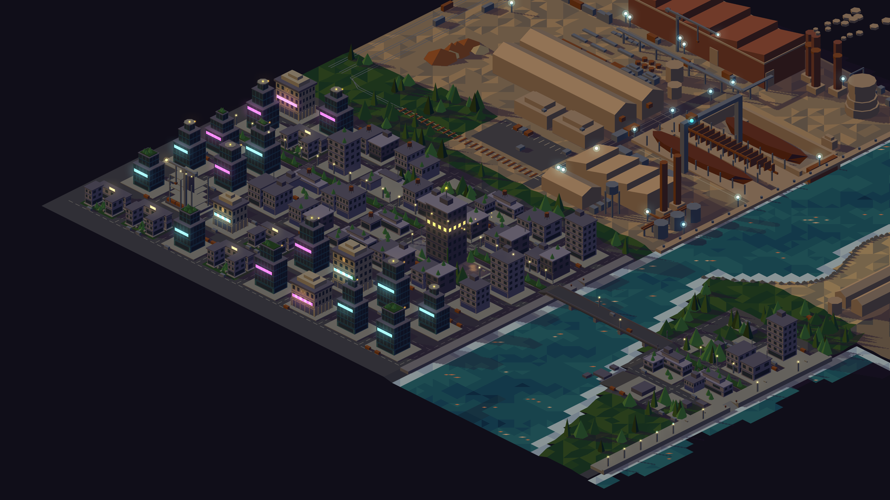
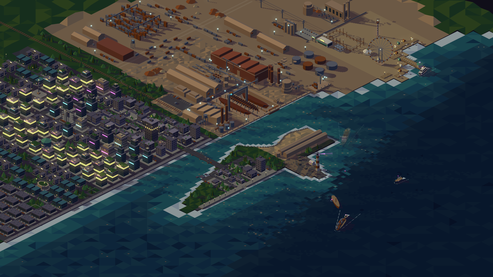
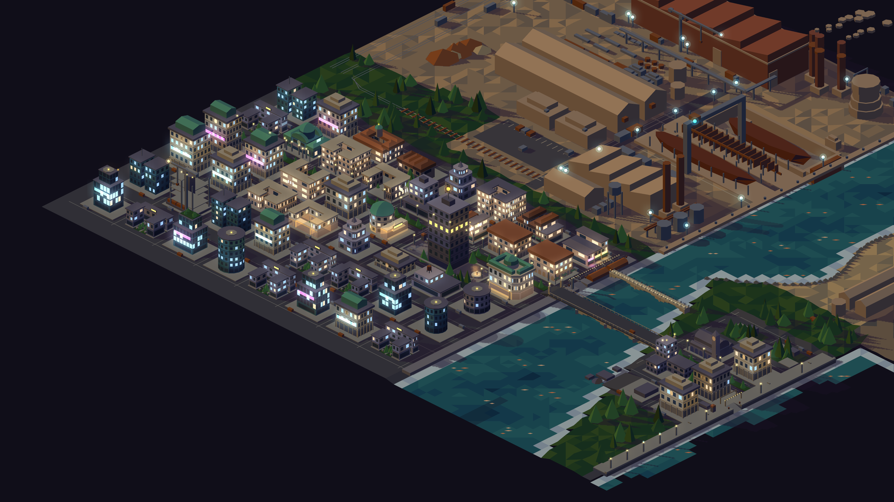
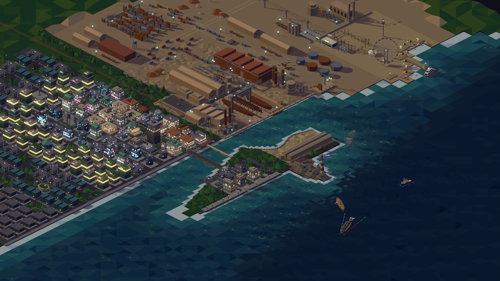
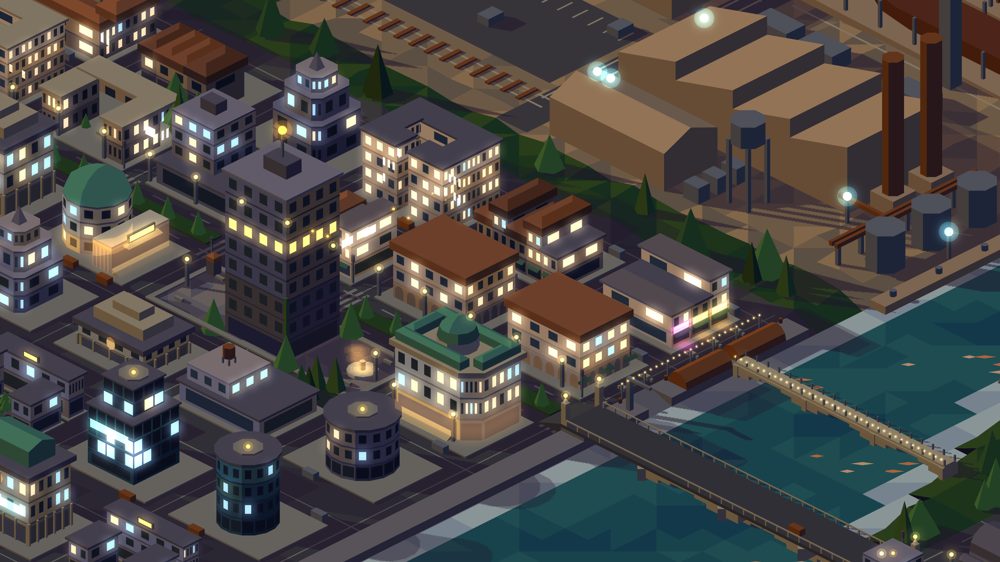
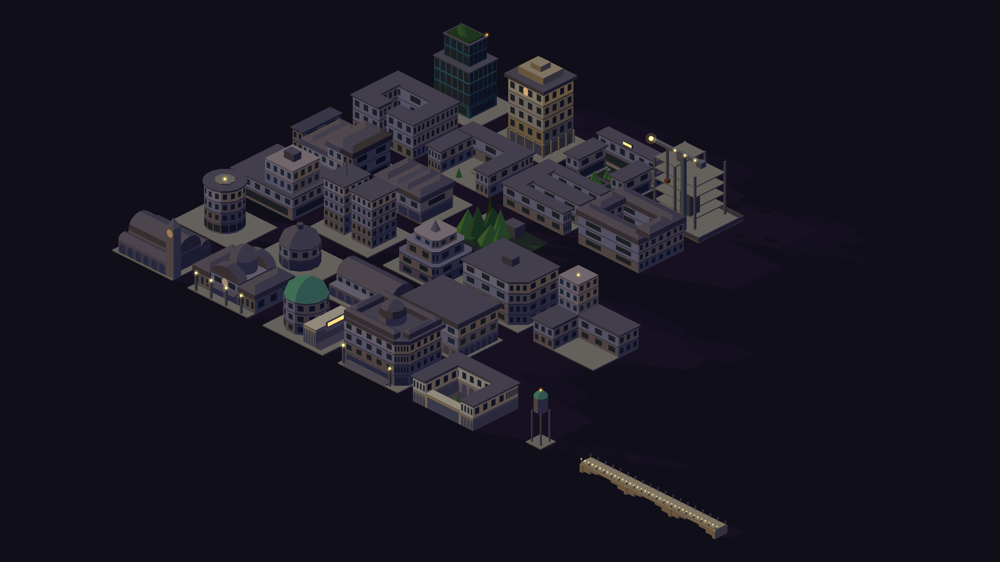
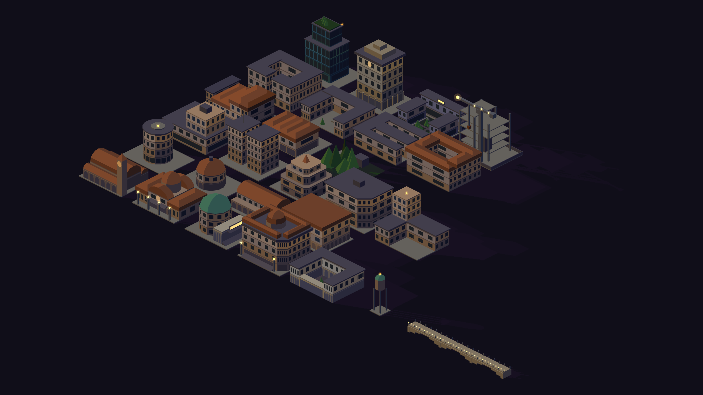
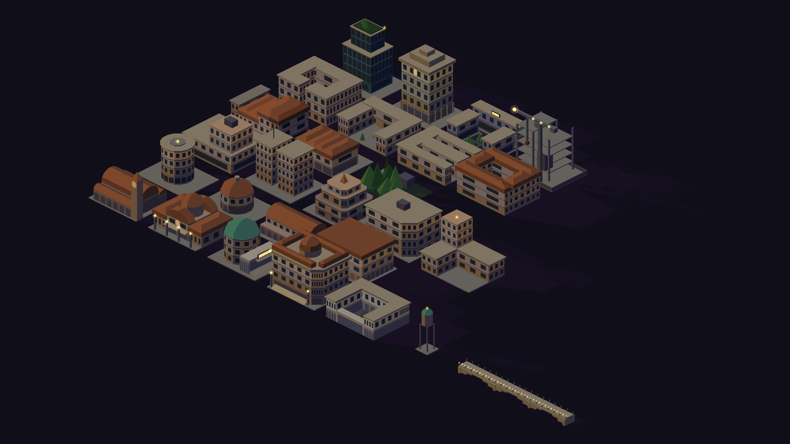
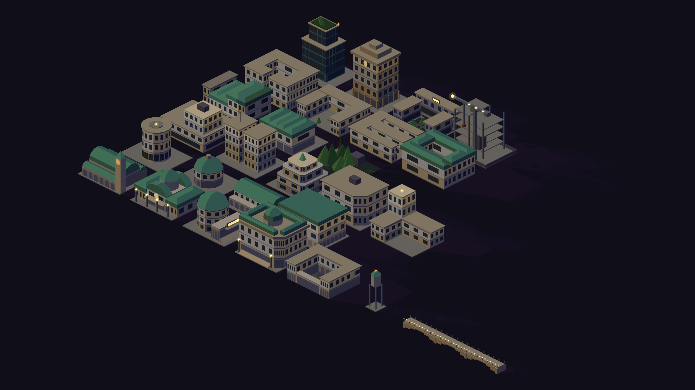

# Resume nivel 2: kit de formas, zonificación y luces — diseño

**Fecha:** 2026-10-15
**Estado:** implementada (2026-10-18)
**Antecede:** `2026-09-14-resume-ciudad-design.md` (grilla, piezas fijas, rulings),
`2026-09-14-mundo-2-fabrica-distrito-blog-design.md` §6 (distrito),
`2026-09-15-mundo-3-tecnologico-feria-agua-barcos-design.md` §3 (tecnológico),
`2026-10-14-cyberpunk-crepusculo-neones-bloom-design.md` (paleta ×0.7, neones, bloom).
**Alcance:** la zona Resume dentro del contenido (`x −54..344`, `y 158..324`):
ciudad vieja, distrito moderno y las piezas fijas (puente, malecón, muelle
oeste, derrumbe, plaza). El motor puro (`src/iso/`) y la paleta. El distrito
tecnológico del sangrado, Portfolio y Blog **no** cambian en esta etapa; el kit
queda listo para que lo adopten después. La geografía (estuario, malecón,
costuras `x 344` / `y 146`, terreno) no se mueve.

## 1. Problema

El análisis de escena de 2026-10-14 sobre Resume encontró:

1. **Formas.** Todo edificio es un prisma rectangular con cornisa y un detalle
   de techo. Los cuatro tipos de manzana (torre, pareja, bajo en L, devorada)
   se distinguen por tamaño y no por forma. No hay patios, retranqueos
   asimétricos, curvas ni cubiertas.
2. **Color.** Cinco tonos por material, elegidos solo por la normal. Dos
   edificios vecinos del mismo material son idénticos; una pared de 18 de alto
   es un solo color.
3. **Planificación.** La grilla es correcta pero el contenido se sortea manzana
   por manzana con pesos globales: no hay barrios, no hay nodos salvo la plaza,
   y las cabeceras del puente están vacías. Según Lynch: bordes e hito bien;
   sendas secundarias, nodos y barrios flojos.
4. **Luces.** Un piso encendido en la torre, faroles ámbar, charcos, y desde la
   historia #11 carteles cian y magenta a media altura en las torres del
   distrito (`facadeSign`, h ≥ 12) y luces animadas en el malecón. Las
   ventanas comunes siguen siendo `glass` oscuro: no hay luz cálida o fría
   por ventana ni nada a nivel de calle.
5. **Kit.** No existe: `prism`, `tiles`, `lamp`, `campus`, `towerCrane` y
   `jungle` son las únicas piezas con función. Bolardo, auto, helipuerto,
   terraza verde y cartel están duplicados inline en dos o tres archivos con
   medidas distintas.
6. **Geometría barata y cara a la vez.** Los 663 `strip` de carriles son casi la
   mitad de la geometría de la zona y al zoom del sitio se leen como ruido.

## 2. Decisiones

| Tema | Decisión |
|---|---|
| Enfoque | Kit declarativo + zonificación (enfoque A de la conversación): recetas puras en `src/kit/`, mapa de barrios con catálogo en `src/city/zoning.ts`, luces en `src/city/lights.ts`; `city.ts` y `district.ts` pasan a ser orquestadores finos |
| Gradientes | Más tonos por material: escalera de **nueve** tonos en vez de cinco, fill plano por polígono. Sin mesh ni shader (ver alternativas descartadas) |
| Planificación | Zonificación + catálogo por barrio. El mapa de barrios y las piezas singulares van a mano; dentro de cada barrio el rng elige del catálogo con pesos |
| Formas | Las cuatro familias: manzana cerrada con patio, volúmenes compuestos y retranqueos, curvas y cubiertas, estructuras singulares |
| Neones | Barrio de bares en la ribera oeste junto al muelle: columnas `102..186`, filas `164..206`. Neones solo en frentes abiertos (avenida y calle del muelle) |
| Cálido / frío | Lo decide el barrio y el material: oficinas y muro cortina frías, residencial, bares y clásicos cálidas, el centro mezclado |
| Alcance | Ciudad vieja + distrito moderno + piezas fijas rehechas. Tecnológico después |
| Texturas | Siguen sin existir. Todo polígono plano con color de la paleta |
| Lo que ya hay de #11 | Se conserva: paleta ×0.7 vía `palette-base.ts` + `npm run palette`, bloom diferido, carteles de fachada del distrito y luces del malecón, helper `neon.ts` (`pulse`, `chase`, `flip`), guarda de acentos de Portfolio. El kit absorbe `facadeSign` como prop `sign`; las nuevas capas animadas usan `neon.ts` |
| Presupuesto | Ver §9. Sube, pero medido y con tope |

### Alternativas descartadas

- **Gradiente real por cara** (Mesh con color por vértice o shader): rompe el
  palette-guard, no se mide en el headless sin GPU, no pega con el papercraft
  facetado. Si algún día se quiere, va encima de esta capa, no en su lugar.
- **Manzana por manzana a mano**: control total pero no escala a las otras
  zonas y cada retoque es editar una tabla de 60 filas.
- **Agujeros genéricos en `poly`**: la manzana con patio no los necesita (ver
  §3) y obligarían a triangular el techo.
- **Sólido `ring` monolítico** (lo que se dijo en la conversación): se descarta
  por el orden de pintado. `sortByDepth` ordena por caja AABB; un anillo entero
  contiene su patio, así que un árbol en el patio se dibujaría antes que el
  anillo y la pared interior que mira a la cámara lo taparía. El patio se
  compone de **cuatro alas** (prismas que no se solapan), y entonces los
  objetos del patio se ordenan entre las alas correctamente. Misma regla para
  U y C.

## 3. Motor: primitivas (`src/iso/solids.ts`, `facade.ts`, `light.ts`)

### Orientación por sentido de giro

`extrude()` orienta hoy cada pared con el centroide del sólido (`face()`),
que falla en huellas cóncavas. Pasa a orientar por el sentido de giro de la
huella: **horario visto desde arriba = exterior**. La normal de la pared
`a→b` es la perpendicular que apunta hacia afuera según ese giro. `poly` queda
válido para L, U, C, T y chaflanes. El techo y la base no cambian. Los demás
sólidos (cone, hull, wheel) siguen como están.

Ruling de profundidad que acompaña: **nada ajeno a la receta entra en el hueco
de una huella cóncava** (una L, una U). Si el hueco tiene mobiliario, la receta
compone alas en vez de un `poly`. Test en el kit (§5).

### Sólidos nuevos

| Sólido | Campos | Caras | Uso |
|---|---|---|---|
| `dome` | `at` (centro de la base), `r`, `h`, `sides` (12..16), `rings` (3..4) | un cuadrilátero por anillo × meridiano, casquete final en triángulos; tono por normal | rotonda, palacio cívico, teatro, estación |
| `vault` | `at` (esquina NO), `len`, `w`, `h`, `axis: "x" \| "y"`, `segments` (6..8) | medio cilindro en franjas longitudinales más dos hastiales semicirculares | mercado cubierto, estación, galpones del muelle |
| techo `hip` en `prism` | `roof: "hip"` | cuatro faldones a `GABLE_RATIO`, cumbrera corta en el eje largo | residencial, bares, estación |

`cone` de 4 u 8 lados sigue siendo la pirámide y el chapitel.

### Fachada

- `facade` pasa a ser válido en `cylinder`: con 12..16 lados da fachada curva.
  `facadeFaces` ya trabaja pared por pared; solo cambia el `tessellateAll`.
- `base: "arcade"` nuevo: arcos de medio punto (6 segmentos por arco, uno por
  columna de la fachada) a `toneOffset −2`, con pilares entre arcos a
  `toneOffset −1`. Mismo mecanismo que `glass` y `portico`.
- **Gradiente por altura**: la fachada emite por piso una banda de pared del
  material del muro con `toneOffset` que sube con el piso: `0` en el tercio
  inferior, `+1` en el medio, `+2` en el superior, para edificios de ≥ 4 pisos;
  `0` y `+1` para 2..3 pisos. La pared cruda queda tapada.
- La fachada devuelve además la lista de ventanas (`windowPatches` ya existe)
  con su piso: la usa el kit para publicar `windows` (§5) y las luces para
  encender ventanas sueltas (§7).

### Tono por sólido

`Solid` gana `tone?: number` (−2..+2), un desplazamiento base que se suma a
todas sus caras antes del `toneOffset` de cada una. Permite variar edificios
vecinos del mismo material sin materiales nuevos. `tessellate` lo aplica; los
tests de paleta no cambian porque el color final sigue saliendo de `toneColor`.

## 4. Paleta de nueve tonos (`src/map/palette-iso.ts`)

`TONE_LADDER` pasa de cinco a nueve, de oscuro a claro:

```
deep, shade, dim, lit, down, top, up, pale, glow
```

`shadeTone` sigue devolviendo uno de los cinco de siempre (`shade lit down
top up`) por la normal; `toneOffset` y `tone` se mueven por los nueve. Todo
material recibe las nueve entradas, agua incluida (así `water-anim` no cambia).

Los cuatro tonos nuevos se definen sobre `BASE_TONES` de `palette-base.ts`
(la paleta sin oscurecer) con la regla de abajo, y `scripts/darken-palette.ts`
(`npm run palette`) los oscurece ×0.7 junto con los cinco de siempre e imprime
los literales que se pegan en `palette-iso.ts`. El test existente "base ×
DARKEN por canal (±1)" cubre los nueve. La regla, aplicada sobre la base:

| Tono | Regla |
|---|---|
| `deep` | `shade × (0.70, 0.72, 0.80)` (más oscuro y más azul) |
| `dim` | media aritmética de `shade` y `lit` |
| `pale` | media aritmética de `up` y `glow` (decidido en #36, opción A: así la luminancia crece estrictamente a lo largo de la escalera) |
| `glow` | `up × (1.12, 1.08, 1.02)`, saturado a 255 |

Materiales nuevos, exclusivos de Resume:

| Material | `top` objetivo | Uso |
|---|---|---|
| `plaster` | ocre rosado cálido `0xb89a86` | residencial de patios, bares |
| `terracotta` | teja `0x9a5a3c` | cubiertas `hip` del residencial y los bares |
| `marble` | blanco cálido `0xcfc4b0` | cívico: palacio, teatro, biblioteca |
| `awning` | verde botella `0x3a5a4a` | toldos de bares y kioscos |

Los `top` de arriba son valores de **base** (sin oscurecer); sus cinco tonos
salen con la regla "ciudad y costa", los cuatro nuevos con la de arriba, y el
script los oscurece ×0.7. El test de paleta exige luminancia monótona a lo
largo de la escalera para cada material.

Acentos nuevos en `ISO_COLORS` (los acentos no se oscurecen, como los nueve
existentes; `portfolio-accents.test.ts` no cambia porque Portfolio no los usa):

| Acento | Color | Uso |
|---|---|---|
| `windowWarm` | `0xffd9a0` | ventana encendida cálida |
| `windowCool` | `0xa8d8ff` | ventana encendida fría |

Los neones usan `amber`, `magenta` y `cyan` con sus `Mid` y `Bleed`, que la
historia #11 ya habilitó en Resume. La regla nueva es de **altura y lugar**:
los neones a nivel de calle (z < 4) existen solo en el barrio de bares; los
carteles de fachada a media altura del distrito (#11) y los de azotea siguen
donde están, como prop `sign` del kit.

## 5. Kit (`src/kit/`)

Módulo puro, sin rng global ni Pixi. Lo consumen `city.ts`, `district.ts` y,
después, cualquier zona.

### Contrato

```ts
interface Lot { x: number; y: number; w: number; d: number; z: number; open: Side[] }  // open: lados con frente abierto (avenida, agua, plaza)
interface Style { mat: Material; trim: Material; roof: Material; tone: number; floorH: number; window: "windowWarm" | "windowCool" }
interface Window { pts: Vec3[]; floor: number; wall: Vec3 /* normal */; building: number }
interface Slot { pts: Vec3[]; wall: Vec3; kind: "neon" | "sign" }
interface Piece { solids: Solid[]; accents: Accent[]; windows: Window[]; slots: Slot[]; landmarkTop?: Vec3 }
type Recipe = (lot: Lot, rng: Rng, style: Style) => Piece;
```

Reglas de toda receta: todo sólido dentro del lote (más el vuelo de cornisa,
0.8); nada por debajo de `lot.z`; altura ≤ 18 salvo recetas marcadas
`landmark` (≤ 24 con cúpula o chapitel); determinista por rng; publica todas
sus ventanas de paredes **que miran a la cámara** (normal con componente
`+x` o `+y`); no toca `accents` para ventanas, eso es de `lights.ts`.

### Formas (`src/kit/forms/`)

| Archivo | Recetas |
|---|---|
| `courtyard.ts` | **O** (cuatro alas, patio con baldosas o verde, pasaje en el ala sur), **U** (abierta a un lado `open`), **C** (dos patios), **patio residencial** (O baja h 6..9, `plaster` + `terracotta` `hip`, árboles de patio) |
| `composite.ts` | **podio + torre** (podio todo el lote h 4..6, torre 10×10 a 12×12 h 12..18 descentrada), **gemelas con puente** (dos torres 8×10 y puente a media altura), **déco escalonada** (tres cuerpos con chaflán y chapitel `cone` 4 lados), **chaflán** (poly con esquina cortada hacia la calle más ancha), **L con torre** (ala baja en L y torre en la esquina) |
| `curved.ts` | **torre cilíndrica** (cylinder 16 lados con fachada), **rotonda** (cylinder 12 lados + `dome`), **nave abovedada** (`vault` + fachada `arcade`), **galería** (planta baja `arcade`, dos pisos encima, techo `hip`) |
| `lowrise.ts` | **hilera de locales** (4..5 lotes angostos de 4..6 de ancho, 2..3 pisos, toldos, `hip` o terraza; publica `slots` de neón en planta baja hacia `open`), **casas en hilera**, **ruina devorada** (lo de hoy, con el kit) |
| `landmarks.ts` | **mercado cubierto** (`vault` central + dos naves laterales + torre del reloj), **estación** (`vault` + `dome` sobre el hall + reloj), **teatro** (tambor + `dome` + columnata `arcade` + marquesina), **palacio cívico** (chaflán + `hip` + `dome` central + escalinata `ramp`), **biblioteca** (galería `arcade` en `marble` + patio), **torre de agua ornamental** (cylinder sobre cuatro patas + `dome` `copper`), **puente peatonal** (tablero de 55 sobre tres arcos de piedra) |

Lo que ya existe en `district.ts` (torre de vidrio escalonada, clásico de
piedra, campus, obra) se muda a `src/kit/forms/modern.ts` sin cambiar su
salida visual más que por la paleta.

### Techos (`src/kit/roofs.ts`)

Cornisa (material `trim`, h 0.4, vuela 0.5), escalón, `gable`, `hip`, terraza
verde, pirámide, cúpula. Un solo lugar para la regla "sobre un techo
retranqueado el detalle apoya en la huella retranqueada".

### Props (`src/kit/props.ts`)

Una función por prop, una medida por rol. Reemplaza todas las copias inline.

| Prop | Medida |
|---|---|
| farol | poste `steel` 0.6×0.6×5, `dot` ámbar r 0.6 |
| semáforo | poste 0.3×0.3×4, caja `officeDark` 0.5×0.5×1.2 |
| auto | 3×1.5×1.2, `steel`/`rust`; **una sola medida** |
| banco, mesa, silla | `paving` 2×0.6×0.5; 1×1×0.7; 0.5×0.5×0.5 |
| bolardo | cylinder `rust` r 0.4 h 0.8, 6 lados |
| árbol de calle / de patio / selva | cone r 1.5 h 4; r 1 h 2.5; `jungle` (r 2..4, h 5..9) |
| toldo | `ramp` `awning` 0.8 de vuelo, h 0.4, `dir` hacia la calle |
| kiosco | prisma 2×2×2.4 `officeDark` + `hip` `terracotta` |
| cartel | caja `officeDark` + poly ámbar (la única implementación) |
| neón | poly del color + poly `Bleed` 1.3× detrás (halo) |
| fuente | cylinder `marble` r 3 h 0.6 + cylinder r 0.6 h 1.5 + charco `amberBleed` |
| tanque de agua, sala de máquinas, antena, helipuerto, baliza, equipos, panel solar, cerco, contenedor | las medidas de hoy, una sola vez |
| guirnalda | `dot`s ámbar r 0.25 cada 1.5 a lo largo de una polilínea a z 3 |

### Laboratorio

`lab/kit.html` + `src/lab/kit.ts`: todas las recetas sobre lotes de 24×18 en
una grilla de 30×24, una fila por archivo de formas, con el estilo de su barrio
por defecto. Teclas: `s` cambia el seed, `1..4` cambia el estilo. Fondo
`#100e19` como el resto del lab. Es la página de QA del kit y la referencia
visual para las otras zonas.

## 6. Zonificación (`src/city/zoning.ts`)

Sobre la grilla de `city-grid.ts`, que no cambia (`WEST_COLS`, `EAST_COLS`,
`ROWS`, `PLAZA`, `SITE`, `COLLAPSED`). Cada manzana recibe un **barrio** por
tabla a mano y cada barrio un **catálogo**: recetas con peso, estilo, política
de luces.

### Barrios

| Barrio | Manzanas | Carácter | Catálogo (peso) | Estilo | Luces |
|---|---|---|---|---|---|
| **Centro** | `72, 188`; cols `72..162` × fila `242`; `42, 218` | financiero alrededor de la plaza y la avenida | podio+torre 30, déco 20, chaflán 20, clásico 15, torre cilíndrica 15 | `office`/`officeDark`/`stone`/`curtain`, `tone` −1..+1 | 45 % encendidas, 70 % frías |
| **Bares (muelle)** | cols `102, 132, 162` × filas `164, 188` | locales con bares, terrazas al agua | hilera de locales 50, galería 20, patio bajo 20, O baja 10 | `plaster`/`officeDark`/`terracotta`/`awning` | 70 % encendidas, 90 % cálidas; neones en frentes abiertos |
| **Residencial de patios** | cols `−48..66` × filas `164..260` menos distrito y centro | manzanas cerradas con patio, techos de teja | patio residencial 40, O 20, U 15, casas en hilera 15, ruina devorada 10 | `plaster`/`stone`/`terracotta` | 55 % encendidas, 95 % cálidas |
| **Cívico** | plaza; `72, 218` (teatro); `162, 218` (palacio cívico); `42, 242` (biblioteca) | nodo principal | fijos | `marble`/`stone`/`copper` | fachadas bañadas (`amberBleed` poly en planta baja), 30 % frías |
| **Ribera este** | cols `280, 310` × filas `164..242`, menos el derrumbe (`COLLAPSED`) | ciudad vieja devorada, mercado frente al puente | mercado fijo en `280, 188`; resto: clásico 30, L con torre 30, ruina devorada 40 | `office`/`officeDark` | 25 % encendidas, mezcla |
| **Distrito moderno** | `DISTRICT_COLS`/`DISTRICT_ROWS` | como hoy, sobre el kit | torre de vidrio 30, gemelas 20, clásico 20, campus 20, cilíndrica 10; obra fija en `SITE` | `curtain`/`stone`/`copper` | 40 % encendidas, 85 % frías |

Piezas singulares fijas, además de las de la tabla: **estación** en `−18, 188`
(la avenida y el tren siguen al oeste), **torre de agua ornamental** en el
patio de `12, 164`, **puente peatonal** sobre el estuario en `y 176` desde el
muelle oeste (`x 198`) hasta la ribera este (`estuaryEast(176) ≈ 252`), que
une el barrio de bares con el mercado: la cabecera del puente de la avenida y
este puente peatonal son los dos nodos nuevos de la ribera.

Rulings que se conservan: la fila frente a la torre (`row 3`, `x 96..162`)
topa a 10 (`maxHeightFor`); el piso encendido de la torre no puede quedar
detrás de nada (`maxDistrictHeight`); nada supera 18 salvo la torre (30) y los
landmarks (≤ 24).

Variación: `zoning` asigna a cada manzana un `tone` por rng (−1..+1) y
rechaza repetir la misma receta en dos manzanas adyacentes del residencial.

### Calles

Los carriles discontinuos quedan **solo en la avenida y el anillo este**; las
demás calles llevan una línea central continua de 0.3 (`strip` único por
tramo). Sendas cebra solo en los cruces de la avenida. Objetivo: de 663 a
≈ 120 `strip`.

## 7. Luces (`src/city/lights.ts`, `city-anim.ts`)

### Ventanas sueltas

`lights(pieces, zoning, rng)` recorre las `windows` de cada pieza y decide por
ventana: apagada, cálida o fría, según la política del barrio (porcentaje
encendido, proporción cálida). Determinista con `zoneRng(seed, "cv", 3)`.

**Oclusión por cajas:** una ventana solo se enciende si ningún sólido de la
escena queda delante de ella en pantalla (`overlaps(screenBounds)` +
`isBehind` de `src/iso/depth.ts`, con barrido por x como `sortByDepth`). Los
acentos se pintan arriba de todo; sin este filtro una ventana encendida
flotaría sobre el edificio de enfrente. Generaliza el ruling de la fila frente
a la torre.

Salida: `Accent` `poly` con `windowWarm` o `windowCool`, alpha 0.85.

### Neones

Solo los `slots` de las piezas del barrio de bares, y solo en paredes cuyo
lado del lote está en `lot.open` (frente a la avenida `y 206` o a la calle del
muelle `x 186..192`). Hasta un neón por local, ≤ 24 en total, z entre 2.4 y
3.6. Colores por rng con pesos `amber 50, magenta 30, cyan 20`. Cada neón
emite su halo y un charco en la vereda (reutiliza `puddle` con el `Bleed`
del color). Guirnaldas en las terrazas del muelle.

### Fachadas bañadas

En el cívico, un `poly` `amberBleed` alpha 0.5 sobre la banda de planta baja
de las paredes visibles: la luz de los faroles del edificio.

### Animación

`city-anim.ts` conserva parpadeo del piso encendido, papeles, antena, los
carteles del distrito y las luces del malecón de #11, y suma (con los helpers
de `neon.ts`):

- **Ventanas que cambian**: cada 300..900 ms una ventana del centro o del
  residencial se prende o se apaga (la política mantiene el porcentaje ±5).
  Solo un subconjunto de ≤ 40 ventanas es animable; el resto es estático y va
  a la Graphics estática de acentos. Capa `city.windows`.
- **Neón que titila**: un neón elegido por rng al arrancar titila (alpha 0.3
  durante un tick cada 1..3 s); los demás son estáticos. Capa `city.neon`.
- Frame 0 = todo encendido y quieto; `reducedMotion` nunca devuelve ids.

## 8. Piezas fijas rehechas (`src/city/fixed.ts`)

Sobre el kit; mismas huellas que hoy.

- **Puente de la avenida**: tablero sobre tres arcos de piedra (`stone`, arcos
  de 6 segmentos como caras bajo el tablero), pilas con tajamar, balaustrada
  de postes cada 3, cuatro obeliscos con farol en las cabeceras. Las rampas y
  el estribo quedan.
- **Puente peatonal** nuevo (§6), `stone` + baranda `steel`, guirnalda.
- **Malecón**: zócalo igual; la cara este del muro lleva fachada `arcade`
  (galería de arcos sobre el agua); pérgola de madera (`deck`) de 12 con
  guirnalda a la altura de la escalera; kiosco; bancos y faroles de props.
- **Muelle oeste**: dos galpones `vault` chicos (12×6) en `y 164..176`, grúa
  de muelle pequeña, bolardos; terrazas de bares con mesas, sillas y toldos
  sobre la vereda del muelle (`x 186..192`), guirnaldas entre postes.
- **Plaza**: baldosas y cordón iguales; fuente centrada en la franja este
  (`x 150, y 227`), dos kioscos en las esquinas norte. La torre no cambia.
- **Derrumbe**: igual, con un fragmento de cúpula caído (`dome` `h` parcial,
  `sides 8`, tumbado se simplifica a medio `dome` apoyado en el agua).

## 9. Tests y presupuesto

### Tests (vitest, sin Pixi)

- `solids.test` (suma): paredes de un `poly` cóncavo apuntan hacia afuera
  (muestra un punto a 0.1 fuera de cada pared); `dome` y `vault` emiten el
  número de caras esperado y ninguna normal apunta al suelo; `hip` tiene
  cuatro faldones; `tone` desplaza todas las caras.
- `palette-iso.test` (suma): nueve entradas por material, luminancia monótona
  creciente a lo largo de la escalera, materiales nuevos presentes;
  `palette-guard` sin cambios.
- `facade.test` (suma): `arcade` emite un arco por columna; fachada en
  `cylinder`; bandas por altura con `toneOffset` creciente.
- `kit.test`: cada receta, con 20 seeds: dentro del lote (+0.8), nada bajo
  `lot.z`, altura ≤ 18 (≤ 24 landmarks), determinista, ventanas solo en
  paredes que miran a la cámara, ningún sólido ajeno dentro del hueco de un
  `poly` cóncavo (test geométrico sobre la salida).
- `zoning.test`: toda manzana tiene barrio; las fijas están donde dice la
  tabla; el barrio de bares es exactamente el conjunto de seis manzanas; en
  un seed se usan ≥ 14 recetas distintas; el residencial no repite receta en
  adyacentes; `maxHeightFor` sigue valiendo.
- `lights.test`: porcentaje encendido por barrio dentro de ±8 del objetivo;
  proporción cálida/fría dentro de ±10; **ninguna ventana encendida tiene un
  sólido delante** (misma función de oclusión aplicada como oráculo
  independiente, por fuerza bruta); neones solo en el barrio de bares, z 2.4..3.6,
  ≤ 24, solo sobre paredes de lados `open`.
- `city-anim.test` (suma): frame 0 quieto; `reducedMotion` sin ids; las
  ventanas animadas son subconjunto de las publicadas; el porcentaje se
  mantiene ±5 en 60 s simulados.
- `city.test` (ajusta): ≥ 90 edificios con fachada; materiales de la zona
  (incluye los cuatro nuevos); autos con una sola medida; `strip` ≤ 150.
- `world.test`: sin cambios de contrato; `LANDMARKS.cv` sigue en la torre.

### Presupuesto

Medido en el mismo headless de Mundo 3 (Chrome vía CDP, sin GPU, DPR 2) sobre
`lab/world.html` y `lab/resume.html`.

Las cifras de "hoy" son las del cierre de #18 (2026-10-14), con el bloom
activo.

| Métrica | Hoy | Tope |
|---|---|---|
| Sólidos elevados de Resume (contenido) | 960 | 2 200 |
| `strip` de Resume | 663 | 150 |
| Polígonos estáticos del mundo | 32 387 | 46 000 |
| Acentos estáticos de Resume | ≈ 90 | 900 |
| Primer dibujo caliente, lab `world.html` (mediana de 10) | 173 ms | 230 ms |
| Primer dibujo caliente, sitio `/` (mediana de 5) | 214 ms | 270 ms |
| Peor redibujo en 5 s, lab | 8–18 ms | 22 ms |
| Bloom: promedio tick + render en 60 frames | 9.5–9.9 ms | ≤ 15 ms (debe seguir en `on`) |

Si el primer dibujo supera el tope o el bloom cae a `fallback`, se recorta
primero `rings` de las cúpulas (4 → 3) y `sides` de los cilindros (16 → 12),
después el porcentaje de ventanas encendidas; nunca la cantidad de recetas.
Las ventanas encendidas estáticas van a las `Graphics` estáticas de acentos
por zona (no se redibujan por tick) para que el costo caiga en el primer
dibujo y no en el presupuesto del bloom.

## 9.1 Medidas

Medido el 2026-10-18 en el cierre (#49), sin tocar código: no se aplicó ningún recorte.

### Método

Chrome headless vía CDP con `agent-browser` 0.27.0 (Chrome 154, `swiftshader-webgl`, sin GPU), DPR 2, viewport 1600×900, en una AMD Ryzen 9 6900HX (16 hilos) con Linux 7.2.0-cachyos. Los tiempos son de la segunda carga: `open` (primera carga, descartada), `wait 3000`, y por lectura `console --clear; reload; wait 3000; console`. El "después" es la rama en `:5173`; el baseline es un worktree de `dd8566d` (`git merge-base origin/main HEAD`) con `npx vite` en `:5174`, medido en la misma máquina y alternando un lado y otro.

Primera pasada (descartada). Se midió con páginas headless abiertas que se fueron acumulando; el proceso GPU de swiftshader llevó el load average a 23-39. En esas condiciones el bloom del sitio cayó a `fallback` (28.2, 28.5 y 22.8 ms), el primer dibujo del sitio dio mediana 364.1 ms y el peor redibujo del lab 12.5-40.4 ms (mediana 23.7). El baseline medido en esa misma sesión también falló: 328.6 ms de primer dibujo en el sitio, 13.5-45.6 ms de peor redibujo en el lab y bloom del lab en `fallback` (19.0 ms) en una de sus dos cargas. Es decir, la máquina saturada, no el cambio, rompía los topes. Esas lecturas no se publican como "Medido".

Pasadas limpias (las que valen): una segunda pasada para el sitio y las dos primeras cargas largas del lab, y una tercera tanda para los diez pares de primer dibujo del lab y su tercera carga larga. Se repitió con el navegador cerrado (`agent-browser close`) entre cargas y esperando a que el load average bajara de 6 antes de cada lectura; cada lectura lleva anotada su línea de load average. Los pares de primer dibujo se alternaron después/baseline. Con ese protocolo el baseline vuelve a dar su "hoy" de §9 (bloom 9.0-9.4 ms, activo).

### Conteos (`src/scenes/city-budget.test.ts`)

Sobre la semilla real del mundo: 1124 sólidos elevados de Resume, 137 `strip`, 707 acentos estáticos y 35 542 polígonos estáticos del mundo (igual al `stage.staticCount` que loguea el lab; el baseline loguea 32 387, el "hoy" de §9).

### Tabla

| Métrica | Hoy | Tope | Medido | Cumple |
|---|---|---|---|---|
| Sólidos elevados de Resume (contenido) | 960 | 2 200 | 1 124 | sí |
| `strip` de Resume | 663 | 150 | 137 | sí |
| Polígonos estáticos del mundo | 32 387 | 46 000 | 35 542 | sí |
| Acentos estáticos de Resume | ≈ 90 | 900 | 707 | sí |
| Primer dibujo caliente, lab `world.html` (mediana de 10) | 173 ms | 230 ms | 159.6 ms (baseline en la sesión: 167.9 ms) | sí |
| Primer dibujo caliente, sitio `/` (mediana de 5) | 214 ms | 270 ms | 226.9 ms (baseline en la sesión: 215.9 ms) | sí |
| Peor redibujo en 5 s, lab (15 ventanas, 3 cargas) | 8–18 ms | 22 ms | 8.6–12.6 ms | sí |
| Bloom: promedio tick + render en 60 frames | 9.5–9.9 ms | ≤ 15 ms (en `on`) | lab 8.8 / 8.9 / 9.1 ms; sitio 8.9 / 8.8 / 9.3 ms; `activo` en las seis | sí |

Recortes aplicados: ninguno. Todos los topes se cumplieron, así que no se tocó `sides` de los cilindros ni el porcentaje de ventanas encendidas (`CATALOGUE[barrio].lights.on`). El recorte de `rings` de las cúpulas (4 → 3) tampoco aplicaba: las cúpulas ya usan `rings: 3` o menos (`src/kit/roofs.ts:60`, `src/kit/forms/landmarks.ts`).

Modo de bloom de la máquina: `on` (activo) en el lab y en el sitio, y en las cinco capturas del lab.

Medianas. Lab, después: 156.8 157.0 157.2 157.4 158.6 160.5 160.9 162.8 164.2 169.2, mediana 159.6 ms. Lab, baseline: 160.3 163.5 164.3 166.4 167.8 167.9 168.3 168.8 172.5 175.0, mediana 167.9 ms. Sitio, después: 221.9 225.6 226.9 233.0 236.9, mediana 226.9 ms. Sitio, baseline: 212.8 214.9 215.9 221.0 251.2, mediana 215.9 ms. El sitio queda 11 ms (5 %) por encima del baseline y 43 ms por debajo del tope; el lab queda 8 ms por debajo del baseline. En el sitio el peor redibujo (no tiene tope en §9) fue de 8.5 a 14.1 ms, contra 8.8 a 13.2 ms del baseline, sobre todas las ventanas de las tres cargas largas de cada lado.

### gzip del bundle JS (`gzip -9`, bytes)

| Archivo | Antes (`dd8566d`) | Después |
|---|---|---|
| index | 109 066 | 121 627 |
| Geometry | 31 347 | 31 347 |
| RenderTargetSystem | 21 551 | 21 551 |
| browserAll | 11 026 | 11 026 |
| init | 4 807 | 4 807 |
| BufferResource | 2 845 | 2 845 |
| canvasUtils | 2 038 | 2 038 |
| CanvasPool | 450 | 450 |
| getTextureBatchBindGroup | 303 | 303 |
| webworkerAll | 88 | 88 |
| Total | 183 521 | 196 082 |

+12 561 bytes (+6.8 %), todo en el chunk principal (`index`). Los nombres con hash cambian entre builds; los demás archivos son idénticos en bytes.

### Lecturas crudas de las pasadas limpias

Copiadas tal cual de `agent-browser console`, en el orden en que se tomaron, con todas las ventanas de peor redibujo y las cargas largas del baseline. Cada carga lleva antes su línea de load average.

```
# lab/world.html primer dibujo, pares (2 después :5173, 2 baseline :5174, ...), segundas cargas, líneas completas
-- despues-par-1 load average: 2.17, 3.09, 7.33
[info] [lab] primer dibujo: 158.6 ms, 35542 polígonos estáticos
[info] [lab] primer dibujo: 157.0 ms, 35542 polígonos estáticos
-- base-par-1 load average: 4.29, 3.50, 7.40
[info] [lab] primer dibujo: 168.3 ms, 32387 polígonos estáticos
[info] [lab] primer dibujo: 167.8 ms, 32387 polígonos estáticos
-- despues-par-2 load average: 4.97, 3.68, 7.41
[info] [lab] primer dibujo: 157.2 ms, 35542 polígonos estáticos
[info] [lab] primer dibujo: 160.5 ms, 35542 polígonos estáticos
-- base-par-2 load average: 5.91, 3.93, 7.43
[info] [lab] primer dibujo: 172.5 ms, 32387 polígonos estáticos
[info] [lab] primer dibujo: 164.3 ms, 32387 polígonos estáticos
-- despues-par-3 load average: 5.06, 3.92, 7.34
[info] [lab] primer dibujo: 162.8 ms, 35542 polígonos estáticos
[info] [lab] primer dibujo: 156.8 ms, 35542 polígonos estáticos
-- base-par-3 load average: 5.43, 4.04, 7.32
[info] [lab] primer dibujo: 166.4 ms, 32387 polígonos estáticos
[info] [lab] primer dibujo: 168.8 ms, 32387 polígonos estáticos
-- despues-par-4 load average: 5.55, 4.23, 7.30
[info] [lab] primer dibujo: 160.9 ms, 35542 polígonos estáticos
[info] [lab] primer dibujo: 157.4 ms, 35542 polígonos estáticos
-- base-par-4 load average: 5.03, 4.27, 7.22
[info] [lab] primer dibujo: 160.3 ms, 32387 polígonos estáticos
[info] [lab] primer dibujo: 167.9 ms, 32387 polígonos estáticos
-- despues-par-5 load average: 5.34, 4.36, 7.20
[info] [lab] primer dibujo: 164.2 ms, 35542 polígonos estáticos
[info] [lab] primer dibujo: 169.2 ms, 35542 polígonos estáticos
-- base-par-5 load average: 5.95, 4.52, 7.22
[info] [lab] primer dibujo: 175.0 ms, 32387 polígonos estáticos
[info] [lab] primer dibujo: 163.5 ms, 32387 polígonos estáticos
# lab/world.html carga larga después, 3ª carga limpia
-- lab-long-despues-3 load average: 5.01, 4.61, 7.13
[info] [lab] primer dibujo: 156.8 ms, 35542 polígonos estáticos
[info] [lab] peor redibujo en 5 s: 10.60 ms
[info] [lab] bloom: promedio 9.1 ms en 60 frames (tick 5.9 + render 3.2), presupuesto 15 ms → activo
[info] [lab] peor redibujo en 5 s: 11.80 ms
[info] [lab] peor redibujo en 5 s: 8.70 ms
[info] [lab] peor redibujo en 5 s: 8.80 ms
[info] [lab] peor redibujo en 5 s: 11.10 ms
# sitio / primer dibujo, alternando A B A B (después :5173 / baseline :5174)
-- site-despues-1 load average: 2.12, 15.49, 21.81
[info] [mapa] primer dibujo: 226.9 ms, 35542 polígonos estáticos
-- site-base-1 load average: 2.02, 15.03, 21.59
[info] [mapa] primer dibujo: 251.2 ms, 32387 polígonos estáticos
-- site-despues-2 load average: 3.14, 14.84, 21.45
[info] [mapa] primer dibujo: 225.6 ms, 35542 polígonos estáticos
-- site-base-2 load average: 5.12, 14.87, 21.39
[info] [mapa] primer dibujo: 215.9 ms, 32387 polígonos estáticos
-- site-despues-3 load average: 5.40, 14.21, 21.00
[info] [mapa] primer dibujo: 221.9 ms, 35542 polígonos estáticos
-- site-base-3 load average: 5.54, 13.59, 20.62
[info] [mapa] primer dibujo: 221.0 ms, 32387 polígonos estáticos
-- site-despues-4 load average: 5.70, 13.03, 20.25
[info] [mapa] primer dibujo: 233.0 ms, 35542 polígonos estáticos
-- site-base-4 load average: 5.98, 12.56, 19.90
[info] [mapa] primer dibujo: 212.8 ms, 32387 polígonos estáticos
-- site-despues-5 load average: 5.11, 11.63, 19.29
[info] [mapa] primer dibujo: 236.9 ms, 35542 polígonos estáticos
-- site-base-5 load average: 5.34, 11.21, 18.95
[info] [mapa] primer dibujo: 214.9 ms, 32387 polígonos estáticos
# sitio / carga larga (3 después + 3 baseline alternadas, puntero movido; el primer dibujo de cada una va en su bloque)
-- site-long-despues-1 load average: 5.73, 10.89, 18.64
[info] [mapa] primer dibujo: 227.5 ms, 35542 polígonos estáticos
[info] [mapa] peor redibujo en 5 s: 11.60 ms
[info] [mapa] bloom: promedio 8.9 ms en 60 frames (tick 5.7 + render 3.1), presupuesto 15 ms → activo
[info] [mapa] peor redibujo en 5 s: 10.70 ms
[info] [mapa] peor redibujo en 5 s: 8.80 ms
[info] [mapa] peor redibujo en 5 s: 13.40 ms
[info] [mapa] peor redibujo en 5 s: 9.70 ms
[info] [mapa] peor redibujo en 5 s: 9.20 ms
[info] [mapa] peor redibujo en 5 s: 12.50 ms
[info] [mapa] peor redibujo en 5 s: 9.70 ms
[info] [mapa] peor redibujo en 5 s: 8.50 ms
-- site-long-base-1 load average: 5.47, 9.83, 17.38
[info] [mapa] primer dibujo: 213.9 ms, 32387 polígonos estáticos
[info] [mapa] peor redibujo en 5 s: 10.60 ms
[info] [mapa] bloom: promedio 9.3 ms en 60 frames (tick 6.1 + render 3.1), presupuesto 15 ms → activo
[info] [mapa] peor redibujo en 5 s: 10.00 ms
[info] [mapa] peor redibujo en 5 s: 12.20 ms
[info] [mapa] peor redibujo en 5 s: 11.20 ms
[info] [mapa] peor redibujo en 5 s: 9.10 ms
[info] [mapa] peor redibujo en 5 s: 10.00 ms
[info] [mapa] peor redibujo en 5 s: 10.20 ms
[info] [mapa] peor redibujo en 5 s: 12.70 ms
[info] [mapa] peor redibujo en 5 s: 10.00 ms
-- site-long-despues-2 load average: 4.72, 8.95, 16.23
[info] [mapa] primer dibujo: 220.3 ms, 35542 polígonos estáticos
[info] [mapa] peor redibujo en 5 s: 11.80 ms
[info] [mapa] bloom: promedio 8.8 ms en 60 frames (tick 5.6 + render 3.2), presupuesto 15 ms → activo
[info] [mapa] peor redibujo en 5 s: 10.50 ms
[info] [mapa] peor redibujo en 5 s: 11.60 ms
[info] [mapa] peor redibujo en 5 s: 9.90 ms
[info] [mapa] peor redibujo en 5 s: 12.90 ms
[info] [mapa] peor redibujo en 5 s: 8.60 ms
[info] [mapa] peor redibujo en 5 s: 8.70 ms
[info] [mapa] peor redibujo en 5 s: 11.30 ms
[info] [mapa] peor redibujo en 5 s: 8.90 ms
-- site-long-base-2 load average: 5.63, 8.81, 15.42
[info] [mapa] primer dibujo: 220.5 ms, 32387 polígonos estáticos
[info] [mapa] peor redibujo en 5 s: 10.50 ms
[info] [mapa] bloom: promedio 9.4 ms en 60 frames (tick 6.3 + render 3.1), presupuesto 15 ms → activo
[info] [mapa] peor redibujo en 5 s: 10.40 ms
[info] [mapa] peor redibujo en 5 s: 11.40 ms
[info] [mapa] peor redibujo en 5 s: 10.20 ms
[info] [mapa] peor redibujo en 5 s: 8.80 ms
[info] [mapa] peor redibujo en 5 s: 10.80 ms
[info] [mapa] peor redibujo en 5 s: 9.90 ms
[info] [mapa] peor redibujo en 5 s: 9.60 ms
[info] [mapa] peor redibujo en 5 s: 9.60 ms
-- site-long-despues-3 load average: 5.64, 8.47, 14.56
[info] [mapa] primer dibujo: 221.1 ms, 35542 polígonos estáticos
[info] [mapa] peor redibujo en 5 s: 10.90 ms
[info] [mapa] bloom: promedio 9.3 ms en 60 frames (tick 5.9 + render 3.4), presupuesto 15 ms → activo
[info] [mapa] peor redibujo en 5 s: 10.60 ms
[info] [mapa] peor redibujo en 5 s: 10.90 ms
[info] [mapa] peor redibujo en 5 s: 11.00 ms
[info] [mapa] peor redibujo en 5 s: 10.50 ms
[info] [mapa] peor redibujo en 5 s: 9.70 ms
[info] [mapa] peor redibujo en 5 s: 10.70 ms
[info] [mapa] peor redibujo en 5 s: 11.10 ms
[info] [mapa] peor redibujo en 5 s: 14.10 ms
-- site-long-base-3 load average: 5.96, 8.59, 13.95
[info] [mapa] primer dibujo: 222.1 ms, 32387 polígonos estáticos
[info] [mapa] peor redibujo en 5 s: 11.20 ms
[info] [mapa] bloom: promedio 9.0 ms en 60 frames (tick 6.1 + render 2.9), presupuesto 15 ms → activo
[info] [mapa] peor redibujo en 5 s: 12.30 ms
[info] [mapa] peor redibujo en 5 s: 13.20 ms
[info] [mapa] peor redibujo en 5 s: 10.00 ms
[info] [mapa] peor redibujo en 5 s: 9.80 ms
# lab/world.html carga larga después (2 cargas limpias)
-- lab-long-despues-1 load average: 0.36, 1.72, 7.81
[info] [lab] primer dibujo: 162.8 ms, 35542 polígonos estáticos
[info] [lab] peor redibujo en 5 s: 10.10 ms
[info] [lab] bloom: promedio 8.8 ms en 60 frames (tick 5.7 + render 3.2), presupuesto 15 ms → activo
[info] [lab] peor redibujo en 5 s: 12.30 ms
[info] [lab] peor redibujo en 5 s: 12.20 ms
[info] [lab] peor redibujo en 5 s: 10.00 ms
[info] [lab] peor redibujo en 5 s: 11.50 ms
-- lab-long-despues-2 load average: 4.77, 2.82, 7.87
[info] [lab] primer dibujo: 164.6 ms, 35542 polígonos estáticos
[info] [lab] peor redibujo en 5 s: 9.20 ms
[info] [lab] bloom: promedio 8.9 ms en 60 frames (tick 5.6 + render 3.3), presupuesto 15 ms → activo
[info] [lab] peor redibujo en 5 s: 9.00 ms
[info] [lab] peor redibujo en 5 s: 11.30 ms
[info] [lab] peor redibujo en 5 s: 12.60 ms
[info] [lab] peor redibujo en 5 s: 8.60 ms
```

Del baseline, en la pasada limpia, el sitio dio bloom 9.3, 9.4 y 9.0 ms (activo). La mediana del sitio sale de las cinco lecturas de `primer dibujo` alternadas de arriba (la de `site-long-*` es otra carga y no entra en la mediana).

### Capturas

Todas a 1600×900 con DPR 2 (PNG de 3200×1800), segunda carga, con el modo de bloom por defecto de la máquina (`activo`: 2.8, 9.5, 2.6, 9.0 y 1.9 ms en las cinco del lab; el kit no tiene bloom). Las "antes" salen del worktree de `dd8566d` en `:5174`. El lab no tiene zoom propio: `despues-resume-zoom.png` se hizo con el gancho de PixiJS DevTools, escalando el contenedor del mundo (`stage.children[0]`) ×2.5, a escala 6.1, y centrándolo en el barrio de bares.

Antes (Resume en `lab/resume.html`, mundo en `lab/world.html` con la tecla `0`):




Después:





El kit en `lab/kit.html`, teclas `1..4` (centro, bares, residencial, cívico):






## 9.2 Desvíos de implementación

Lo que los hijos de la historia declararon en sus PR (contra `feature/35-resume-nivel-2`), respecto de esta spec y del texto de sus issues.

- **#51 (calles, #43).** Los carriles discontinuos usan período 5/5, no 4/4: con 4/4 `city()` da 156 `strip` (el distrito suma 15 propios) y el tope es 150; el issue pedía alargar el período antes que quitar calles. Cebras de 3 franjas de 0.8 en cada cruce de la avenida salvo bajo el puente. Resultado: 665 → 141 `strip` al cerrar el PR, 137 al cierre.
- **#53 (motor, #37).** El centro de cara de `dome` y `vault` queda en `at.z + h/3`, no en `at.z`: en `at.z` el centroide de la base coincide con el centro y la normal de la base no se puede orientar. La compuerta de `vault` es el arco de `segments + 1` puntos sin repetir esquinas.
- **#55 (fachada, #38).** Los arcos de `arcade` tienen 9 puntos, no 11 (las dos esquinas superiores del rectángulo son los extremos del arco). Se agregó `visibleWalls(solid)` y se tocó una línea en `city.ts` y `tech-anim.ts`, fuera del alcance declarado, porque la banda del piso 0 se contaba como pared (la ciudad mostraba 32 ventanas encendidas en lugar de 8).
- **#120 (paleta, #36).** `pale` es el promedio de `up` y `glow`, no de `top` y `up` (decisión humana, opción A): la regla original dejaba `pale` por debajo de `up` en los 34 materiales y rompía la luminancia estrictamente creciente. El test `cityLadder satura a 255` pasa a esperar `0xfffff5` en lugar de `0xffffff`.
- **#137 (kit modern, #39).** `lot.z` es la superficie sobre la que se apoya la receta (el distrito usa `PLINTH_H`; el campus, 0). Las torres de vidrio sortean `rng.int(16, 19)` en lugar de `(16, 24)` para respetar el tope de altura de 24: las más altas bajan de 27.5 a ≤ 24.3. La baliza aparece desde `h ≥ 18` (antes 20). La pluma de la grúa mide 13 en lugar de 14. El cartel del campus es el `sign` del kit y pierde el halo `amberBleed`. El presupuesto de sólidos elevados de `tech.test` sube de 1200 a 1250.
- **#145 (courtyard y lowrise, #40).** `courtyardC` se arma en cinco bandas porque con alas de 5 no entra en 15 de fondo. Un `hipRoof` mide `1.5·(1 + GABLE_RATIO)` con su cumbrera, no 1.5: el prisma es de 1.5 de alero y `HIP_ROOF_H` se exporta para que las recetas descuenten el techo real. Con frentes cortos, `shopRow` y `rowHouses` usan `floor(len/4)` locales. Las ventanas de paredes compartidas se publican igual y las descarta la oclusión (#144).
- **#148 (composite y curved, #41).** El brazo de la L es de 8, no de 7 (la torre de 8×8 tiene que caer en el codo sin entrar en el hueco). La cornisa de la L son dos losas a ras de las caras del hueco, no una huella corrida. `twinTowers` va de 12 a 13.6, no de 12 a 16, porque el tope de 18 cuenta las coronas. `podiumTower` baja el podio con `maxH` bajo. La `gallery` son dos prismas apilados.
- **#155 (landmarks, #42).** El teatro mira al este sin importar `lot.open` (tambor, columnata y escalinata miden 19.56 y no entran en 15 de fondo): la manzana `(72, 218)` necesita calle al este. Las naves laterales del mercado miden `min(4, (d − 9)/2)`. El arco del puente peatonal usa `lot.z + 1.8·sin(π(k+0.5)/6)` con un anillo de 0.4 en la corona (la fórmula literal del issue cuelga el arco al revés 6 bajo `lot.z`). Nueva `fitToCap` que aplasta en z lo que supera el tope.
- **#163 (zonificación, #44).** `(72, 164)` está asignada a centro, de modo que bares son seis manzanas y centro siete. El tope de 24 vale solo para las fijas y el distrito: `classic` es `landmark` pero queda en 18 en centro y ribera. `eatenRuin` y `campus` quedan a z 0 sin zócalo de manzana. `tone` sale siempre de `rng`. Las fijas usan el estilo de su barrio (la estación toma `distrito`). `district.ts` y su test se eliminan.
- **#170 (luces, #45).** La oclusión usa la silueta convexa del cajón proyectado (`screenHull`, `hullsOverlap`, `hides` en `src/iso/depth.ts`) y no el AABB de pantalla: con el AABB literal se apagaban 1328 de 1695 ventanas y los 8 slots abiertos de neón. Los neones también pasan por oclusión, y la semilla del mundo tiene 3 neones, no ≥ 8 (los 5 de la avenida del local `(102, 188)` quedan detrás de la torre de 30 y dos faroles; el test pide ≥ 3; seguimiento en #165). "Encendida con probabilidad p" es una cuota exacta por barrio (las `round(p·n)` claves más bajas) y no sorteos independientes, con los que la ribera quedó en 16.7 % contra 25 %. La z del neón se mide relativa a `lot.z`. Las guirnaldas de las terrazas del muelle quedan para #48.
- **#172 (puente y derrumbe, #47).** El perfil de los arcos del puente es `z − r + (r − 0.4)·sin(...)` y no `z − r·sin(...)` (la fórmula literal da un arco invertido, un delantal de piedra más hondo en el centro). La cúpula caída va en `(270.5, 259.5, −0.9)` y no en `(271, 254)`, que cae dentro de la losa hundida. Los x de pilas son centros de pila, y el tramo de estribo a la primera pila (x 198..212) queda sin arco bajo el tablero. `stoneArch` toma el perfil del borde inferior como función. Seguimiento en #171 (la luz del obelisco SE flota sobre un techo).
- **#175 (animación, #46).** `CityLights.flicker` es el índice del neón que titila, sorteado después de todos los demás sorteos del rng de luces. `createCityAnim` recibe `Pick<CityScene, "tower" | "neon" | "lights">`. Un tick dispara a lo sumo un evento de ventana y uno de titileo.
- **#181 (malecón, muelle y plaza, #48).** Los galpones del muelle van en `y 164..176` y `178..190`, en `x 193..198` (a ras del borde del agua) y los bolardos en `x 192.5`, no en `x 192.5..197.5` y `x 193`, que dejaban cinco bolardos dentro de un galpón. La pérgola va en `x0..x0 + 4` (no `x0 + 2..x0 + 6`, porque su poste SE flotaba sobre la rampa). Los kioscos de la plaza van dentro del cordón, en `(PLAZA.x + 1.4, PLAZA.y + 1.4)` y `(PLAZA.x + PLAZA.w − 3.4, PLAZA.y + 1.4)`, porque en las coordenadas del issue pisaban los bancos. El charco de la fuente tiene alpha 0.35 (`props.puddle` gana un `alpha` opcional). El muro real del lote es `x 184.5` y no `x 186`, y ahí cuelgan los toldos. `maxHeightFor` topa a 10 la manzana `(162, 242)` (frente a la fuente, que si no la tapa y deja el charco brillando sobre el techo). Seguimiento en #178 (los charcos de suelo no tienen oclusión).
- **Cierre (#49).** Las cúpulas ya usan `rings: 3` o menos (`src/kit/roofs.ts:60`, `src/kit/forms/landmarks.ts`), así que el recorte "rings 4 → 3" de §9 no aplicó. No hubo recortes de presupuesto.

Resumen de seguimientos abiertos por los hijos: #52, #54, #126, #131, #136, #142, #143, #144, #146, #147, #151, #152, #165, #171, #178.

## 9.3 Criterios de aceptación de #35

- [x] `npm test` y `npm run typecheck` verdes en cada entrega; los tests nuevos de la spec §9 existen y pasan (solids, palette, facade, kit, zoning, lights, city-anim, city).
- [x] `lab/kit.html` muestra todas las recetas de §5; `lab/resume.html` muestra los seis barrios de §6 reconocibles.
- [x] Ninguna ventana encendida ni neón queda delante de un sólido que debería taparlo (test de oclusión por fuerza bruta como oráculo).
- [x] Neones a nivel de calle solo en las seis manzanas del barrio de bares, ≤ 24.
- [x] Presupuesto de §9 medido en el headless de siempre: polígonos estáticos ≤ 46 000, primer dibujo lab ≤ 230 ms (mediana de 10), sitio ≤ 270 ms (mediana de 5), peor redibujo ≤ 22 ms, bloom sigue en `on`.
- [x] Capturas antes/después de `lab/resume.html` y `lab/world.html` a 1600×900 en `docs/superpowers/specs/assets/2026-10-15-resume-nivel-2/`.
- [x] La spec queda con estado "implementada", desvíos de implementación anotados y medidas.

### Veredicto por criterio (#49, 2026-10-18)

1. **Suite y typecheck verdes, tests nuevos presentes: PASS.** `npm test` al cierre: 78 archivos, 949 tests en verde; `npm run typecheck` sin errores. Los tests de la spec §9 existen: `src/iso/solids.test.ts`, `src/map/palette-iso.test.ts`, `src/iso/facade.test.ts`, `src/kit/kit.test.ts` (más `src/kit/forms/*.test.ts`), `src/city/zoning.test.ts`, `src/city/lights.test.ts`, `src/scenes/city-anim.test.ts` y `src/scenes/city.test.ts`. Lo que no se pudo reverificar es que cada una de las seis entregas estuviera en verde por separado: está declarado en el cuerpo de cada PR (515, 527, 541, 547, 617, 700, 786, 857, 868, 904, 915, 929 y 947 tests, con typecheck limpio) y no se reprodujo entrega por entrega.
2. **Kit completo y seis barrios reconocibles: PASS, con juicio visual.** `src/lab/kit-scene.test.ts` ("un lote por receta, una fila por familia en el orden del registro") y `src/kit/kit.test.ts` (registro único y contrato por receta); `src/city/zoning.test.ts` ("centro, residencial, cívico, ribera y distrito según la tabla", "con la semilla del mundo se usan ≥ 14 recetas distintas"). Capturas `kit-centro.png`, `kit-bares.png`, `kit-residencial.png`, `kit-civico.png` y `despues-resume.png`: en la última se leen los patios de terracota al oeste, los locales con toldo junto al muelle, las torres del centro, las cúpulas cívicas, el mercado al otro lado del puente y el vidrio del distrito. "Reconocible" es un juicio visual; queda a la vista del responsable. Por la tabla de §6, el kit tiene seis familias (`modern`, `courtyard`, `lowrise`, `composite`, `curved`, `landmarks`) en `src/kit/forms/`.
3. **Oclusión por fuerza bruta: PASS.** `src/city/lights.test.ts`: "ninguna ventana encendida queda tapada por un sólido (oráculo por fuerza bruta)" y "ningún neón queda tapado por un sólido (oráculo por fuerza bruta)". Con la salvedad declarada en #170 (la oclusión usa la silueta convexa y no el AABB de pantalla) y en #171 y #178: las luces de piezas fijas (obeliscos, charcos de suelo) no están cubiertas por esa oclusión, y #171 documenta un caso concreto que flota. El criterio habla de ventanas y neones, que sí están cubiertos.
4. **Neones solo en bares, ≤ 24: PASS.** `src/city/lights.test.ts` ("neones: solo en bares, ≤ 24, frente abierto, uno por local, z 2.4..3.6 sobre el lote…" y "a lo sumo 24 aunque haya 30 slots abiertos"); `src/city/zoning.test.ts` ("bares son exactamente las seis manzanas del muelle"). En la semilla del mundo hay 3 neones (ver #170), muy por debajo del tope.
5. **Presupuesto medido: PASS.** Tabla de §9.1, pasada limpia. Los números de la primera pasada no se publican: la máquina saturada hizo fallar también al baseline. Conteos garantizados por `src/scenes/city-budget.test.ts` (sólidos elevados, `strip`, acentos y polígonos estáticos contra sus topes). Bloom `activo` en las seis cargas limpias (lab y sitio).
6. **Capturas: PASS.** Los nueve PNG de §9.1 existen en `docs/superpowers/specs/assets/2026-10-15-resume-nivel-2/` (`antes-resume`, `antes-mundo`, `despues-resume`, `despues-mundo`, `despues-resume-zoom`, `kit-centro`, `kit-bares`, `kit-residencial`, `kit-civico`), a 3200×1800 (1600×900 a DPR 2).
7. **Spec implementada, con desvíos y medidas: PASS.** Estado `implementada (2026-10-18)`, §9.1 (medidas), §9.2 (desvíos) y este veredicto.

Sobre el modo de bloom: `on` en el lab y en el sitio en la máquina de medición, sin desvío ni seguimiento abierto.

## 10. Orden de implementación

Cada paso deja `npm test` y `npm run typecheck` verdes y la escena visible en
el lab. Son seis entregas mergeables por separado:

1. **Motor y paleta** (§3, §4): orientación por giro, `dome`, `vault`, `hip`,
   fachada en cilindro y `arcade`, bandas por altura, `tone`, escalera de
   nueve, materiales y acentos nuevos, script de paleta. La ciudad actual se
   ve igual salvo las bandas por altura.
2. **Kit** (§5): `src/kit/` con formas, techos y props; `lab/kit.html`.
   `district.ts` migra sus cuatro tipos al kit. Nada más cambia de aspecto.
3. **Zonificación** (§6): `zoning.ts`, `city.ts` reescrito como orquestador,
   calles simplificadas, piezas fijas nuevas del mapa (estación, mercado,
   teatro, palacio, biblioteca, torre de agua, puente peatonal).
4. **Luces** (§7): `lights.ts`, oclusión, neones, fachadas bañadas,
   `city-anim` ampliado.
5. **Piezas fijas rehechas** (§8): puente, malecón, muelle, plaza, derrumbe.
6. **Cierre**: medición de presupuesto, capturas de `lab/resume.html` y
   `lab/world.html` a 1600×900, README del lab, estado de esta spec.

## 11. Fuera de alcance

- Distrito tecnológico, Portfolio, Blog y la feria sobre el kit: etapas
  siguientes, con el kit ya probado.
- Rotar luz o cámara, texturas, sprites, shaders, sonido.
- Cambios de geografía, terreno, costuras o reintegración al sitio.
