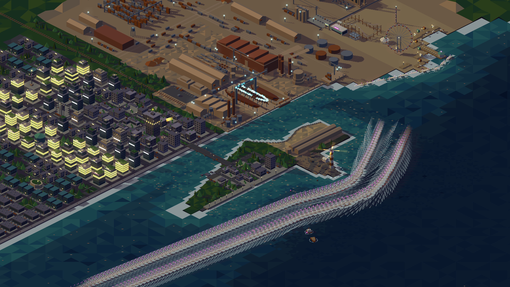

# Inventario de los conjuntos de barcos (antes de #85)

**Fecha:** 2026-10-17
**Estado:** "antes" y "después" completos
**Issues:** #85 (regresión de los barcos), #86 (inventario "antes"), #87 (carriles nuevos), #88 (verificación "después").
**Alcance:** inventario verificado en código y en el sitio de todos los conjuntos de assets de barco, tal como están antes de #85 (`main` 9dc191c, que era la base de `feature/85-barcos-semirrecta` antes de #87; las referencias a código de este documento son a ese commit), con capturas y conteos por frame. "Después" es `feature/85-barcos-semirrecta` tras #87 (commit 11586e2), con capturas y conteos del mismo tipo. No cambia código.

Las capturas viven en `assets/85-barcos/`. Cada una se tomó con agent-browser, viewport 1600 × 900 a 2x (PNG de 3200 × 1800), sin cambiar nada de `src/`.

## Inventario

La tabla sale de `grep -n 'kind: "hull"\|boya\|bote\|lancha\|buoy\|wreck' src/scenes/*.ts` y de las capturas. "Correcto" es la lectura visual del conjunto en la captura: casco, superestructura, luces y estela completos, sin tapar ni superponerse mal, y con el fade solo en el sangrado y no a la vista. Los botes salvavidas y las balsas que llevan los kits de `ships.ts` (bote salvavidas del carguero en `ships.ts:62`, bote del remolcador en `ships.ts:125`) son piezas del barco, no un conjunto aparte, y se cuentan en la fila del barco.

| Conjunto | Archivo | Instancias simultáneas | Instancias por ciclo | Dónde | Animación | Correcto |
|---|---|---|---|---|---|---|
| `cargo`, `tug`, `barge` (carguero, remolcador solo, empujador con barcaza) | `src/scenes/ships.ts` (kits), `src/scenes/sea-anim.ts` (`SHIPS`, `shipStateAt`) | 3 barcos, 2 o 3 a la vista según la fase (ver el ciclo) | 3 (uno por fase 0, 1/3, 2/3) (ver Ciclo de los barcos) | Carril de ida y de vuelta sobre la bahía y el mar abierto; zarpe y atraque en la dársena del astillero | Se mueven por los carriles, con estela de espuma y luces (`magentaMid` de tope, `magenta` a babor y `cyanMid` a estribor). Desvanecido (`alphaAt`) solo en los últimos 30 u (`FADE_U`) del extremo de mar de cada carril, a pleno en el fondeadero. Pausa de 24 s (`BERTH_MS`) en `BERTH` con giro en el lugar entre los 8 y 16 s (`BERTH_TURN_MS`). No se anima el casco ni los botes salvavidas | sí, sin tapados ni solapes; fade solo en el sangrado (ver abajo): [antes-cover](assets/85-barcos/antes-cover.png), [antes-recorrido](assets/85-barcos/antes-recorrido.png) |
| `ferry` (lancha colectiva) | `src/scenes/ships.ts`, `src/scenes/sea-anim.ts` (`FERRY_ROUTE`) | 1 | 1 | Entre el muelle de la feria y el de graneles, parando 4 s en cada punta | Camina `FERRY_ROUTE` sin suavizado de giro; estela corta y luces. Sin fade (alpha 1, `sea-anim.ts:159`). La cabina no se anima | sí: [antes-lancha](assets/85-barcos/antes-lancha.png) |
| pecio partido | `src/scenes/sea.ts` (`wreck()`) | 1 (dos mitades visibles: proa y casa de popa) | 1 (estático) | Fosa, junto a la boya del pecio | Nada: sin luces ni estela; solo los anillos de espuma del agua | sí, como pecio: [antes-pecio](assets/85-barcos/antes-pecio.png) |
| boya del pecio | `src/scenes/sea.ts` (`buoysAndWreck()`, `WRECK_BUOY`) | 1 | 1 (estática) | Pegada a la casa de popa del pecio | Cilindro `steel` con luz fija `magentaMid` y anillo de espuma; no parpadea | sí: [antes-pecio](assets/85-barcos/antes-pecio.png) |
| boyas de canal (2) | `src/scenes/sea.ts` (`BUOYS`, `buoysAndWreck()`) | 2, en (420, 80) y (430, 160) | 2 (estáticas) | Canal, al oeste del pecio | Luz rosa que parpadea desfasada (`sea-anim.ts`, `buoyOn`): nunca las dos apagadas. El cilindro no se mueve | sí: [antes-pecio](assets/85-barcos/antes-pecio.png), una encendida y la otra apagada |
| casco en construcción (quilla y cuadernas, grada 1) | `src/scenes/shipyard.ts` (`slipways()`, `i === 0`) | 1 | 1 (estático) | Grada 1 del astillero, bajo la grúa pórtico | Sin animación del casco; las chispas de soldadura (`weldSpots`) son un acento aparte | sí, esqueleto a la vista: [antes-darsena](assets/85-barcos/antes-darsena.png) |
| casco entero en grada 2 | `src/scenes/shipyard.ts` (`slipways()`, `hull` de 74 × 10 u) | 1 | 1 (estático) | Grada 2 del astillero | Sin animación | sí en geometría; la popa queda parcialmente tapada por las chimeneas, sólidos estáticos: [antes-darsena](assets/85-barcos/antes-darsena.png) |
| casco en el dique seco | `src/scenes/shipyard.ts` (`dryDock()`, `DOCK` (120, 6), 72 × 24, z = −6) | 1 | 1 (estático) | Dársena, arriba a la derecha en el encuadre del astillero | Sin animación | sí: casco oxidado hundido en el dique, completo: [antes-darsena](assets/85-barcos/antes-darsena.png) |
| botes del muelle de la feria | `src/scenes/fair.ts:199` (`hull` de 5 u, `bayShoreX(y) - 9`) | 4, en y = −284, −256, −228, −200 | 4 (estáticos) | Franja de arena de la feria | Sin animación, sin luces ni estela. Los visibles se leen como elipses claras; el 4 es nítido, junto a una sombrilla | parcial: el bote 3, en (247, −228), queda enterrado en el tramo de entarimado del muelle (`fair.ts` ~98-102, x 240..248, y −228..−210, z 0..0,6). No está bajo la sombra del muelle sino dentro del sólido, así que cuenta como tapado por sólidos estáticos. Los otros tres, sí: [antes-feria-botes](assets/85-barcos/antes-feria-botes.png) |

Fade de los barcos: en código el alpha baja de 1 solo dentro de `FADE_U` del extremo de mar de cada carril, y esos extremos caen fuera del cover, en (376, 640) a la ida y (430, 655) a la vuelta. En el time-lapse las estelas llegan al borde inferior izquierdo del cover a pleno brillo, así que el fade no se ve: ocurre en el sangrado.

Resultado del grep: no aparece ningún otro conjunto de barcos fuera de estas filas. Los demás `kind: "hull"` están en los tests o son los de las filas de arriba.

### Ciclo de los barcos

Medido en código con `.scratch/cycle.ts` (el script está al final de esta sección). Las constantes son de `src/scenes/sea-anim.ts`.

- `CYCLE_MS` = 1 805 380 ms (unos 1805 s, 30 min).
- Ida (`OUT`): 796 168 ms, carril de 955,4 u a 1,2 u/s.
- Fuera de pantalla (`OFF_MS`): 15 000 ms.
- Vuelta (`BACK`): 970 212 ms, carril de 1164,3 u.
- Atraque (`BERTH_MS`): 24 000 ms, con un giro en el lugar entre los 8 y los 16 s.
- Fases de los tres barcos: 0, 1/3 y 2/3 del ciclo.

Proporción del ciclo que pasan los tres barcos en cada combinación de estados, muestreando cada 100 ms:

| combinación | proporción |
|---|---|
| 2 de ida + 1 de vuelta | 32,4 % |
| 1 de ida + 2 de vuelta | 61,3 % |
| 1 de ida + 1 de vuelta + 1 atracado | 3,9 % |
| 1 de ida + 1 de vuelta + 1 fuera de pantalla | 2,4 % |

Es decir que casi siempre hay tres barcos navegando y solo en un 6,3 % del ciclo hay uno atracado o fuera de pantalla.

```ts
// .scratch/cycle.ts, se corre con: npx tsx .scratch/cycle.ts
import { CYCLE_MS, OFF_MS, BERTH_MS, laneLength, LANE_SPEED, shipStateAt, SHIPS } from "../src/scenes/sea-anim";
const OUT = laneLength("out")/LANE_SPEED*1000, BACK = laneLength("back")/LANE_SPEED*1000;
console.log({CYCLE_MS, OUT, BACK, OFF_MS, BERTH_MS, out: laneLength("out"), back: laneLength("back")});
const combos = new Map<string, number>();
for (let t=0;t<CYCLE_MS;t+=100){ const key = SHIPS.map(s=>shipStateAt((t+s.phase*CYCLE_MS)%CYCLE_MS).lane).join(","); combos.set(key,(combos.get(key)??0)+100); }
for (const [k,v] of combos) console.log(k, (v/1000).toFixed(1)+"s", (100*v/CYCLE_MS).toFixed(1)+"%");
```

## Conteos por frame (PixiJS DevTools)

Se tomaron con la extensión PixiJS DevTools 2.3.1 en agent-browser (HeadlessChrome, Pixi 8.20.1, renderer webgl2) y `window.__PIXI_DEVTOOLS_WRAPPER__.rendering.capture()`, como indica `CLAUDE.md`. La columna "Página" dice de dónde sale cada fila: el sitio (`/map/lab/world.html`, ver el método) o el lab real (`/lab/world.html`). Todas las filas están en el encuadre cover: contenedor en (625,63; 157,14), escala 1,4904 a 1600 × 900. `meshes`, `texts`, `masks`, `tilingSprites` y `nineSliceSprites` dan 0 en todas.

| # | Página | Instante | Estado de los barcos (leído de la captura) | containers | graphics | sprites | filters | instrucciones | renderTime ms |
|---|---|---|---|---|---|---|---|---|---|
| 1 | sitio, carga A | ~+3 s | carguero frente a la grada y el fondeadero; remolcador con barcaza en mar abierto al SE; remolcador solo al SO; lancha en la orilla de la feria | 9 | 105 | 0 | 3 | 63 | 0,40 |
| 2 | sitio, carga B | ~+35 s | igual, con corrimientos de pocos px | 9 | 105 | 0 | 3 | 63 | 0,40 |
| 3 | sitio, carga B | +3 s del anterior | igual | 9 | 105 | 0 | 3 | 63 | 0,50 |
| 4 | sitio, carga B | ~+80 s | carguero un poco al E; lancha ya a la izquierda del muelle de la feria | 9 | 105 | 0 | 3 | 63 | 0,30 |
| 5 | sitio, carga C | ~+30 s | carguero casi en el fondeadero; los otros dos en mar abierto | 8 | 82 | 0 | 2 | 53 | 4,70 |
| 6 | sitio, carga C | ~+130 s | carguero en camino hacia el E, lancha salida de la feria | 8 | 82 | 0 | 2 | 53 | 0,30 |
| 7 | lab (`/lab/world.html`, tecla 4) | 2026-10-17 20:52:56 UTC | cover; sin lectura de tramos por barco | 8 | 82 | 0 | 2 | 53 | 0,50 |
| 8 | lab (`/lab/world.html`, tecla 4) | 20:53:32 UTC, 36 s después | cover; sin lectura de tramos por barco | 8 | 82 | 0 | 2 | 53 | 0,40 |

Observaciones:

- `drawCalls` dio 0 en todas las capturas: en headless no es fiable. Valen `totals` e `instructions`.
- Los barcos son `Graphics`: no suman sprites ni meshes. Los totales no cambian con el movimiento de los barcos, aunque sí a lo largo de una misma carga (ver el punto siguiente); el mundo estático está cacheado en pocos objetos.
- Los totales no son constantes: 9/105/3/63 (containers/graphics/filters/instrucciones) en las filas 1 a 4 y 8/82/2/53 en las demás. La causa no está verificada. Coincide con la tarea diferida del bloom (`attachBloom` en `scheduleIdle`, después del primer dibujo): los conteos altos salen primero y bajan después, así que no es el bloom sumándose. Una explicación posible es que el bloom se prueba encendido, mide 60 frames y, a ~2 fps en headless, pasa el presupuesto de 15 ms y queda en `fallback`, que quita el filtro; no se verificó. En el lab, el primer conteo de esta sesión dio 9/105/3/63 y unos 40 s después, en la misma carga, 8/82/2/53. El renderTime de 4,70 ms de la fila 5 es un pico aislado.
- El estado por barco entre instantes no se puede leer: la página no expone `state(k)`. Cerca del cover, el carguero (el barco que sale del astillero) está junto al fondeadero; no se afirma nada de los tramos entre un instante y otro.

## Método del time-lapse

- **URL.** La que da el issue, `http://localhost:5173/map/lab/world.html`, no sirve el lab. `vite.config.ts:4` fija `base: "/"`, así que esa ruta cae al `index.html` del sitio (`src/main.ts`, título "Nicolás Riccomini"). El lab real es `http://localhost:5173/lab/world.html` (`src/lab/world.ts` y `page.ts`). Por eso todas las capturas y conteos de las filas 1 a 6, y el time-lapse, se tomaron en el sitio, en su encuadre cover (contenedor en (625,63; 157,14), escala 1,4904 a 1600 × 900). Ahí las teclas 0 a 6 y `?speed=` no se aplican. Las filas 7 y 8 se tomaron en el lab real, apretando 4. El sitio es lo que ve un visitante, así que vale como "antes".
- **Velocidad.** Headless corre a unos 2 fps, y el ticker de Pixi acota `deltaMS` a 100 ms (`_maxElapsedMS`). En el lab, `?speed=N` rinde solo unos 0,2·N s simulados por s real. No alcanza.
- **Método A.** En cambio se llamó al listener del ticker de la página con `deltaMS` = 15 000 ms por cuadro, sin tocar `src/`. En cada `requestAnimationFrame` se hace `renderer.render(stage)` y, en la misma tarea, `drawImage` del canvas sobre un acumulador con `globalCompositeOperation = "lighten"`. El `lighten` no saturó el fondo, así que no hizo falta la variante de diferencia.
- **Duración.** 170 cuadros, 170 × 15 s = 2550 s simulados (1,41 × `CYCLE_MS`), en unos 133 s reales (~1,3 fps), desde el estado inicial de la página. Cada cuadro avanza 18 u de ruta.
- **Qué no es ruta.** Los rastros de la lancha y de las luces de la noria y la grúa pórtico (zonas de la feria y del astillero) salen del `lighten` y no son rutas de barcos.

Para obtener el ticker de la app se parchea `Ticker.prototype.update` un momento, para tomar el que tiene `_minElapsedMS` y dejarlo en `window.__tk`. El import lleva el hash de Vite del momento (`?v=...`; hay que tomarlo del bundle servido). Paso previo, `.scratch/hook-ticker.js`:

```js
(async()=>{const m=await import('/node_modules/.vite/deps/pixi__js.js?v=730f03ea');const P=m.Ticker.prototype;const o=P.update;let tk=null;P.update=function(t){if(this._minElapsedMS)tk=this;return o.call(this,t)};await new Promise(r=>setTimeout(r,2000));P.update=o;window.__tk=tk;return String(tk._head.next._fn).slice(0,100)})()
```

Bucle, `.scratch/hook2.js` (`accA` es el acumulado `lighten` que se exporta como PNG; `accB` es la variante por diferencia contra el cuadro 0, que no se usó):

```js
(() => { const w = __PIXI_DEVTOOLS_WRAPPER__, src = w.canvas; const l = __tk._head.next; const fn = l._fn, ctx = l._context; const DT = 15000;
const mk=()=>{const c=document.createElement('canvas');c.width=src.width;c.height=src.height;return c}; const f0=mk(), tmp=mk(), accB=mk(), accA=mk(); const g0=f0.getContext('2d'), gt=tmp.getContext('2d'), gB=accB.getContext('2d'), gA=accA.getContext('2d'); gB.fillStyle='#000'; gB.fillRect(0,0,accB.width,accB.height); gB.globalCompositeOperation='lighten'; gA.globalCompositeOperation='lighten';
const T = window.__tl = { accA, accB, n: 0, t0: performance.now(), simMs: 0, run: true, DT };
const loop = () => { if (!T.run) return; fn.call(ctx, { deltaMS: DT }); T.simMs += DT; w.renderer.render(w.stage); gA.drawImage(src,0,0); if(T.n===0){g0.drawImage(src,0,0);} else { gt.globalCompositeOperation='copy'; gt.drawImage(f0,0,0); gt.globalCompositeOperation='difference'; gt.drawImage(src,0,0); gB.drawImage(tmp,0,0);} T.n++; requestAnimationFrame(loop); };
requestAnimationFrame(loop); return 'ok'; })()
```

## Antes


El recorrido viejo, tal como queda en el time-lapse: el barco sale de la dársena del astillero, sube por la bahía, sale por la bocana y rodea la punta por el este (x ≥ 500). Después vira al SSW hacia la esquina inferior izquierda del cover y sale de pantalla. La vuelta entra por abajo, sube por el lado este y cruza la bahía hacia el norte. Se ven los tres barcos con ida y vuelta, el time-lapse cubre 1,41 ciclos, así que cada barco hace al menos una ida y una vuelta completas.

### Capturas por conjunto y encuadres

Para repetir cada captura (#88): el contenedor es `stage.children[0]`; el punto de mundo (x, y) se proyecta con sx = x − y, sy = (x + y)/2 (`src/iso/project.ts`), y la posición es `(W/2 − sx·s, H/2 − sy·s)` con W × H = 1600 × 900 px CSS. El encuadre manual dura hasta la próxima tecla o `resize`, que llaman a `fit()` (`src/lab/page.ts`).

| Captura | x | y | s | Posición del contenedor | Conjuntos |
|---|---|---|---|---|---|
| [antes-cover](assets/85-barcos/antes-cover.png) | encuadre inicial del sitio, o tecla 4 en el lab | | 1,4904 | (625,63; 157,14) | barcos, lancha, todo el mundo |
| [antes-darsena](assets/85-barcos/antes-darsena.png) | 185 | 48 | 4 | (252, −16) | gradas 1 y 2, dique seco |
| [antes-pecio](assets/85-barcos/antes-pecio.png) | 437,5 | 132,5 | 6 | (−1030, −1260) | pecio, boya del pecio, boyas de canal |
| [antes-lancha](assets/85-barcos/antes-lancha.png) | 262 | −160 | 3,5 | (−677; 271,5) | lancha. No se reencuadró siguiendo a la lancha: se mueve y no se expone su posición |
| [antes-feria-botes](assets/85-barcos/antes-feria-botes.png) | 236,5 | −241,5 | 11 | (−4458; 477,5) | botes de la feria (antes 264, −242, s = 8) |

La posición de `antes-cover` se verificó también en el lab real a 1600 × 900. Sin desplazamiento extra: la proyección se calibró con la boya del pecio en (470, 160).

## Después

Las capturas "después" se tomaron en el lab real, `http://localhost:5173/lab/world.html`, con agent-browser, PixiJS DevTools 2.3.1 y el ticker detenido con el método A del "antes" (método del time-lapse), a 1600 × 900 a 2x (PNG de 3200 × 1800). Las del "antes" salieron en su mayoría del sitio, no del lab; el encuadre cover es el mismo (contenedor en (625,63; 157,14), escala 1,4904), así que son comparables. La discrepancia de base de URL (`CLAUDE.md` dice `/map/` y `vite.config.ts` fija `/`) está registrada en #101. La cota del reloj inicial de los animadores antes de enganchar el ticker fue de 13,0 s reales en el time-lapse, 5,9 s en las instantáneas y 7,0 s en las de conjunto, muy por debajo de los 25 s que el margen de las capturas tolera.



### Inventario después

| Conjunto | Instancias simultáneas | Instancias por ciclo | Animación | Correcto |
|---|---|---|---|---|
| `cargo`, `tug`, `barge` | 3 barcos, de 1 a 3 a la vista | 3 (fases 0, 1/3, 2/3) | Dos carriles semirrectos entre la bocana y la esquina inferior izquierda del cover. Ciclo `out → offscreen (OFF_MS) → back → offscreen (PORT_MS)`, con fade de `FADE_U` en las dos puntas y sin fondeadero ni giro en el lugar. Luces y estela como antes | sí, sin tapados, solapes ni bucle: [despues-recorrido](assets/85-barcos/despues-recorrido.png) y las seis instantáneas de abajo |
| `ferry` | 1 | 1 | Sin cambios (`FERRY_ROUTE`, sin fade) | sí, con estela, lejos de los carriles: [despues-lancha](assets/85-barcos/despues-lancha.png) |
| pecio partido | 1 (proa y casa de popa), ahora en (490, 262) | 1 (estático) | Ninguna | sí; la vuelta pasa por delante, sin solape: [despues-pecio](assets/85-barcos/despues-pecio.png) |
| boya del pecio | 1, ahora en (498, 272) | 1 (estática) | Luz fija `magentaMid` | sí: [despues-pecio](assets/85-barcos/despues-pecio.png) |
| boyas de canal (2) | 2, ahora en (398, 150) y (392, 200) | 2 (estáticas) | Parpadeo desfasado, nunca las dos apagadas | sí; la ida pasa por delante, al este: [despues-boyas](assets/85-barcos/despues-boyas.png) |
| casco en construcción (grada 1) | 1 | 1 (estático) | Ninguna | sí: [despues-gradas](assets/85-barcos/despues-gradas.png) |
| casco entero en grada 2 | 1 | 1 (estático) | Ninguna | sí: [despues-gradas](assets/85-barcos/despues-gradas.png) |
| casco en el dique seco | 1 | 1 (estático) | Ninguna | sí: [despues-gradas](assets/85-barcos/despues-gradas.png) |
| botes del muelle de la feria | 4 | 4 (estáticos) | Ninguna | parcial, el bote 3 sigue enterrado (defecto de #86, sin cambios): [despues-feria-botes](assets/85-barcos/despues-feria-botes.png) |

Los tres barcos son los de siempre; cambió la ruta. La ida (`LANE_OUT`) sale de la bocana en (362, −16), bordea la punta del faro por el este y corre recta hasta salir del cover; la vuelta (`LANE_BACK`) es la misma curva 42 u al este, invertida, y termina en la bocana (397, −39).

### Ciclo después

Medido con `.scratch/88-ciclo.ts` (script abajo), contra `src/scenes/sea-anim.ts`:

- `CYCLE_MS` = 1 172 343 ms (unos 1172 s, 19,5 min).
- Ida (`OUT`): 573 262 ms, carril de 687,9 u a 1,2 u/s.
- Fuera de pantalla tras la ida (`OFF_MS`): 15 000 ms.
- Vuelta (`BACK`): 554 081 ms, carril de 664,9 u.
- Fuera de pantalla en puerto (`PORT_MS`): 30 000 ms.
- Fases de los tres barcos: 0, 1/3 y 2/3 del ciclo.

Proporción del ciclo en cada combinación de estados de los tres barcos, muestreando cada 100 ms:

| combinación | proporción |
|---|---|
| 2 de ida + 1 de vuelta | 46,7 % |
| 1 de ida + 2 de vuelta | 41,8 % |
| 1 de ida + 1 de vuelta + 1 fuera de pantalla | 11,5 % |

Es decir que en el 88,5 % del ciclo hay tres barcos navegando, y en el 11,5 % restante hay dos a la vista, uno yendo y otro volviendo: nunca queda un carril vacío.

```ts
// .scratch/88-ciclo.ts, se corre con: npx tsx .scratch/88-ciclo.ts
import { CYCLE_MS, OFF_MS, PORT_MS, laneLength, LANE_SPEED, shipStateAt, SHIPS } from "../src/scenes/sea-anim";
const OUT = laneLength("out")/LANE_SPEED*1000, BACK = laneLength("back")/LANE_SPEED*1000;
console.log({CYCLE_MS, OUT, BACK, OFF_MS, PORT_MS, out: laneLength("out"), back: laneLength("back")});
const combos = new Map<string, number>();
for (let t=0;t<CYCLE_MS;t+=100){ const key = SHIPS.map(s=>shipStateAt((t+s.phase*CYCLE_MS)%CYCLE_MS).lane).sort().join(","); combos.set(key,(combos.get(key)??0)+100); }
for (const [k,v] of combos) console.log(k, (v/1000).toFixed(1)+"s", (100*v/CYCLE_MS).toFixed(1)+"%");
```

### Time-lapse


Método A como en el "antes", con el ticker detenido: el listener del ticker de la página se llama con `deltaMS` fijo, `DT` = 6 000 ms (7,2 u de ruta por cuadro), 200 cuadros, 1 200 s simulados en unos 83 s reales. Los cuadros muestrean los instantes 6 a 1200 s, un tramo de 1194 s, que es más que `CYCLE_MS` (1172,3 s): cada barco recorre al menos una ida y una vuelta. Cada cuadro se acumula con `lighten`, como en el "antes".

Lectura: dos trazas paralelas parten de la bocana, a la derecha de la punta del faro, curvan suavemente hacia el sur-suroeste y salen por la esquina inferior izquierda del cover. No hay bucle alrededor de la punta, ni tramos al norte o al este, ni giro en el lugar. Las trazas azules de la noria y la grúa pórtico no son rutas. Alrededor de la curva al este de la punta las dos trazas se ven muy juntas, pero son más anchas que un casco porque acumulan estelas de muchos cuadros; la separación es de 42 u por diseño y la prueba `sea-anim.test.ts` ("separación: dos cargueros, uno en cada carril, nunca se tocan en pantalla") la verifica. En ninguna captura se vieron dos barcos de carriles opuestos superpuestos. Los dos botes quietos de abajo, al centro, son la lancha de la feria.

Los dos pares comparativos del issue: `antes-cover.png` contra [despues-cover-1](assets/85-barcos/despues-cover-1.png), y [antes-recorrido](assets/85-barcos/antes-recorrido.png) contra [despues-recorrido](assets/85-barcos/despues-recorrido.png).

### Capturas instantáneas

Seis capturas del cover con el ticker detenido, separadas 196 s (T/6 = 195,4 s). Los estados salen de `shipStateAt((fase·CYCLE_MS + t) % CYCLE_MS)` y de `npx tsx .scratch/88-estado.ts <t>`; la distancia es la recorrida a lo largo del carril. En todas las capturas los tres barcos están a alpha 1, a 55 s o más de un borde de estado o de fade. "Yendo" y "Volviendo" listan los barcos a alpha 1 en cada carril. Las 18 posiciones en pantalla vistas coinciden con las proyectadas (error de unos 15 px sobre 2000).

| Captura | t simulado (s) | cargo | tug | barge | Yendo | Volviendo |
|---|---|---|---|---|---|---|
| [despues-cover-1](assets/85-barcos/despues-cover-1.png) | 82 | ida 98 u | ida 567 u | vuelta 330 u | `cargo`, `tug` | `barge` |
| [despues-cover-2](assets/85-barcos/despues-cover-2.png) | 278 | ida 334 u | vuelta 97 u | vuelta 566 u | `cargo` | `tug`, `barge` |
| [despues-cover-3](assets/85-barcos/despues-cover-3.png) | 474 | ida 569 u | vuelta 332 u | ida 100 u | `cargo`, `barge` | `tug` |
| [despues-cover-4](assets/85-barcos/despues-cover-4.png) | 670 | vuelta 98 u | vuelta 567 u | ida 335 u | `barge` | `cargo`, `tug` |
| [despues-cover-5](assets/85-barcos/despues-cover-5.png) | 866 | vuelta 333 u | ida 101 u | ida 570 u | `tug`, `barge` | `cargo` |
| [despues-cover-6](assets/85-barcos/despues-cover-6.png) | 1062 | vuelta 568 u | ida 337 u | vuelta 100 u | `tug` | `cargo`, `barge` |

Lo que se ve: en todas, los barcos que van hacia el mar (proa abajo a la izquierda) siguen el carril de ida y los que vuelven (proa arriba a la derecha) el de vuelta, completos, con casco, superestructura, luces y estela, sin tapar nada ni pisar boya, pecio, punta ni lancha. La captura 1 muestra los tres tipos a pleno, así que hace de captura "un barco de cada tipo" que pide el issue. El remolcador es chico a escala cover pero legible. En ninguna captura hay dos barcos de carriles opuestos en el tramo de la curva al este de la punta; los más cercanos (ida a 98 a 100 u contra vuelta a 566 u) quedan a unos 110 px de pantalla.

### Capturas por conjunto

El mismo método de encuadre que en "Antes" (posición `(800 − (x − y)·s, 450 − ((x + y)/2)·s)`), con el t simulado de cada una.

| Captura | x | y | s | Posición del contenedor | t simulado (s) | Conjuntos |
|---|---|---|---|---|---|---|
| [despues-pecio](assets/85-barcos/despues-pecio.png) | 470 | 262 | 5 | (−240; −1380) | 82 | pecio, boya del pecio, barco de la vuelta |
| [despues-boyas](assets/85-barcos/despues-boyas.png) | 410 | 175 | 5 | (−375; −1012,5) | 170 | boyas de canal, barco de la ida |
| [despues-lancha](assets/85-barcos/despues-lancha.png) | 262 | −160 | 3,5 | (−677; 271,5) | 170 | lancha |
| [despues-gradas](assets/85-barcos/despues-gradas.png) | 185 | 48 | 4 | (252; −16) | 170 | gradas 1 y 2, dique seco |
| [despues-feria-botes](assets/85-barcos/despues-feria-botes.png) | 236,5 | −241,5 | 11 | (−4458; 477,5) | 170 | botes de la feria |

Lectura de cada una:

- Pecio: se ven las dos mitades y la boya rosa pegada. El barco de la vuelta, a 331 u en (458, 271), pasa unas 32 u al oeste del pecio (490, 262), por delante: cerca, pero sin solape. No se afirma un margen amplio.
- Boyas: el carguero de la ida, a 204 u en (436, 167), pasa por delante, al este, sin tapar ni pisar. La boya (392, 200) se ve encendida. La boya norte (398, 150) se ve apagada: es la fase del parpadeo (se encienden desfasadas, nunca las dos apagadas), no un defecto.
- Lancha: un bote con estela junto a la costa de la feria, lejos de los carriles. Se ve uno solo; el otro queda fuera del encuadre.
- Gradas: grada 1 con quilla y cuadernas, grada 2 con casco entero y el dique seco abajo a la izquierda, bajo el pórtico. Ningún barco de fondeadero ni girando en el agua.
- Botes de la feria: con el mismo encuadre que el "antes" (s = 11), igual que entonces solo se ve claro el bote 4. Una vista exploratoria con s = 7, no commiteada, mostró los botes 1, 2 y 4; el bote 3, en (247, −228), sigue enterrado en el entarimado del muelle. Es un defecto previo hallado por #86, no causado por #85.

### Conteos por frame

Con `rendering.capture()` de PixiJS DevTools, igual que en el "antes", en el cover del lab real con el ticker detenido. `meshes`, `texts` y `masks` dan 0.

| # | Página | Instante | containers | graphics | sprites | filters | instrucciones | renderTime ms |
|---|---|---|---|---|---|---|---|---|
| 1 | lab después (`/lab/world.html`) | 1 200 s simulados, 2026-10-17 21:17:39 UTC | 9 | 105 | 0 | 3 | 59 | 0,5 |
| 2 | lab después (`/lab/world.html`) | 1 400 s simulados, 21:17:41 UTC | 9 | 105 | 0 | 3 | 63 | 0,6 |

Contra el "antes" (8/82/0/2/53 y 9/105/0/3/63, en containers/graphics/sprites/filters/instrucciones): el conteo "después" es el mismo que el alto del "antes" (9/105/0/3), con 59 y 63 instrucciones. Los barcos son `Graphics`, así que cambiar los carriles no suma objetos. El estado bajo del "antes" (8/82/0/2/53) no apareció en estas dos tomas, que son de un mismo instante de la carga; la causa de esa variación sigue sin verificar (ver las observaciones del "antes"). El renderTime queda en el mismo orden (0,3 a 0,6 ms, salvo el pico aislado de 4,7 ms del "antes"). `drawCalls` sigue en 0 en headless, no es fiable.

### Desviaciones respecto de #85

- Sin fondeadero. El tramo dársena a bocana era el gancho de unos 200 px antes de un recorrido de unos 700 que se quería sacar, y la vuelta por la bahía cruzaba la zona de la lancha. Los barcos aparecen y desaparecen con fade en la bocana (el fade de la bocana ocurre a la vista, cosa que el ticket admite). Desaparecen `BERTH*` y el estado `berth`; el ciclo pasa a `out → offscreen (OFF_MS) → back → offscreen (PORT_MS)`.
- 42 u de separación entre carriles en vez de unos 30. Con 30 o 36 u dos cargueros a la par se superponen en pantalla; dejan de tocarse a partir de 42 u (medido con la misma SAT de `sea-anim.test.ts`).
- Boyas (398, 150) y (392, 200) y pecio (490, 262) con su boya (498, 272) movidos de donde estaban. Un barco al oeste o al norte de un sólido que se le superpone en pantalla queda detrás de él, y con las boyas y el pecio donde estaban cualquier carril pegado a la punta quedaba detrás de alguno. El pecio sigue en la fosa. Los vértices de los carriles no se deben mover más de 2 u sin revalidar (comentario de `LANE_OUT`).
- No se exige que la ida cruce la fosa. Era una propiedad de la ruta vieja que el ticket no enumera.

### Defectos encontrados

Ninguno nuevo. Se miró: los 18 estados de las seis instantáneas (ningún barco detrás de un sólido ni sobre boya, pecio, punta o lancha, todos a alpha 1 en el carril que dice la tabla), los cinco encuadres por conjunto, el time-lapse (sin bucle, sin tramos fuera de los carriles, sin solape de carriles) y los conteos.

Quedan dos observaciones que no son defectos de #85:

- El bote 3 de la feria, en (247, −228), sigue enterrado en el entarimado del muelle: defecto previo hallado por #86, sin cambios, no derivado a una issue nueva.
- La boya norte (398, 150) apagada en `despues-boyas` es la fase del parpadeo.

Límite de lo verificado: no se vio un instante con dos barcos de carriles opuestos en la curva, así que la ausencia de solape visual se apoya en la prueba de `sea-anim.test.ts` y no en una captura. El barco de la vuelta pasa a unas 32 u del pecio: cerca, pero por delante y sin tocarlo.

### Tabla final antes y después

| Conjunto | Antes | Después | Captura antes | Captura después |
|---|---|---|---|---|
| barcos (`cargo`, `tug`, `barge`) | bucle por la bahía, rodeando la punta por el este, con fondeadero y giro en el lugar; ciclo de 1805 s | dos carriles semirrectos bocana a esquina inferior izquierda, sin fondeadero; ciclo de 1172 s | [antes-cover](assets/85-barcos/antes-cover.png), [antes-recorrido](assets/85-barcos/antes-recorrido.png) | [despues-recorrido](assets/85-barcos/despues-recorrido.png) y las seis instantáneas |
| `ferry` | sin cambios | sin cambios | [antes-lancha](assets/85-barcos/antes-lancha.png) | [despues-lancha](assets/85-barcos/despues-lancha.png) |
| pecio y boya del pecio | (462, 150) y su boya | (490, 262) y (498, 272); sin solape con la vuelta | [antes-pecio](assets/85-barcos/antes-pecio.png) | [despues-pecio](assets/85-barcos/despues-pecio.png) |
| boyas de canal | (420, 80) y (430, 160) | (398, 150) y (392, 200) | [antes-pecio](assets/85-barcos/antes-pecio.png) | [despues-boyas](assets/85-barcos/despues-boyas.png) |
| gradas 1 y 2, dique seco | correctos | correctos | [antes-darsena](assets/85-barcos/antes-darsena.png) | [despues-gradas](assets/85-barcos/despues-gradas.png) |
| botes de la feria | el bote 3 enterrado | igual (defecto de #86) | [antes-feria-botes](assets/85-barcos/antes-feria-botes.png) | [despues-feria-botes](assets/85-barcos/despues-feria-botes.png) |
| conteos por frame | 8/82/0/2/53 y 9/105/0/3/63 | 9/105/0/3/59 y 9/105/0/3/63 | tabla "Conteos por frame" | tabla "Conteos por frame" de Después |
