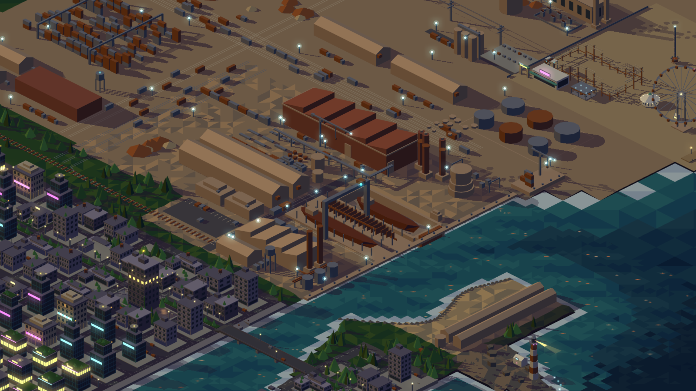
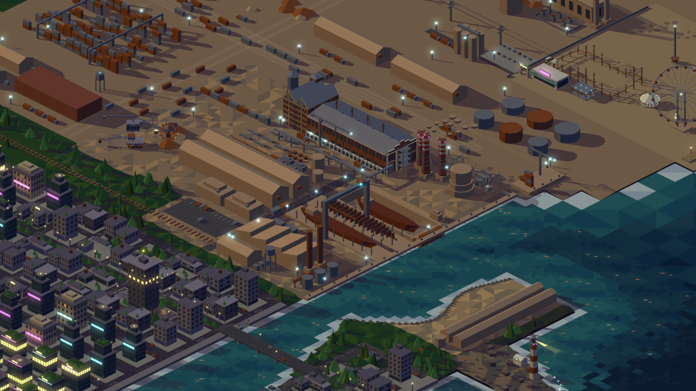

# Fábrica en detalle: planta, chimeneas, subestación y excavadora

**Fecha:** 2026-10-24
**Estado:** implementado en #208–#217 (rama `feature/207-fabrica-detalle`); los
desvíos están en §14
**Alcance:** remodelar con mucho más detalle arquitectónico la planta de
ladrillo, las chimeneas y la subestación de la fábrica (Portfolio,
`src/scenes/factory.ts`), y agregar una excavadora de rueda de cangilones
animada en la playa de vías. Para eso se extiende el kit iso (`src/iso/`).
Reemplaza, para estas piezas, lo que dice
`2026-09-14-mundo-2-fabrica-distrito-blog-design.md` §5.

## 1. Objetivo y criterio de éxito

Hoy la planta es un prisma de ladrillo mudo con dientes de sierra y la
subestación son seis cubos con dos pórticos (ver los exhibits `#planta` y
`#subestacion` del storybook). El objetivo es que cada pieza se lea como un
modelo concreto y reconocible, con sus rasgos de arquitectura visibles en el
storybook: ventanas con su carpintería, marcas de columnas, remates, dientes
de la pala, partes de la rueda, aisladores, etc.

Éxito: en la captura del storybook de cada exhibit se ve cada ítem de su
**inventario** (§5–§9). El revisor lo coteja ítem por ítem contra la captura
y contra las fotos de referencia.

## 2. Reglas de modelado

- **Visibilidad.** La cámara (`VIEW_DIR = normalize(1.4, 1.4, 1)`) solo ve la
  cara superior y las que miran a **+x (este)** y **+y (sur)**. Todo el
  detalle va en esas caras; las caras norte y oeste llevan el material base
  sin ornamento. Cuando la referencia tiene un rasgo en una fachada que acá
  no se vería (la fachada norte de la Fábrica de Luz, el testero oeste), se
  **espeja** a la cara visible.
- **Tamaño mínimo:** 0.15 u. Más chico no se lee ni en el storybook.
- **Huellas estables.** La planta conserva su huella `x 20..120, y −46..−16`
  y el portón este `y −23..−17` (de ahí sale la cinta existente). Las
  chimeneas exentas conservan posición, radio de boca y altura de boca
  (`STACKS`, `STACK_BASE_H`), así el humo (`factory-anim.ts`) no cambia. La
  cinta, la grúa torre, el desvío, la playa de camiones y las vías no se
  mueven.
- **Sin solapes.** Ninguna pieza nueva pisa otra: se agrega a
  `factory.test.ts` un test por cada caso de vecindad nombrado en este spec.
- **Presupuesto.** El PR informa las caras de cada exhibit antes y después
  (panel del storybook). La escena estática se tesela una vez; la rueda de la
  excavadora se re-tesela cada frame y su capa tiene un tope de **400 caras**,
  verificado por test.

## 3. Referencias

Las fotos de licencia libre están en
`docs/superpowers/specs/assets/fabrica-refs/<pieza>/` (reducidas a 1280 px);
autor, licencia y origen en `fabrica-refs/CREDITS.md`. Las de copyright
(iStock que mandó el usuario, galería del estudio Impulso) se citan solo por
URL. Antes de modelar una pieza, el agente **mira** sus fotos.

| Pieza | Modelo real | Fotos |
|---|---|---|
| Nave de calderas | La Fábrica de Luz, ex central térmica de la Minero Siderúrgica de Ponferrada (MSP), nave de calderas: 52 × 16 m, 18 m de alto. Rehabilitación Impulso (2011, Europa Nostra 2012) | `planta/01`, `planta/02`; Impulso galería 01–07 (solo URL, §3.1) |
| Bloque de maltería | No. 2 Maltings, Mistley, Essex (Robert Free, 1893, Grade II, Historic England 1391744) y las Nos. 1, 3 y 4 vecinas | `molino-tanque/01`–`05` |
| Tanque de agua | Tanque de fábrica sobre patas, Kenyon (RI) y Quinebaug Mills (CT) | `molino-tanque/06`–`08` |
| Chimeneas exentas | Chimeneas de ladrillo y hormigón con bandas de balizamiento (OACI Anexo 14, cap. 6) | `chimeneas/01`–`08` |
| Subestación | Subestación de 63 kV de Pont-l'Abbé (Francia); celosía de Davis Dam 69 kV (EE.UU., años 50) | `subestacion/01`–`08` |
| Excavadora | TAKRAF 1521 **SRs 1300 "Big Wheel"** (1984), Ferropolis: 74,5 m de largo, 31 m de alto, rueda de 8,4 m | `excavadora/01`–`07` |

### 3.1 Solo por URL

- Impulso, rehabilitación de la MSP:
  https://www.impulso.es/portfolio/rehabilitacion-y-restauracion-de-la-central-termica-de-la-msp-en-ponferrada/
  (galería `MSP-Galeria-01..07.jpg`: 03 piñón escalonado, 04 fachada sur con
  las 4 chimeneas, 05 chimenea de ladrillo, 06 aérea).
- Datos de la MSP: Real Academia de Bellas Artes de San Fernando, informe 44
  (2022), https://doi.org/10.53786/informes.44.
- Maltería de Mistley en iStock (la foto del usuario):
  https://www.gettyimages.com/detail/photo/old-malt-factory-building-in-mistley-essex-outside-royalty-free-image/869102244
- Ferropolis, ficha oficial de las máquinas: https://www.ferropolis.de/gelaende/bagger
- Máquina hermana SRs 1300 nº 1504: https://www.kuladig.de/Objektansicht/BKM-32002482
- OACI Anexo 14, cap. 6 (bandas: ~1/7 del alto, número impar, extremos del
  color oscuro; luces apenas debajo de la boca):
  https://www.avaids.com/icao.pdf

## 4. Extensiones del kit

Cada una con sus tests en `src/iso/*.test.ts`.

1. **Sólido `beam`**: `{ kind: "beam"; a: Vec3; b: Vec3; size: number; mat }`,
   barra de sección cuadrada `size` entre dos puntos cualesquiera (4 caras
   laterales + 2 tapas), con sombra (`shadowPolygon` sobre sus 8 vértices) y
   caja para el recorte del storybook (`src/lab/crop.ts`). Es lo único
   inclinado del kit: plumas, tirantes, diagonales de celosía, tramos de
   escalera, cables, pasatapas inclinados.
2. **`Facade` más rica**, todo opcional (lo ya construido no cambia; un test
   de no regresión compara las caras de una fachada sin opciones nuevas):
   - `grid: { cols, rows }`: carpintería de acero (parteluces) sobre cada
     ventana, como franjas finas oscuras.
   - `head: "flat" | "segmental"`: dintel recto o arco rebajado (el arco como
     polígono de 5–7 puntos), en un material propio (`headMat`).
   - `sill`: alféizar saliente bajo cada ventana.
   - `piers: { every, w, mat }`: pilastras salientes entre columnas de
     ventanas, del piso al alero.
   - `courses: { mat, h }`: imposta saliente en cada entrepiso.
   - `plinth: { h, mat }`: zócalo de otro material.
   - `ties: { r, mat }`: placa circular de tirante (octógono plano) sobre cada
     pilastra en cada entrepiso.
   - `bays` irregulares no hacen falta: el ritmo es regular en todas las
     referencias.
3. **Placas**: parches planos coplanares a una pared (rectángulo, disco,
   triángulo) para carteles, placas de características, óculos, rejillas de
   celosía de ladrillo, ranuras. Se emiten **dentro del sólido anfitrión**,
   después de su pared, como hace `facade`, para que el orden de pintado no
   las mande detrás de la pared. La forma de exponerlo (campo `plates` en
   `prism`/`poly` o en `Facade`) la decide el plan.
4. **`wheel` de cangilones**: opciones nuevas del sólido `wheel`, todas en el
   plano de la rueda (giran con `angle`):
   - `hollow`: sin rayos ni cubo; llanta doble (dos anillos) con
     `slots` ranuras radiales cortas entre ellos.
   - `buckets: { n, depth, teeth, mat }`: `n` cangilones como trapecios que
     sobresalen de la llanta, cada uno con `teeth` dientes triangulares en el
     labio delantero.
   Las góndolas colgantes de la noria no cambian.
5. **Materiales nuevos** en `src/map/palette-base.ts` (`BASE_TONES`),
   oscurecidos con `npm run palette` y pegados en `palette-iso.ts`; los cubre
   la guarda de paleta:
   - `signal`: rojo de balizamiento (bandas de chimenea, carteles de peligro).
   - `stockbrick`: ladrillo amarillo de Mistley (pilastras, arcos, impostas).
   - `safety`: amarillo de barandas y escaleras de la excavadora.
   - Pizarra: se usa `steel`. Gris lila de la excavadora: `office`. Grava:
     `rock` o `sand`, lo que lea mejor en la captura.

## 5. Planta: nave de calderas (Fábrica de Luz)

Ocupa `x 44..120, y −46..−16`. Muros h 14 hasta el alero, techo a dos aguas
de pendiente baja con cumbrera E-O. Reemplaza los dientes de sierra.

Inventario:

- [ ] **Pilastras de celosía de acero** `rust`, salientes del muro sur, cada
      ~7 u (10–11 vanos), con **base** (zapata `concrete`) y, arriba, una
      **ménsula diagonal** (`beam`) que sostiene el alero. Celosía sugerida
      con dos montantes finos y presillas.
- [ ] **Entramado**: viga de acero horizontal `rust` en cada entrepiso entre
      pilastras; los paños entre vigas y pilastras son ladrillo.
- [ ] **Banda de celosía de ladrillo** bajo el alero en toda la fachada
      (placas oscuras en damero o rejilla).
- [ ] **Ventanas** de acero en cuadrícula de ~3×4 paños, dintel recto: fila
      alta 2 por vano; fila baja más anchas.
- [ ] **Zócalo** como volumen bajo `whitewash` adosado al pie del muro sur, con
      ventanales de acero en cuadrícula (~4×5) y una **fila de tubos cortos**
      (`cylinder`, alternando `whitewash`/`rust`) en su borde superior.
- [ ] **Techo** `steel` (pizarra) con **alero volado** y remate perimetral
      claro; **caperuzas** bajas de ventilación aisladas en la cumbrera (no
      linterna continua).
- [ ] **Cuatro chimeneas metálicas** `rust`, finas, en fila sobre el faldón
      norte cerca de la cumbrera, cada una con **4 tensores** (`beam`
      finos) anclados al techo. No echan humo.
- [ ] **Testero este** (espejo del oeste real): marco `whitewash` con pilastras
      gruesas en las esquinas, bandas en cada piso y cornisa; paños de ladrillo
      visto con 1 ventana por paño; **piñón escalonado de 3 niveles** con paños
      de celosía de ladrillo. El portón este existente queda en su lugar.
- [ ] **Torre de escalera exenta** de acero gris oscuro (`steel`) delante del
      testero, `x 121..126, y −34..−26`: dos pares de postes altos, tramos en
      zigzag (`beam`), descanso en cada piso, baranda. No toca la cinta
      (`x 121..123, y ≥ −20`) ni la base de la primera chimenea (`x ≥ 126.5`).
- [ ] **Cinta inclinada** nueva: celosía `rust` desde el suelo, en la playa de
      camiones, subiendo en diagonal por la fachada sur hasta una **tolva**
      (caja `rust`) colgada junto al alero. No pisa camiones, grúa ni pallets.

## 6. Planta: bloque de maltería (Mistley)

Ocupa `x 20..44, y −46..−16`, 5 pisos (h ~22). Ladrillo `brick` con detalles
`stockbrick`. Su cara este linda con la nave (h 14): solo los pisos que asoman
sobre el alero de la nave (z > 14) llevan ventanas en esa cara; la cara
principal es la **cabecera sur**.

Inventario:

- [ ] **Doble techo a dos aguas paralelo**: dos cumbreras N-S, así la cabecera
      sur muestra **dos piñones iguales** (~45°), techo `steel`.
- [ ] **Pilastras** `stockbrick` entre cada vano; en la cabecera suben hasta
      el vértice de cada piñón (central y esquinas).
- [ ] **Impostas dentadas** `stockbrick` en cada piso, formando grilla con las
      pilastras; cornisa que sigue los faldones del piñón.
- [ ] **Ventanas chicas** casi cuadradas con **arco rebajado** `stockbrick` y
      alféizar: 2 por paño en la cabecera sur; 1 por vano en los pisos de la
      cara este que asoman sobre la nave.
- [ ] **Placas de tirante** circulares oscuras sobre las pilastras en cada
      entrepiso (las "marcas de columnas").
- [ ] **Óculos**: 2 por piñón, con anillo en relieve.
- [ ] **Puertas de carga apiladas** en un eje de la cabecera sur y un
      **portón** doble en su planta baja.
- [ ] **Horno** con **techo piramidal empinado** de pizarra (`cone` de 4 lados,
      `steel`) en el extremo norte, a la altura de la cumbrera.

## 7. Tanque de agua

`x 6..14, y −40..−32`, al oeste del bloque de maltería. No toca el desvío ni la
locomotora (`y ≥ −9.3`). Con la cámara desde el sudeste queda detrás de la
maltería en el exhibit `planta`: se mira solo en el exhibit de pieza
`tanque-agua` (#214).

Inventario:

- [ ] **4 patas** `rust` inclinadas hacia adentro (`beam`) y **riser** central.
- [ ] **2 niveles de tornapuntas** horizontales con **cruces en X** de varilla
      fina en cada paño.
- [ ] **Escalera recta** sobre una pata hasta la pasarela.
- [ ] **Pasarela circular en voladizo con baranda** en la junta fondo/cilindro.
- [ ] **Fondo** semiesférico (conos o cilindros escalonados), **cilindro**
      `steel` de alto ≈ diámetro, **techo cónico** bajo con alero y **bola** en
      la punta.

## 8. Chimeneas exentas (las tres de `STACKS`)

Misma posición, radio en la boca y altura de boca que hoy.

Inventario:

- [ ] **Fuste troncocónico** de ladrillo (cilindros apilados de radio
      decreciente; la boca conserva el radio actual) con **zunchos** de acero
      finos regulares.
- [ ] **Bandas de balizamiento** en la mitad superior: 7 bandas iguales
      `signal`/`whitewash`, `signal` arriba y abajo (OACI 1/7). Se quita la
      banda `rust` actual.
- [ ] **Plataforma anular con baranda** volada justo debajo de la boca.
- [ ] **Corona**: cornisa saliente en la boca.
- [ ] **Pararrayos**: 4–6 varillas finas en el borde de la boca.
- [ ] **Escalera de gato** vertical en la cara visible, hasta la plataforma.
- [ ] **Luces de balizamiento** (acentos `magenta`, el más cercano al rojo)
      apenas debajo de la boca.
- [ ] **Base** más ancha y escalonada sobre el pedestal `concrete`, con una
      **puerta** en la cara sur.

## 9. Subestación de intemperie (Pont-l'Abbé + celosía de Davis Dam)

Dentro del cerco actual `x 149..190, y −60..−47`. Orden del vano de oeste a
este: pórtico de llegada → seccionadores → transformadores de corriente →
transformador; el segundo transformador en paralelo, y un pórtico de salida
al este.

Inventario:

- [ ] **Pórticos de celosía** `steel` (llegada al oeste, salida al este):
      columnas de sección cuadrada con **diagonales en X** (`beam`), viga
      **Warren** (cordones + zigzag), **puntas piramidales** con **mástil de
      hilo de guardia**.
- [ ] **Tres fases** de conductores entre pórticos, con **cadenas de amarre**
      de 8–10 discos (`whitewash` o `glass` alternando radios) en cada
      anclaje, y **puentes** que bajan a los equipos.
- [ ] **Seccionadores de apertura central**, uno por fase: dos columnas de
      porcelana con polleras (cilindros de radio alterno) y brazo horizontal
      `signal`, sobre bastidor.
- [ ] **Transformadores de corriente**: columna con polleras y **cabeza
      redondeada**, sobre **pedestal de escalerilla**, de a 3.
- [ ] **Dos transformadores de potencia**, cada uno con: cuba `steel`,
      **bloques de radiadores** a los costados (aletas finas), **conservador**
      cilíndrico horizontal (cilindro tumbado o prisma de 8 lados hecho con
      `beam`/placas) sobre soporte con su **caño**, **3 pasatapas** con
      polleras **inclinados 30–45°** (`beam`), **placa** de características.
- [ ] **Muro cortafuego** de hormigón entre los transformadores, más alto que
      la cuba; **fosos** de aceite con borde de hormigón.
- [ ] **Patio** de grava; **caseta de control** baja `whitewash` con puerta y
      ventana.
- [ ] **Cerco** de malla romboidal (líneas finas cruzadas) con postes; **portón
      de dos hojas** de barrotes entre pilares de hormigón en la cara sur;
      **carteles**: triángulo amarillo de rayo y panel rojo de peligro.

La línea entra por el pórtico de llegada; no se tiende hacia el hinterland.

## 10. Excavadora de rueda de cangilones (SRs 1300 "Big Wheel")

Pieza nueva en la playa de vías (`railYard`), al este de las vías y los
vagones (`x ≥ −38.9`). Escala comprimida: ~45 u de largo, tope en z ~20. La
**pluma de la rueda va hacia el NE** y la **pluma de descarga hacia el SO**:
así la rueda (que es el sólido `wheel`, de frente a la cámara) queda en el
plano de la pluma, como en la máquina real. Chasis cerca de `(−30, 76)`;
rueda apoyada en un **acopio fijo** cerca de `(−14, 60)`. Los demás acopios
del rng evitan la huella de la máquina; la pluma de descarga pasa por encima de
las vías y los vagones, sin tocarlos.

Inventario:

- [ ] **Rueda** `rust`, r ~5.5, `hollow` con **ranuras radiales** en la llanta
      doble, **14 cangilones** con **2 dientes** cada uno y fondo de malla
      (placa oscura).
- [ ] **Escudo** de chapa fijo sobre el cuadrante superior de la rueda.
- [ ] Dentro de la rueda: **tolva fija**, **cortina** oscura y **tambor de
      cabeza** de la cinta.
- [ ] **Pluma de la rueda** de celosía `office` (gris lila), inclinada ~28°
      hacia abajo, con la **cinta** adentro, **rodillos portantes en V**
      visibles en la punta y **pasarela con baranda** `safety`.
- [ ] **Mástil en A** de celosía pesada, **dos tirantes rígidos** (`beam`) y
      **pórtico intermedio** sobre la pluma, del que cuelga la pluma.
- [ ] **Viga superior** horizontal de celosía, larga, con **cajón** en la
      punta: la línea más alta.
- [ ] **Superestructura**: caja de chapa `office` con **banda de ventanas** con
      parteluces y un **cartel** claro (placa `whitewash`).
- [ ] **Pluma de descarga** de celosía hacia el SO con **tolva colgante** en la
      punta.
- [ ] **Cabina del operador** colgada bajo la pluma junto a la rueda: vidriada en
      **2 filas de 3–4 paños** con marcos, techo con alero, y **3 reflectores**
      cónicos (acentos `amber` encendidos).
- [ ] **Chasis**: **orugas** `rust` con **zapatas** (franjas transversales) y
      rodillos visibles, **anillo de giro**, plataforma con **barandas**
      `safety`, **casa baja** crema (`whitewash`) con 2–3 ventanas cuadradas y
      techo `rust`, **escaleras** entre niveles.
- [ ] **Animación**: la rueda gira lento (~0.5 rad/s) como capa de sólidos del
      `factoryAnimator` (`factory.wheel`), con el mismo contrato que la noria
      de la feria; con `reduced-motion`, quieta. Capa ≤ 400 caras (test).

## 11. Storybook

- Exhibit nuevo `excavadora` en el grupo `fabrica` (`src/lab/exhibits.ts`),
  con su caja.
- Se recalculan las cajas de `planta` (incluye torre de escalera y tanque),
  `chimeneas`, `subestacion`, `playa-vias` y `cinta`; los comentarios "a mano"
  se actualizan.
- `exhibits.test.ts` y `crop.test.ts` siguen pasando (el `beam` entra al
  recorte por sus vértices).

## 12. Criterios de aceptación

- `npm run typecheck` y `npm test` pasan, incluida la guarda de paleta.
- Tests nuevos: tessellation y sombra de `beam`; opciones nuevas de `facade`
  con no regresión de las existentes; `wheel` con cangilones y dientes; tope
  de caras de la capa de la rueda; no solapes nombrados en §5–§10; humo
  intacto (posiciones de boca iguales a las de hoy).
- El PR trae capturas del storybook (viewport 1600×900 a 2x) **antes y
  después** de `planta`, `chimeneas`, `subestacion`, `playa-vias`, `cinta` y
  la nueva `excavadora`, más una vista del mundo con la fábrica entera, y la
  tabla de caras por exhibit antes/después.
- Cada casilla de los inventarios §5–§10 se marca en la descripción del PR
  señalando dónde se ve en la captura.

## 13. Fuera de alcance

- La torre de enfriamiento, la grúa torre, la playa de camiones (salvo la cinta
  inclinada que la cruza) y la cinta existente no cambian.
- No se tiende la línea de alta tensión del hinterland hasta la subestación.
- No se modelan las otras máquinas de Ferropolis (Mosquito, Mad Max, Gemini,
  Medusa).
- Sin texto legible: los carteles son placas de color.

## 14. Desvíos y medición

Lo que cambió al implementar respecto de lo escrito arriba. Cada línea cita el
issue hijo donde está la decisión (los planes están en `docs/plans/`).

### 14.1 Desvíos

- **§4.1:** `beam` ya existía (#78) con la firma `{ from, to, w, h }`, no
  `{ a, b, size }`. No se agregó otro sólido.
- **§4.3:** las placas son el campo `plates` de `prism`, `poly` y `ramp`, en
  `src/iso/plate.ts` (#210). `gable` las ignora y `step` las aplica solo a la
  caja.
- **§5, nave (#213):**
  - Los portones sur se quitaron; queda solo el este.
  - El farol de (58, −16) pasó a (50, −13.5).
  - Pilastras fuera del muro (y −16..−15.5), porque en y −16.5..−16 quedaban
    dentro del prisma (D1).
  - Tolva (x 58.2..61.2, y −16..−14) y cinta (de (50, −4, 0.5) a
    (59.7, −15, 12.5)) corridas (D2).
  - Techo desde x 44, sin alero oeste (D3).
  - Faldón norte en 5 tramos E-O, uno por chimenea (D18).
  - `sortByDepth` ya no ordena entre cajas separadas por dos planos opuestos,
    tampoco sin giro (D19).
  - Queda abierto #218: devolver la regla de zona de `world.test` a igualdad
    exacta (venía de #219, que la dejó como subconjunto).
- **§6, maltería (#214):**
  - Fachada uniforme en todas las caras: la este lleva 8 ventanas por piso
    (2 por vano), no 1 por vano; las de z < 14 quedan tapadas por la nave
    (decisión 9 de #207).
  - Techo partido alrededor del horno: 6 rampas `steel` (D1).
  - Óculos a z 19.7 y no 19.8, para que el anillo no asome del faldón (D4).
  - Impostas lisas: el kit no tiene dentículos.
  - Pilastras de los extremos corridas hacia adentro (x 20..20.5 y 43.5..44)
    y la de x 32 solo de z 16.7 a 18 (D2). Con eso se atiende #223, el choque
    de la pilastra de x 44 con la nave.
- **§7, tanque (#214):** se ve entero solo en el exhibit `tanque-agua`; en
  `#planta` asoman la cuba y el techo detrás de la maltería. Es un desvío del
  criterio 1.
- **§8, chimeneas (#212):**
  - La plataforma no está a boca − 2: llena una junta de 0.3 entre la 6ª y la
    7ª banda.
  - La escalera va por fuera de la plataforma (`y + (r + 1.2)·cos(π/8) + 0.2`).
  - Los zunchos van en la junta de arriba de cada tramo que se afina, con el
    radio del tramo + 0.1.
  - La base r + 1.0 sobresale 0.011 del pedestal en la chimenea de r 2.8.
- **§9, subestación (#215):**
  - El código vive en `src/scenes/substation.ts`, no en `factory.ts` (A1).
  - El conductor va entre las cadenas, de 152.85 a 185.15 (A3).
  - T1 no lleva aletas al sur y su placa va en la cara este (A5).
  - Base `concrete` bajo cada cuba (A6).
  - Paños de la celosía 2.5/2.5/2.5/1.5 (A2); exhibit con `h: 13`.
- **§10, excavadora (#216):**
  - La máquina estática vive en `scene.excavator`, capa `factory.excavator`
    con `heading` propio, y no en `scene.solids` (decisión 1).
  - Superestructura a z 11..16, no a z 3.4 (2).
  - Cabina corrida a dx 13..15.5, dy 1.9..3.5 (4).
  - Pasarela, baranda y rodillos en V terminan en dx 15 (5).
  - Bloque de pivote de la pluma, que el issue no nombra (10).
  - Los acopios rng quedan al norte (y ≈ 44..48) porque la caja de la máquina
    incluye el radio de la rueda (11).
  - La caja del exhibit se recorta en x ≤ 4 (12).
- **§11 (#214):** exhibit de pieza nuevo `tanque-agua`, en el grupo fábrica
  después de `planta`.

### 14.2 Caras por exhibit

| exhibit | sólidos antes | caras antes | sólidos después | caras después |
|---|---|---|---|---|
| `planta` | 13 | 39 | 221 | 1972 |
| `chimeneas` | 40 | 165 | 463 | 1637 |
| `subestacion` | 20 | 67 | 364 | 1212 |
| `playa-vias` | 14 | 42 | 87 | 490 |
| `cinta` | 35 | 99 | 61 | 535 |
| `excavadora` | — | — | 84 | 485 |
| `tanque-agua` | — | — | 46 | 165 |

Cada columna usa la caja de exhibit de su propio árbol: "antes" la de `main`
(b489779) y "después" la de esta rama. `excavadora` y `tanque-agua` no existen
en `main`. La fila `tanque-agua` es informativa: su tanque entra en `planta`
solo en parte.

### 14.3 Vista del mundo y totals

- Antes: 
- Después: 

La excavadora aparece solo en "después" porque es nueva.

`totals` de `rendering.capture()` en el mundo (tecla `1`, `?speed=0`):

- Antes (69 instrucciones): `{"containers":9,"graphics":169,"meshes":0,"sprites":0,"texts":0,"tilingSprites":0,"nineSliceSprites":0,"filters":3,"masks":0}`
- Después (75 instrucciones): `{"containers":9,"graphics":175,"meshes":0,"sprites":0,"texts":0,"tilingSprites":0,"nineSliceSprites":0,"filters":3,"masks":0}`

Suma sin `containers`: 172 antes, 178 después. Con `containers`: 181 antes, 187
después. Polígonos estáticos del primer dibujo: 32447 antes, 37449 después.

### 14.4 Rendimiento

Consola de la página `index.html` sin parámetros, en la rama:

Primera carga:
```
[info] [lab] peor redibujo en 5 s: 28.70 ms
[info] [lab] bloom: promedio 18.2 ms en 60 frames (tick 11.9 + render 6.3), presupuesto 15 ms → fallback
```
Caliente 1:
```
[info] [lab] peor redibujo en 5 s: 30.20 ms
[info] [lab] bloom: promedio 19.8 ms en 60 frames (tick 12.9 + render 7.0), presupuesto 15 ms → fallback
```
Caliente 2:
```
[info] [lab] peor redibujo en 5 s: 23.00 ms
[info] [lab] bloom: promedio 18.4 ms en 60 frames (tick 11.9 + render 6.5), presupuesto 15 ms → fallback
```

Entorno: Pixi 8.20.1, renderer `webgl2`, viewport 1600×900 a 2x, agent-browser
headless (HeadlessChrome, ~2 fps) con la extensión PixiJS DevTools 2.3.1. El
bloom se midió en el dev server.

Las dos corridas calientes pasaron los 15 ms de presupuesto, así que se abrió
el seguimiento #229. La medición salió de un navegador headless, por lo que
hay que confirmarla en hardware real.
