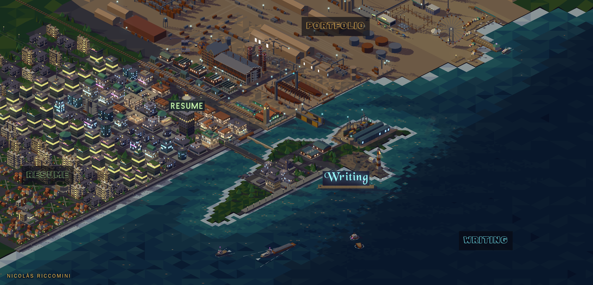
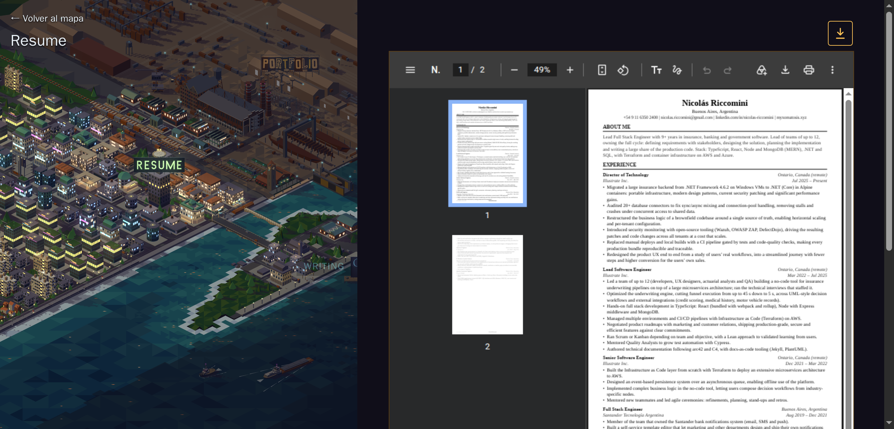
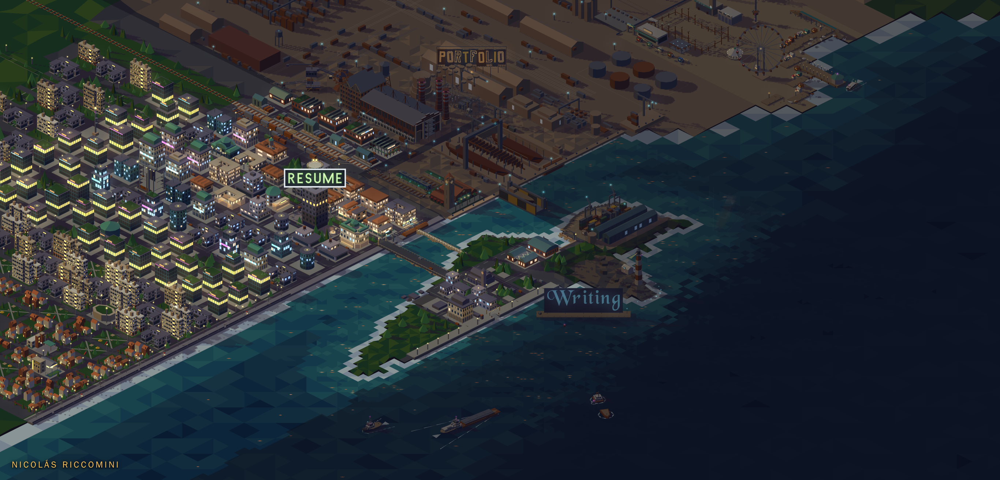

# Carteles de zona: integración al sitio

**Fecha:** 2026-11-17
**Estado:** implementado
**Cierra:** #389 (hijos #390, #391, #392, #393) y #394.
Integra los carteles de `2026-11-15-carteles-de-zona-rediseno-design.md` y
`2026-11-11-carteles-de-zona-assets-design.md` a la escena del sitio.

## 1. Contexto

Los carteles existían solo en el storybook (`/lab/storybook.html`). El sitio
usaba otros marcadores de zona y la navegación no pasaba por ellos. #389
planteó cuatro riesgos de montarlos en el mundo:

- **Carriles:** un cartel en el agua no puede invadir el carril de los barcos
  (`LANE_OUT`) ni quedar tapado por ellos.
- **Encuadre:** la cámara cover (`coverView`) tiene que mostrar los tres
  carteles, o dar una salida legible cuando no caben.
- **Rendimiento:** más sólidos y acentos estáticos, con el bloom ya cerca del
  límite.
- **Guardrails:** legibilidad, oclusión y topes de presupuesto con tests.

Se resolvió en cuatro hijos: plataforma (#390), corona (#391), tinker con su
animador (#392) y navegación por carteles (#393). Esta spec registra el
resultado y lo medido.

## 2. Decisiones

Las diez de #389:

1. Cada escena construye su cartel (`signBox`, `SIGNS`, `SIGN_ORDER`); el
   mundo los ensambla en `assembleWorld`.
2. La antena sale de la corona (#391).
3. El sitio de la plataforma se mueve de (400, 170) a (392, 178): a 8,2 u de
   `LANE_OUT` fallaba la regla de oclusión de barcos en 90 muestras; en
   (392, 178) quedan 14,7 u al carril y 10,6 u a cada boya.
4. Los exhibits de contexto son recortes (crops) de la escena, no copias.
5. El hit test va del cartel a la geografía (`zoneAtScreen`).
6. Los enlaces son invisibles; si el rótulo no cabe, cae al borde (`edge`).
7. La cámara no cambia: `coverView` y `COVER_FOCUS_U` quedan como estaban.
8. Rubik sale de la navegación (#393).
9. La oclusión se decide por posición y por puertas, no por render.
10. Presupuesto con topes en tests: acentos estáticos del mundo ≤ 2 600
    (`city-budget.test.ts`), polígonos estáticos ≤ 56 000, acentos de ciudad
    ≤ 1 300, sólidos elevados del astillero ≤ 800.

## 3. Sitios finales

| Constante | Archivo | Valor | Lugar |
|---|---|---|---|
| `CROWN_SITE` | `src/world/signs.ts` | (129, 227, 30) | corona, sobre la ciudad |
| `TINKER_SITE` | `src/world/signs.ts` | (60, −24, 13.5) | sala sur, taller tinker |
| `PLATFORM_SITE` | `src/world/signs.ts` | (392, 178) | plataforma, agua libre |

La plataforma no está donde la spec del 2026-11-15 (§5) la puso primero; ver §6.

## 4. Encuadre

Caja de cada cartel en píxeles del host, de `coverView` × `signBox`. Escala
cover: laptop 1,1757; teléfono 1,2420.

| Pantalla | Zona | Palabra | Caja (px del host) | Modo |
|---|---|---|---|---|
| laptop 1366×657 | `portfolio` | PORTFOLIO | `600.1..688.3 × 69.6..86.1` | `sign` |
| laptop 1366×657 | `cv` | RESUME | `393.7..466.7 × 236.7..251.0` | `sign` |
| laptop 1366×657 | `blog` | Writing | `747.5..846.5 × 397.2..425.2` | `sign` |
| teléfono 390×750 | `portfolio` | PORTFOLIO | `307.4..400.6 × 101.5..118.9` | `sign` |
| teléfono 390×750 | `cv` | RESUME | `89.4..166.5 × 278.0..293.1` | `sign` |
| teléfono 390×750 | `blog` | Writing | `463.2..567.8 × 447.6..477.1` | `edge` |

En la laptop caben los tres. En el teléfono (390 px) no caben a ningún
`COVER_FOCUS_U`: Writing queda fuera de la ventana y su rótulo cae al borde.

## 5. Presupuesto y frame

Cada cartel construido solo en su sitio:

| Cartel | Sitio | Sólidos | Caras | Acentos estáticos |
|---|---|---|---|---|
| RESUME (corona) | `CROWN_SITE` (129, 227, 30) | 33 | 109 | 402 (238 poly + 164 dot) |
| PORTFOLIO (tinker) | `TINKER_SITE` (60, −24, 13.5) | 154 | 417 | 198 (114 poly + 84 dot; + 19 animados en `tinker.lights`) |
| Writing (plataforma) | `PLATFORM_SITE` (392, 178) | 75 | 224 | 656 (654 poly + 2 dot) |
| Total | | 262 | 750 | 1 256 |

Acentos estáticos del mundo: 1 222 antes (planificación de #389), 2 451
después; 26 luces de la ciudad quedan ocultas tras la corona (#391). Tope
2 600.

Frame, antes (`main` 331c0c2) y después (rama). agent-browser headless,
1366×657 @2, servidor dev de vite, 2026-11-17; valores de la segunda corrida
(caliente) de cada lado.

| | antes | después |
|---|---|---|
| first draw (ms) | 1111.5 | 1096.5 |
| polígonos estáticos | 45 309 | 45 887 |
| bloom, promedio (ms) | 41.0 | 42.1 |
| veredicto del bloom | `fallback` | `fallback` |
| peor redibujo en 5 s (ms) | 65.20 | 54.80 |
| acentos estáticos del mundo | 1 222 | 2 451 |

Bloom, tick + render: antes 25,3 + 15,7; después 25,8 + 16,3. Primera corrida
(fría): `main` first draw 2395.8, bloom 63.4 (37,6 + 25,9) `fallback`, peor
redibujo 161.50; rama 726.4, bloom 25.9 (15,8 + 10,1) `fallback`, peor 27.10.
La dispersión entre corridas es mayor que la diferencia entre lados: el GL por
software del headless (~2 fps) no es representativo (#229). Se registra, no se
exige. Los topes (56 000 polígonos, 2 600 acentos) sí los vigilan los tests.

## 6. Desvíos

- **No caben los tres en el teléfono.** Writing sale en modo `edge` (§4); es
  el único rótulo que no queda sobre su cartel.
- **La plataforma no está donde la spec del 2026-11-15 §5 la puso.** (400, 170)
  pasa a (392, 178) por la regla de oclusión de barcos (§2.3).
- **La antena ya no existe.** Salió de la corona en #391.

## 7. Capturas

Sitio real, `assets/389-carteles-sitio/`:

-  `assets/389-carteles-sitio/plataforma-sitio.png`: cartel Writing.
-  `assets/389-carteles-sitio/corona-sitio.png`: cartel RESUME.
-  `assets/389-carteles-sitio/tinker-sitio.png`: cartel PORTFOLIO.
-  `assets/389-carteles-sitio/sitio-laptop.png`: laptop 1366×657.
-  `assets/389-carteles-sitio/sitio-laptop-resume.png`: laptop, zona Resume.
-  `assets/389-carteles-sitio/sitio-foco.png`: foco de un cartel.
-  `assets/389-carteles-sitio/sitio-telefono.png`: teléfono 390×750, Writing en `edge`.
