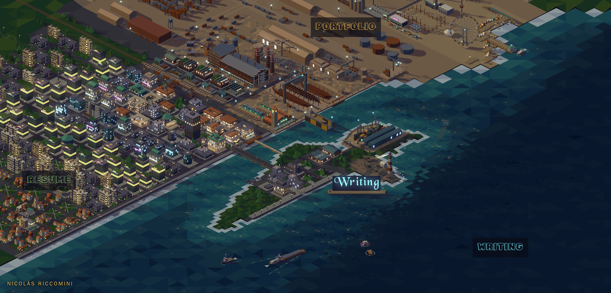
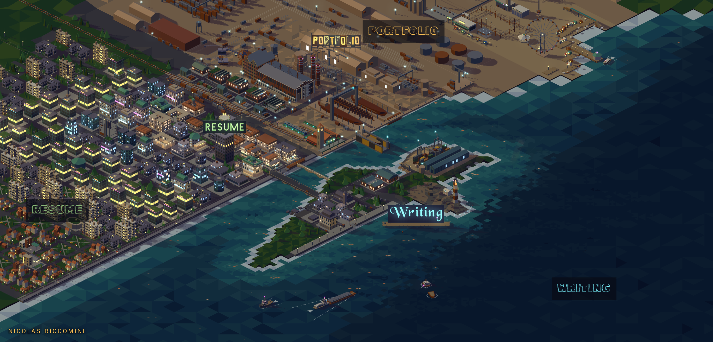
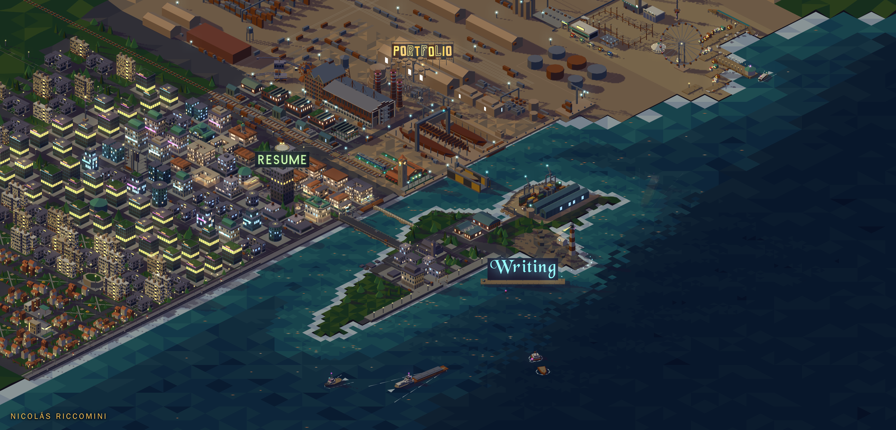
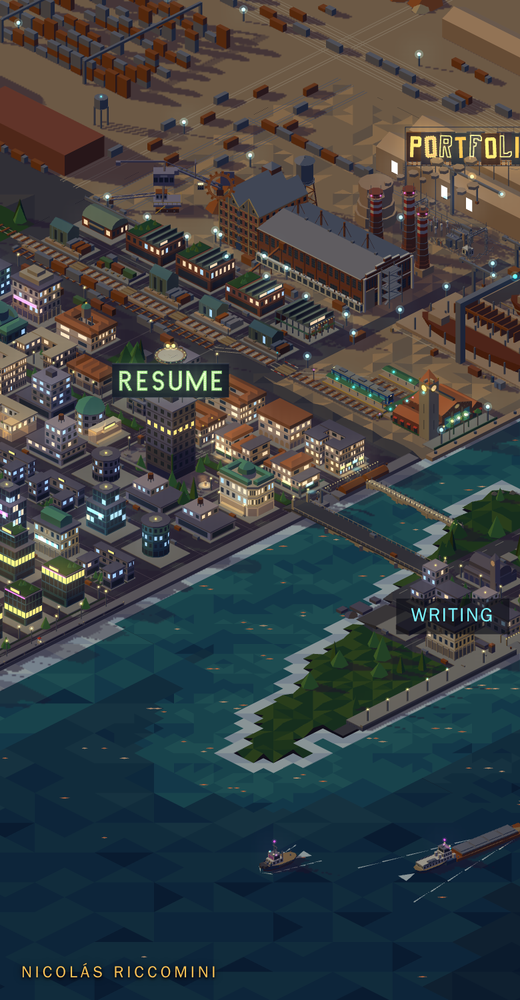

# Carteles de zona: integración al sitio

**Fecha:** 2026-11-17
**Estado:** implementado
**Cierra:** #389 (hijos #390, #391, #392, #393) y #394.
Integra los carteles de `2026-11-15-carteles-de-zona-rediseno-design.md` y
`2026-11-11-carteles-de-zona-assets-design.md` a la escena del sitio.

## 1. Contexto

Los carteles existían solo en el storybook (`/lab/storybook.html`). El sitio
usaba los rótulos HTML de `#zonas` en Rubik Doodle Shadow y la navegación no
pasaba por los carteles. #389 planteó cuatro riesgos de montarlos en el mundo:

- **Carriles:** un cartel en el agua no puede invadir el carril de los barcos
  (`LANE_OUT`) ni quedar tapado por ellos.
- **Encuadre:** que los tres entren en `coverView` y no tapen hitos.
- **Rendimiento:** medir contra el presupuesto de frame del mundo (#229); solo
  la plataforma suma unos 650 acentos.
- **Guardrails:** niveles 1 y 2 de legibilidad; `npm run legibility` debe
  seguir pasando con los carteles en el mundo real, a 1.17 y 0.83.

Se resolvió en cuatro hijos: plataforma (#390), corona (#391), tinker con su
animador (#392) y navegación por carteles (#393). Esta spec registra el
resultado y lo medido.

## 2. Decisiones

Las de #389 (agrupadas como las hereda #394):

1. Cada escena construye su cartel: `city()` llama `towerCrown` tras
   `plazaAndTower`, `shipyard()` llama `tinkerSign` y `assembleWorld` suma
   `tinkerAnimator` etiquetado `portfolio`, `sea()` llama `seaPlatformAt`. Así el
   velo y los filtros de zona clasifican cada cartel por posición.
2. La antena de la torre real sale, con su luz (capa `city.antenna`): la corona
   remata la torre (#391).
3. El sitio de la plataforma se mueve de (400, 170) a (392, 178): con la
   cubierta a 8,2 u de `LANE_OUT` fallaba la regla de oclusión de barcos en 90
   muestras; en (392, 178) la cubierta queda a 14,7 u del carril y a 10,6 u de
   cada boya.
4. Los exhibits de contexto son recortes del mundo real (`cropScene`/
   `cropAnimators`); el `kind: "context"` pierde `build`/`animate`.
5. El hit test va del cartel a la geografía (`zoneAtScreen`).
6. Los enlaces son invisibles; cuando menos de la mitad de la caja del cartel
   queda dentro del host, el link vuelve a ser el rótulo visible pegado al
   borde (`edge`, `labelLayout`). `aria-current="page"` reemplaza a `.dim`.
7. La cámara no cambia: `coverView` y `COVER_FOCUS_U` quedan como estaban.
8. Rubik sale de la navegación (#393).
9. Oclusión: no cambia el dibujo (los acentos van encima de todo). Se resuelve
   por posición (3.) y la guardan compuertas puras: la regla de carriles y
   "ninguna pieza de barco ni de la lancha cruza las letras de ningún cartel"
   (`sea-anim.test.ts`), y `checkSign` de cada cartel contra los sólidos del
   mundo que cruzan su caja de pantalla, a 1.17 y 0.83 (`src/lab/signs.test.ts`).
   Las compuertas miran los sólidos estáticos, los barcos y la lancha; el humo
   de la fábrica queda fuera (§6).
10. Presupuesto con topes en tests: acentos estáticos del mundo ≤ 2 600
    (`city-budget.test.ts`), polígonos estáticos ≤ 56 000, acentos de ciudad
    ≤ 1 300, sólidos elevados del astillero ≤ 800.

## 3. Sitios finales

| Constante | Archivo | Valor | Lugar |
|---|---|---|---|
| `CROWN_SITE` | `src/scenes/sign-crown.ts` | (129, 227, 30) | corona, sobre la ciudad |
| `TINKER_SITE` | `src/scenes/sign-tinker.ts` | (60, −24, 13.5) | galpón de montaje sur del astillero |
| `PLATFORM_SITE` | `src/scenes/sign-platform.ts` | (380, 178) | tabla flotante, agua libre |

La plataforma no está donde la spec del 2026-11-15 (§5) la puso primero; ver §6. El 2026-11-19 pasa a ser una tabla flotante con `WRITING` pintado y se mueve a (380, 178) (spec del 2026-11-15, §8.2); las tablas de §4 y §5 tienen sus valores nuevos.

## 4. Encuadre

Caja de cada cartel en píxeles del host, de `coverView` × `signBox`. Escala
cover: laptop 1,1757; teléfono 1,2420.

| Pantalla | Zona | Palabra | Caja (px del host) | Modo |
|---|---|---|---|---|
| laptop 1366×657 | `portfolio` | PORTFOLIO | `600.1..688.3 × 69.6..86.1` | `sign` |
| laptop 1366×657 | `cv` | RESUME | `393.7..466.7 × 236.7..251.0` | `sign` |
| laptop 1366×657 | `blog` | WRITING | `745.2..820.7 × 414.8..437.5` | `sign` |
| teléfono 390×750 | `portfolio` | PORTFOLIO | `307.4..400.6 × 101.5..118.9` | `sign` |
| teléfono 390×750 | `cv` | RESUME | `89.4..166.5 × 278.0..293.1` | `sign` |
| teléfono 390×750 | `blog` | WRITING | `460.7..540.5 × 466.1..490.1` | `edge` |

En la laptop caben los tres. En el teléfono (390 px) no caben a ningún
`COVER_FOCUS_U`: Writing queda fuera de la ventana y su rótulo cae al borde;
PORTFOLIO queda cortado unos 11 px a la derecha pero sigue en `sign` (más de
la mitad de su caja queda dentro).

## 5. Presupuesto y frame

Cada cartel construido solo en su sitio:

| Cartel | Sitio | Sólidos | Caras | Acentos estáticos |
|---|---|---|---|---|
| RESUME (corona) | `CROWN_SITE` (129, 227, 30) | 33 | 109 | 402 (238 poly + 164 dot) |
| PORTFOLIO (tinker) | `TINKER_SITE` (60, −24, 13.5) | 154 | 417 | 198 (114 poly + 84 dot; + 19 animados en `tinker.lights`) |
| WRITING (tabla flotante) | `PLATFORM_SITE` (380, 178) | 1 | 6 | 382 (382 poly) |
| Total | | 188 | 532 | 982 |

Acentos estáticos del mundo: 1 222 antes (planificación de #389), 2 450
después; 26 luces de la ciudad quedan ocultas tras la corona (#391). Tope
2 600.

Frame, antes (`main` 331c0c2, que además trae #398, ausente en la rama) y
después (rama). agent-browser headless,
1366×657 @2, servidor dev de vite, 2026-11-17; valores de la segunda corrida
(caliente) de cada lado.

| | antes | después |
|---|---|---|
| first draw (ms) | 1111.5 | 1096.5 |
| polígonos estáticos | 45 309 | 46 111 |
| bloom, promedio (ms) | 41.0 | 42.1 |
| veredicto del bloom | `fallback` | `fallback` |
| peor redibujo en 5 s (ms) | 65.20 | 54.80 |
| acentos estáticos del mundo | 1 222 (plan de #389) | 2 135 |

Polígonos y acentos estáticos recalculados al integrar #395 en `main` (lámparas industriales y dots fuera, pluma STS): la rama de #389 medía 46 576 y 2 450; los tiempos son los de esa medición. Recalculados otra vez con la tabla flotante de Writing (2026-11-19): 46 111 y 2 135 (era 46 481 y 2 409).

Bloom, tick + render: antes 25,3 + 15,7; después 25,8 + 16,3. Primera corrida
(fría): `main` first draw 2395,8, bloom 63,4 (37,6 + 25,9) `fallback`, peor
redibujo 161,50; rama 726,4, bloom 25,9 (15,8 + 10,1) `fallback`, peor 27,10.
La dispersión entre corridas es mayor que la diferencia entre lados: el GL por
software del headless (~2 fps) no es representativo (#229). Se registra, no se
exige. Los topes (56 000 polígonos, 2 600 acentos) sí los vigilan los tests.

Polígonos estáticos después: la rama medida imprimió 45 887; al integrar
`main` (que trae #398) quedan 46 576, el número que imprime hoy el log
(`[mapa] first draw`) y que recalcula `docs.test.ts`; los acentos estáticos del
mundo, 2 451 en la rama, quedan en 2 450.

## 6. Desvíos

- **No caben los tres en el teléfono.** Writing sale en modo `edge` (§4); es
  el único rótulo que no queda sobre su cartel.
- **La plataforma no está donde la spec del 2026-11-15 §5 la puso primero.** (400, 170)
  pasa a (392, 178) por la regla de oclusión de barcos (§2.3).
- **La antena ya no existe.** La corona ocupa su lugar en la azotea de la torre (#391).
- **El humo de la fábrica pasa delante de PORTFOLIO.** Las bocanadas de
  `factory.smoke0/1` (`src/scenes/factory-anim.ts`: cilindros opacos que suben
  hacia el NNE hasta `PUFF_RANGE` = 28 u desde las chimeneas en (58, 32) y
  (72, 26)) cruzan la caja de pantalla de las letras del *tinker* en 753 de
  1 200 cuadros (300 s cada 250 ms); en esos cuadros `checkSign` a 1.17 marca
  respaldo < 1 (mínimo 0,955) y el neón se dibuja encima del humo. Ninguna
  compuerta lo ve: la del mundo prueba los sólidos estáticos y la de
  `sea-anim.test.ts`, barcos y lancha. Corregirlo cambia el animador del humo
  (deriva, alcance o alfa), fuera del alcance de este cierre, que no toca
  código de ejecución.

## 7. Capturas

Sitio real, `assets/389-carteles-sitio/`:

-  `assets/389-carteles-sitio/plataforma-sitio.png`: cartel Writing.
-  `assets/389-carteles-sitio/corona-sitio.png`: cartel RESUME.
-  `assets/389-carteles-sitio/tinker-sitio.png`: cartel PORTFOLIO.
-  `assets/389-carteles-sitio/sitio-laptop.png`: laptop 1366×657.
-  `assets/389-carteles-sitio/sitio-laptop-resume.png`: laptop, zona Resume.
-  `assets/389-carteles-sitio/sitio-foco.png`: foco de un cartel.
-  `assets/389-carteles-sitio/sitio-telefono.png`: teléfono 390×750, Writing en `edge`.
