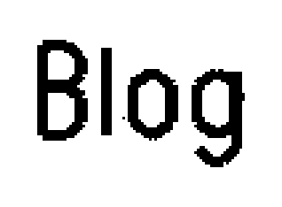
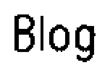

# Legibilidad, nivel 3

Generado por `npm run legibility`; no se edita a mano.

Fecha: 2026-11-15

Viewport: 1600×900 @2

Preproceso del OCR, igual para todos los carteles: luminancia relativa (WCAG) por píxel, escalado ×3 por vecino más cercano y umbral binario en el punto medio entre la mediana del núcleo y la del anillo; la tinta (el lado del núcleo) queda negra sobre blanco. tesseract.js con datos `eng` 4.0.0_best_int locales, modo de página palabra única (PSM 8) y lista blanca A–Z a–z.

## plataforma-escena a 1.17

| Métrica | Valor | Umbral | ✓/✗ |
| --- | --- | --- | --- |
| contraste | 8.96:1 | ≥ 4.5:1 | ✓ |
| halo | 0.12 | ≤ 0.5 | ✓ |
| OCR | `Blog` | = `Blog` | ✓ |

 

## plataforma-escena a 0.83

| Métrica | Valor | Umbral | ✓/✗ |
| --- | --- | --- | --- |
| contraste | 8.96:1 | ≥ 3:1 | ✓ |
| halo | 0.07 | ≤ 0.5 | ✓ |
| OCR | `Blog` | ≈ `Blog` (sin mayúsculas) | ✓ |

 

## Nivel 2 (checkSign)

Sin violaciones.
